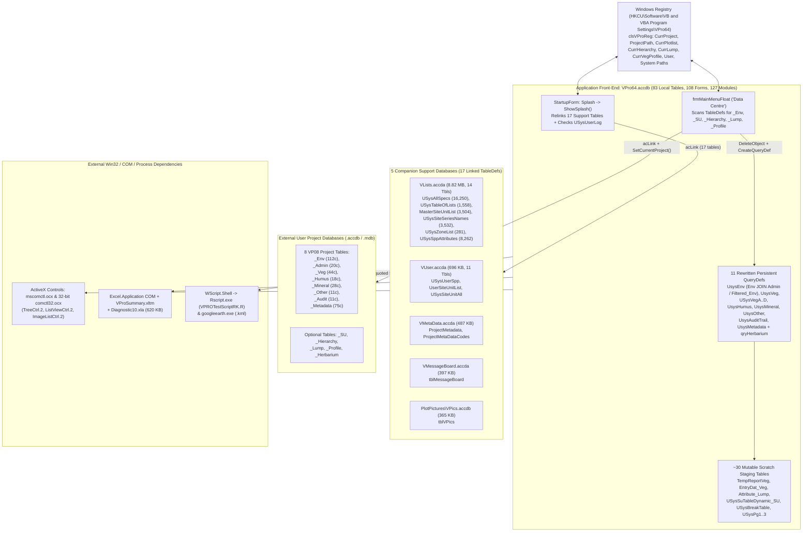

# Legacy Architecture: MS Access, DAO, VBA, ActiveX & COM Forensics

> **Navigation:** [Master Index](../00_index.md) | **History & Evolution:** [Version Matrix](./version_matrix.md) · `Legacy Architecture` · [Site Archive Manifest](./site_archive_manifest.md) | **Related:** [Data Dictionary](../02_present_state/data_dictionary.md) · [Present System Architecture](../02_present_state/system_architecture.md) · [Citations Index](../04_evidence_and_sources/citations_index.md)

---

## 1. Hub-and-Spoke Multi-Database Architecture

Legacy **VPro 64** (`../VPRO_ACCESS/VPro64/VPro64.accdb`, `29,396,992 B`, `BuildDate = 02/23/23`, schema `VP08`) is a stateful Microsoft Access front-end engine comprising **83 local tables, 21 persistent `QueryDefs`, 9 local DAO `Relations`, 108 Forms, 15 Reports, 4 user Macros, and 127 VBA Standard/Class Modules** (`VPro64_forAI/`).

Rather than connecting to a database server, `VPro64.accdb` dynamically attaches external `.accdb`/`.accda`/`.mdb` files via DAO `TableDefs` (`DoCmd.TransferDatabase acLink`) and **mutates its own persistent `QueryDef` SQL definitions in-place** whenever the user switches projects, site units, hierarchies, or herbaria (`VPro64_forAI/Modules/V7mdlSplash.txt`, `V7mdlSetCurrent.txt`).

---

## 2. Complete Binary Database Inventory (`VPro64` & `VPRO_ACCESS_1`)

DAO 16.0 (`DAO.DBEngine.120`) read-only inspection across `VPro64` and `VPRO_ACCESS_1` inventoried **22 Access database binaries** spanning `VP03` through `VP08` and `VTrees Ver03`:

| Binary Path (Relative to Sibling `Work/` Workspace) | Size | Schema Tag | Local / Linked Tbls | Forms / Reports / Modules | Forensic Significance |
|---|---:|---|---|---|---|
| `VPRO_ACCESS\VPro64\VPro64.accdb` | `29.40 MB` | `VP08` | `83` / `0` (prepped via `PrepDB`) | `108` / `15` / `127` | Canonical VPro 64 front-end (`BuildDate = 02/23/23`, `CustomRibbonID = VPro15-CHARS`). |
| `VPRO_ACCESS_1\VPro64\VPro64.accdb` | `29.40 MB` | `VP08` | `83` / **`17`** | `108` / `15` / `128` | Live initialized copy showing all **17 runtime linked support tables** + `Module2` AI exporter. |
| `VPRO_ACCESS_1\VPro64\BECMaster_fixing.accdb` | **`545.23 MB`** | `VP08` | `11` / `1` (broken `D:\BECMaster\...`) | `0` / `0` / `0` | **Provincial Master Dataset:** `71,567` plots, `1,651,842` veg rows, `597,277` audit rows; `Env->Veg` FK relation dropped! |
| `VPRO_ACCESS\VPro64\VLists.accda` | `8.82 MB` | `01 Feb. 2023` | `14` / `0` | `0` / `0` / `0` | Provincial taxonomy (`USysAllSpecs`), picklists (`USysTableOfLists`), `MasterSiteUnitList`, species traits. |
| `VPRO_ACCESS\VPro64\VUser.accda` | `696 KB` | `VP03`/`VP05` | `11` / `0` | `0` / `0` / `0` | Personal `USysUserSpp`, `UserSiteUnitList`, colour themes, preferences. |
| `VPRO_ACCESS\VPro64\VMetaData.accda` | `487 KB` | — | `2` / `0` | `0` / `0` / `0` | Corporate `ProjectMetadata` (42 cols) + `ProjectMetaDataCodes`. |
| `VPRO_ACCESS\VPro64\VMessageBoard.accda` | `397 KB` | — | `2` / `0` | `2` / `0` / `0` | Legacy Terminal-Server broadcast board (retired in VPro 2.0). |
| `VPRO_ACCESS\VPro64\PlotPictures\VPics.accdb` | `365 KB` | — | `1` / `0` | `0` / `0` / `0` | Plot photo index (`tblVPics`). |
| `VPRO_ACCESS\VPro64\ServicePacks\Vp19SpList.accdb` | `385 KB` | — | `1` / `0` | `0` / `0` / `0` | Service pack registry (`USysServicePackList`). |
| `VPRO_ACCESS\VPro64\Templates\TemplateVPro15.accdb` | `557 KB` | `VP07` | `7` / `0` | `0` / `0` / `0` | VPro 15 template (131-col `Env`, pre-`Admin` split). |
| `VPRO_ACCESS\VPro64\Templates\TemplateVPro13.accdb` | `639 KB` | `VP06` | `6` / `0` | `0` / `0` / `0` | VPro 13 template (composite PK `(PlotNumber, Species)` on `Veg`). |
| `VPRO_ACCESS\VPro64\Templates\TemplateVPro03.mdb` | `496 KB` | `VP05` | `10` / `0` | `0` / `0` / `0` | Jet 4.0 template with integrated `_TreePlot`, `_Trees`, `_CWD`, `_CWDPiling`. |
| `VPRO_ACCESS\VPro64\Templates\TemplateVProXP.mdb` | `291 KB` | `VP05` | `6` / `0` | `0` / `0` / `0` | Original VPro XP 6-table Jet 4.0 template. |
| `VPRO_ACCESS\VPro64\Templates\TemplateVENUS5.mdb` & `Venus42Templates.mdb` | `844 KB` / `963 KB` | VENUS | `29` (+`9` broken links) / `32` | `0` / `0` / `0` | BC MoF VENUS 4.2 & 5.0 TEM data interchange templates. |
| `VPRO_ACCESS_1\VPro64\Haida_Gwaii_2019.accdb` & `Manning_TEM_Vpro19.accdb` | `11.08 MB` / `1.27 MB` | `VP08` | `10` / `9` | `0` / `0` / `0` | Real-world `VP08` field projects (`21` and `61` plots; both missing Relation #6 `_Env->_Metadata`). |
| `VPRO_ACCESS_1\VTrees\VTrees.accdb` (+ `VTreesSys.mda`, `VTreesUser.mda`, `SiTest.accdb`) | `3.60 MB` (+`11.09 MB`) | `Ver03` / `Ver02` | `20` / `0` | `15` / `0` / `39` | Companion Mensuration, Kozak Taper Volume & SiteTools app (**unported 32-bit VBA**). |

---

## 3. Core VBA Subsystems & Mathematical Algorithms

### 3.1 Session State, `QueryDef` Aliasing & Busy-Wait Modal Choreography
* **Registry Singleton (`VPro64_forAI/Modules/clsVProReg.txt:1-318`):** Persists session state under `HKCU\Software\VB and VBA Program Settings\VPro64` (`Current\*`, `System\*`), supplemented by `clsRepOpt.txt` (report options) and `clsExport.txt` (export options).
* **Global Variant State & Busy-Wait Loops (`V7mdlGlobalDeclarations.txt:1-46`, `V7mdlAttachProjects.txt:36-38`):** 33 global variables (`sysCurrProject`, `sysCurrSU`, `sysRemoteDB`, etc.) coordinate modeless/modal dialogs via `Do : DoEvents : Loop Until ...` spin-loops.
* **Runtime SQL View Rewriting (`V7mdlSetCurrent.txt:23-164`):** `SetCurrentProject(Project)` deletes and recreates `UsysEnv`, `UsysVeg`, `USysVegA..D`, `UsysHumus`, `UsysMineral`, `UsysOther`, `UsysAuditTrail`, and `UsysMetadata`; `SetCurrentSu` rewrites `Filtered_Env` (`INNER JOIN [<SU>_SU]`) and points `UsysEnv` to `Filtered_Env`. `CompareRegToCurrent()` (`V7mdlSplash.txt:70-137`) inspects `Mid(MyQD.SQL, 21, i - 21 - 4)` at fixed character offsets to detect registry drift on startup.

### 3.2 Phytosociological Aggregation & BEC Diagnostic Math
1. **Strata Merging (`BuildStrataTable`, `V7mdlCreateTables.txt:334-393`):** Consolidates split `_Veg` rows via `Max(Cover*)`, then collapses sub-layers into 4 ecological strata (`1=Tree A`, `4=Shrub B`, `6=Herb C`, `7=Moss D`), honoring explicit `TotalA`/`TotalB` field estimates and capping summed sub-layers at `99%`:
   $$\text{Strata } A = \begin{cases} \text{TotalA} & \text{if } \text{TotalA} \neq \text{NULL} \\ \min(99,\, C_1 + C_2 + C_3) & \text{otherwise} \end{cases}, \quad \text{Strata } B = \begin{cases} \text{TotalB} & \text{if } \text{TotalB} \neq \text{NULL} \\ \min(99,\, C_4 + C_5 + C_{5a} + C_{5b} + C_{5c}) & \text{otherwise} \end{cases}$$
   *(Note: Epixyls `Cover8`, epiliths `Cover9`, and epiphytes `Cover10` are omitted from `BuildStrataTable`.)*
2. **Presence, Domin-Krajina Significance, Prominence & Goldstream Scales (`V7mdlValueConversions.txt:4-199`):**
   For a unit of $n$ plots where taxon occurs in $k$ plots with cover sum $S$:
   * **Presence:** $P = k/n \in [0,1] \rightarrow \text{Classes } \mathrm{I}\,(0\text{–}0.20),\ \mathrm{II}\,(0.20\text{–}0.40),\ \mathrm{III}\,(0.40\text{–}0.60),\ \mathrm{IV}\,(0.60\text{–}0.80),\ \mathrm{V}\,(0.80\text{–}1.00)$.
   * **Mean Cover (`AverageType = 1`):** $\bar{C} = S/n$; **Characteristic Cover (`AverageType = 2`, retired in VPro 2.0):** $\bar{C}_{\text{char}} = S/k$.
   * **Significance Class:** `+` ($\le 0.3$), `1` ($0.3\text{–}1.0$), `2` ($1.0\text{–}2.2$), `3` ($2.2\text{–}5.0$), `4` ($5.0\text{–}10$), `5` ($10\text{–}20$), `6` ($20\text{–}33$), `7` ($33\text{–}50$), `8` ($50\text{–}75$), `9` ($>75$).
   * **Prominence Value:** $\text{PV} = (10 \cdot \bar{C}) \sqrt{P}$; **Goldstream Value (Will MacKenzie):** $\text{GV} = (100 \cdot P) \sqrt{\bar{C}}$.
3. **BEC Differential / Diagnostic Species (`V7mdlDiagnostic.txt:57-170` & `ExcelTools\Diagnostic10.xla`):** Classifies species across compared units into Differential (`d`), Dominant Differential (`dd`), Constant Dominant (`cd`), Constant (`c`), and Important Companion (`ic`) based on $\ge 2$-class separation in Presence (`1..5`) and Significance (`0..9`).
4. **Companion `VTrees.accdb` Kozak Stem Taper Integration (`VTrees::mdlVolumeTools1:1-145`):** Numerically integrates 0.1 m Smalian stem frustums (`0.0000785398163 * dH * (DIB_a^2 + DIB_b^2) / 2`) using 74 BGC-by-species variable-exponent coefficients (`tblTaperCoefficients`) and Gross Volume Adjustment Factors (`tblTaperGVAF`), plus fixed-column batch interchange with BC MoF **SiteTools**.

---

## 4. Critical Technical Debt, Memory-Safety Bugs & Platform Constraints

### 4.1 CRITICAL 64-Bit Win32 API Stack Corruption & Pointer Truncation (`Declare PtrSafe`)
During the VPro 19 $\rightarrow$ VPro 64 port to 64-bit Access, `PtrSafe` keywords were added to 77 Win32 `Declare` statements across 9 modules **without widening 32-bit `Long` pointer/handle parameters to 8-byte `LongPtr`**:

| Module & Lines | Defective x64 Declaration | Crash / Memory Corruption Mechanism |
|---|---|---|
| `V7mdlRibbonPictureBAS.txt:79` | `GdipCreateBitmapFromFile(ByVal FileName As LongPtr, bitmap As Long) As Long` | `gdiplus.dll` writes an **8-byte `GpBitmap*` pointer** into 4-byte `bitmap As Long`, **corrupting 4 adjacent bytes on the VBA call stack** and truncating pointers `> 0x7FFFFFFF`! |
| `V7mdlRibbonPictureBAS.txt:43-50` & `V7mdlUtility.txt:21-30` | `GlobalAlloc(...) As Long`, `GlobalLock(ByVal hMem As Long) As Long`, `MoveMemory(ByVal Destination As Long, ...)` | Truncates 64-bit `HGLOBAL` and heap `LPVOID` addresses above 2 GB / 4 GB, causing immediate **`0xC0000005` Access Violation** crashes in `RtlMoveMemory` or clipboard corruption. |
| `V7mdlRibbonPictureBAS.txt:34-38` | `LoadLibrary(...) As Long`, `GetProcAddress(ByVal hModule As Long, ...) As Long` | x64 Windows system DLL base addresses (`0x7FF8...`) always exceed 32 bits and truncate immediately. |
| `V7mdlFileDialogTools.txt:22` | `Type tagOPENFILENAME ... lCustData As Long` (`LPARAM`) | 4-byte `Long` instead of 8-byte `LongPtr` misaligns struct layout on x64. |
| `VTrees.accdb :: mdlAPI:25-50` | `Declare Function aht_apiGetOpenFileName ...` (no `PtrSafe`) | **Hard VBA compile failure** on 64-bit Microsoft Access; `VTrees.accdb` cannot run on 64-bit Office without refactoring! |

### 4.2 Broken 32-Bit ActiveX Controls & Runtime OCX Registration
* `Forms/USysAssignSU.txt` (`lines 1139-1404, 2652-4416`), `USysLumpMaster.txt`, and `USysComboLumpMaster.txt` embed both VB5 **`COMCTL.ListViewCtrl.1` (`comctl32.ocx` — 32-bit only; Microsoft never shipped a 64-bit `comctl32.ocx`)** and VB6 **`MSComctlLib.TreeCtrl.2` (`mscomctl.ocx`)**.
* `V7mdlSplash.txt:436-527` hardcodes `"C:\Program Files (x86)\Common Files\microsoft shared\"`, attempts `System32\MSCOMCTL.OCX` binding, and calls undocumented **`SysCmd(504, 16483)`** (`lines 286, 295`) to force runtime VBA recompilation.

### 4.3 Office COM Hijacking, File Bloat & Non-Transactional Destructive SQL
* **Live Excel Session Hijacking:** `GetObject(, "Excel.Application")` (`V7mdlReportsShortVeg.txt:601`, `V7mdlReportsLongVeg.txt:205`) attaches to *any* workbook the user already has open, deletes worksheets (`lines 799-801`), or calls `xl.Quit` (`line 239`), while enforcing obsolete Excel 97 `<= 250` column limits!
* **Single-User Mutation & 2 GB Access Ceiling:** Every report, filter, and context switch creates/deletes scratch tables inside `VPro64.accdb` and even mutates columns inside shared `VLists.accda :: USysAllSpecs` (`AddAttributeDescriptions`, `V7mdlReportsShortVeg.txt:292-307`), causing rapid `.accdb` bloat (`>100 MB` compact prompt in `frmMainMenuFloat.txt:1971`) and threatening Access's hard **2.0 GB corruption limit** on `BECMaster_fixing.accdb` (`545 MB`).
* **Zero Transaction Wrapping on `DELETE *`:** `OptimizeVeg` (`V7mdlOptimizeVeg.txt:44-48`) and `CombineSppCovers` (`V7mdlSpellCheck2020.txt:195-200`) run `DELETE * FROM [<Project>_Veg]` followed by `INSERT INTO` without `BeginTrans`/`CommitTrans`—permanently destroying vegetation tables if an error interrupts insertion.

### 4.4 Eleven Confirmed Logic & Schema Defects in Production VPro 64

| # | Exact Citation (`VPro64_forAI\`) | Defect Summary |
|---:|---|---|
| `1` | `Modules\V7mdlSUTableTools1.txt:119-125` | `InsertSuIntoEnv()` hardcodes `INNER JOIN Sample_SU` instead of `[" & SuTable & "]`, failing to update unit names unless plots exist in demo `Sample_SU`. |
| `2` | `Modules\V7mdlPlotProfiling.txt:30-46` | `MadEquals()` compares `C2..C7 = MyMax` where `MyMax` is an undeclared `Empty` Variant (`Option Explicit` missing), breaking equality profiling on layers `2..7`. |
| `3` | `Modules\V7mdlRelationships.txt:95, 154-169, 222-238` | `CreateRelationship()` tries to link `EnvTable.StartDate` (moved to `_Admin` in `VP08`!) under `On Error Resume Next`, silently omitting Relation #6 on all `VP08` projects; `FindRelation()` checks `CurrentDb` instead of `RemoteDB`. |
| `4` | `Modules\V7mdlExportXML.txt:25-39` & `V7mdlImportXML.txt:148-184` | XML Export/Import only transfers 6 `VP06` tables, **silently dropping `<Project>_Admin` and `<Project>_Metadata`**. |
| `5` | `Modules\V7mdlAttachMasterLists.txt:143, 174, 198` | Typo `remotedbDB.TableDefs` swallowed as `"Unknown"`; `UpdateMetadataSppList` has unconditional `GoTo MyExit` on line 198 (dead no-op called on every veg edit). |
| `6` | `Modules\V7mdlValueConversions.txt:161-175` | `vpRoundUp()` overwrites its formatted result with `vpRoundUp = ValIn` on the next line, disabling rounding in `ProminenceClass` and `GoldstreamClass`. |
| `7` | `Modules\V7mdlSpellCheck2020.txt:185-187` | `CombineSppCovers()` sums herb heights (`Sum(Height6)` instead of `Max`), applies lexicographic `Max()` to `Text(255)` `HeightB`, and leaves `Sum(Cover*)` uncapped. |
| `8` | `Modules\V7mdlExportToR2.txt:161, 207` | Omits CHARS `C5a..C5c` in `>99` guard and checks `C5a > 99` instead of `C5c > 99` in `RGroup35c`. |
| `9` | `Modules\V7mdlGoogleEarth.txt:103, 140` | Hardcodes `-` prefix before `Longitude`, emitting invalid `--125.4` KML coordinates when `Longitude` is already negative. |
| `10` | `Forms\FS882-8x6XL.txt:9765, 10051` & `V7mdlCoordTools.txt:29` | Uses `Single` (`Float32`) intermediates in DMS/DD conversion (~1 m truncation) and skips `_Admin` orphan-prevention block via `GoTo MyExit` at line 10051. |
| `11` | `VLists.accda`, `VPro64.accdb`, `ExportTableDesign.bas:155` | Zero indexes on `USysAllSpecs` (16,250 rows) & `USysSppAttributes` (8,262 rows); `HeightB` typed `Text(255)`; `ProjectID` width `30` (`_Env`) vs `20` (`_Metadata`); `Sample_Admin.Plot` `Text(255)` vs `USysAdminTable.Plot` `Text(7)`; `ExportTableDesign.bas` misreports all composite PKs as `Indexed: No`. |
