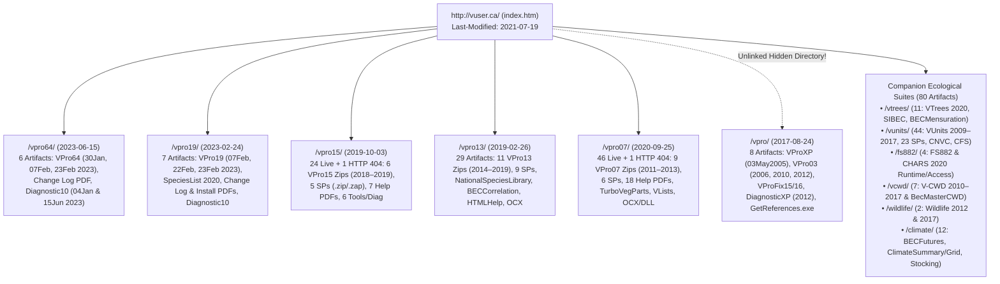

# `vuser.ca` Remote Site & Local Companion Archive Manifest

> **Navigation:** [Master Index](../00_index.md) | **History & Evolution:** [Version Matrix](./version_matrix.md) · [Legacy Architecture](./legacy_architecture.md) · `Site Archive Manifest` | **Evidence:** [Citations Index](../04_evidence_and_sources/citations_index.md)

---

## 1. Remote Archive Topology (`http://vuser.ca/`)

Full forensic crawling and HTTP/binary inspection of Russell Klassen's distribution portal **`http://vuser.ca/`** (CarrierZone/Bell static hosting, FrontPage 12.0 / Expression Web) mapped **35 distinct URL endpoints**, **11 site graphics**, and **200 downloadable binary archives & documents** totaling **`~1.14 GB`** (`forensics_vuser_history.md` §2.1–2.5).

### 1.1 Notable Server Anomalies Discovered
1. **Unlinked `/vpro/` Directory (`HTTP 200`):** Not linked from `http://vuser.ca/index.htm`, yet still live on the server—preserving the only surviving copies of **`VProXPFullInstall03May2005.zip`**, **`VPro03FullInstall2006Nov29.zip`**, **`VPro03 - July 29, 2010.zip`**, **`VPro03ForKim.zip`**, and `VProFix15/16.zip`.
2. **Firewall-Bypass `.zap` Archives (`5` files):** Files ending in `.zap` (`ClimateGridServicePack01.zap`, `ClimateGridServicePack02.zap`, `TreeGuideCompare14July2016.zap`, `VProSP-Make short veg report QC optional.zap`, and internal `Diagnostic10*.zap`) have standard ZIP magic bytes (`50 4B 03 04`) renamed to bypass BC Government email/proxy ZIP blockers.
3. **Two Broken Links (`HTTP 404`) & Nine Restricted Directories (`HTTP 403`):**
   * `http://vuser.ca/vpro07/VPro07-22June2009.zip` (`404` empty anchor on `/vpro07/index.htm`).
   * `http://vuser.ca/vpro15/SampleDataForVPro15.zip` (`404` on `/vpro15/index.htm`).
   * `/help/` and eight `/servicepacks/` or `/helpfiles/` directory roots return `HTTP 403 Forbidden` (directory listing disabled, while direct file URLs return `HTTP 200`).
4. **Filename Date Typo on VPro 19:** `http://vuser.ca/vpro19/VPro19-07Feb2003.zip` (`Last-Modified: Tue, 07 Feb 2023 17:26:03 GMT`) was uploaded in **2023** with `2003` mistyped in the filename.

---

## 2. Cryptographic Provenance Cross-Match: Local `VPRO_ACCESS` vs. `vuser.ca`

Every local companion asset in sibling `../VPRO_ACCESS` (`93` files across `Diagnostic10.xla`, `VTrees\`, `VLists\`, `VUser\`, `VMetaData\`, and `VMessageBoard\`) was SHA-256 hashed and matched against extracted `vuser.ca` distributions:

| Local Workspace Asset (`VPRO_ACCESS\`) | Local Count / Size | Upstream `vuser.ca` Source Archive & Member | Provenance Verification Proof |
|---|---|---|---|
| **`Diagnostic10.xla`** | `1` file (`624,128 B`) | `http://vuser.ca/vpro64/Diagnostic10-15June2023.zip :: Diagnostic10.xla` | **100% Byte-Identical SHA-256:** `ea6ef4e13953a023e899bd2f00e86683cd4ef54c1e11dfc05331214822df38e4` (`2023-06-15` `mdlPairwise.bas` patch). |
| **`VTrees\**`** (`VTrees.accdb`, `VTreesSys.mda`, `VTreesUser.mda`, `SIndex\SiTest.accdb`, `HelpFiles\*`, `Icons\*`) | `27` files (`15.27 MB`) | `http://vuser.ca/vtrees/VTrees27Jan2020%20For%20Office%202010.zip` *(identical to `...For Office 2016.zip`, Zip SHA-256 `84ed2779...`)* | **27 / 27 Files 100% Byte-Identical SHA-256** (`VTrees.accdb` = `e46e7736...`, `SiTest.accdb` = `338d6e60...`). |
| **`VLists\Tables_Data\*.csv` & `Tables_Def\*.txt`** | `28` files (`14` tables) | `http://vuser.ca/vpro64/VPro64-23Feb2023.zip :: VPro64/VLists.accda` (`SHA-256: 2a5ad098...`, `Updated: 2023-02-23`) | Exact 14-table schema & row match: `USysAllSpecs` (`16,250` rows, `CRUSTORG` 2023), `MasterSiteUnitList` (`3,504` rows), `USysMasterAudit` (`884` rows). |
| **`VUser\Tables_Data\*.csv` & `Tables_Def\*.txt`** | `22` files (`11` tables) | `http://vuser.ca/vpro64/VPro64-23Feb2023.zip :: VPro64/VUser.accda` (`SHA-256: dab83cab...`) | Uniquely fingerprinted by `USysUserSpp.csv = 6` rows (incl. `ABIE_RK = "Abies Klassinicus"`, vs. `3` rows in `VPro19-23Feb2023` and `8` rows in `VPro64-07Feb2023`). |
| **`VMetaData\Tables_Data\*.csv` & `Tables_Def\*.txt`** | `4` files (`2` tables) | `http://vuser.ca/vpro64/VPro64-23Feb2023.zip :: VPro64/VMetaData.accda` (`SHA-256: cffca7c3...`, `2014-09-08`) | Exact match (`ProjectMetadata` = `8` templates `BEC..VRI`, `ProjectMetaDataCodes` = `5` rows). |
| **`VMessageBoard\{Forms,Queries,Tables_*}`** | `9` files (`2` tbls, `2` frms, `3` qrys) | `http://vuser.ca/vpro64/VPro64-23Feb2023.zip :: VPro64/VMessageBoard.accda` (`SHA-256: 8c1c4bab...`, `2008-08-26`) | Exact match (`tblMessageBoard` = `1` row from Russell Klassen dated `2/13/2008`). |
| **`VPro64\VPro64.accdb`** | `29,396,992 B` | `http://vuser.ca/vpro64/VPro64-23Feb2023.zip :: VPro64/VPro64.accdb` | `SHA-256: 01481b94569c7172f32a812e65365f78cea5e440dd63220d91a37dade5778423` (`BuildDate = 02/23/23`, `83` local tables, `108` forms, `127` modules). |

---

## 3. Complete Catalog of All 200 Downloadable Artifacts on `http://vuser.ca/`

### 3.1 Core VPro Program, Library, Diagnostic & Documentation Archives (`120` Artifacts across `/vpro*`)

#### A. `/vpro64/` — 64-Bit Microsoft Access 365 Era (`6` Artifacts, `2023`)
| URL Path (`http://vuser.ca/...`) | Size (Bytes) | Last-Modified (UTC) | SHA-256 (`first 16 hex`) | Primary Contents & Notes |
|---|---:|---|---|---|
| `vpro64/Diagnostic10-15June2023.zip` | `249,968` | `2023-06-15 21:36` | `f7cf6fdbd64378c1` | **Latest `vuser.ca` release:** `Diagnostic10.xla` (`624,128 B`, `ea6ef4e1...` = local `Diagnostic10.xla`). |
| `vpro64/VPro64-23Feb2023.zip` | `19,973,049` | `2023-02-24 17:22` | `895851af71db6c9d` | **Final VPro 64 full package:** `VPro64.accdb`, `VLists.accda`, `VUser.accda`, `VMetaData.accda`, `VMessageBoard.accda`, `OldVPro.docx`, `ExcelTools/*`, `Templates/*` (`185` files). |
| `vpro64/VPro 64 Change Log.pdf` | `125,565` | `2023-02-24 17:20` | `ce91eca357b9ffd9` | `53`-entry changelog (`2019-10-01` to `2023-02-23`). |
| `vpro64/VPro64-07Feb2023.zip` | `20,132,410` | `2023-02-07 22:05` | `4b757c0d6a2b3914` | Full VPro 64 build (`186` files; `2023-02-01` `VLists.accda`). |
| `vpro64/VPro64-30Jan2023.zip` | `20,181,949` | `2023-01-30 17:15` | `51ccba831e05c686` | Initial 64-bit `PtrSafe` port (`185` files). |
| `vpro64/Diagnostic10(for 64)-04Jan2023.zip` | `241,121` | `2023-01-04 13:09` | `232e97ca6a445f03` | Initial 64-bit Excel `Diagnostic10.xla` (`621,568 B`). |

#### B. `/vpro19/` — 32-Bit Access 2016/365 `VP08` Era (`7` Artifacts, `2019–2023`)
| URL Path (`http://vuser.ca/...`) | Size (Bytes) | Last-Modified (UTC) | SHA-256 (`first 16 hex`) | Primary Contents & Notes |
|---|---:|---|---|---|
| `vpro19/VPro19-23Feb2023.zip` | `21,828,141` | `2023-02-24 17:17` | `c4d5d9bb35b4795a` | **Final 32-bit VPro 19 full package** (`204` files). |
| `vpro19/VPro 19 Change Log.pdf` | `123,840` | `2023-02-24 17:18` | `7408d02e6f411dde` | VPro 19 release notes (`53` entries). |
| `vpro19/VPro19-22Feb2023.zip` | `21,830,859` | `2023-02-22 23:02` | `0f5747f07b6445be` | Penultimate VPro 19 archive (`204` files). |
| `vpro19/VPro19-07Feb2003.zip` | `21,820,982` | `2023-02-07 17:26` | `d26b89c2dde8842a` | Feb 7, 2023 VPro 19 build (`2003` filename typo). |
| `vpro19/Diagnostic10(for 19)-04Jan2023.zip` | `240,650` | `2023-01-04 13:08` | `d0d01fcdcb7880ab` | Dual 32/64-bit `Diagnostic10.xla` (`620,032 B`). |
| `vpro19/SpeciesList11May2020.zip` | `1,196,806` | `2020-09-08 19:27` | `0e0b8753187895ed` | `SpeciesList11May2020.accdb` (`5.24 MB`, adds `_X` dead-standing codes). |
| `vpro19/helpfiles/Installing VPro 19.pdf` | `127,649` | `2019-09-30 14:48` | `b5ae1d26e89ef4cb` | VPro 19 installation guide. |

#### C. `/vpro15/` — Access 2010–2016 `VP07` Metadata/SIVI/CHARS Era (`24` Live Artifacts, `2016–2019`)
* **Full Distributions (`6`):** `VPro15-04May2018.zip` (`17.33 MB`, `b95b112b`), `VPro15-08May2018.zip` (`20.97 MB`, `bd2014c7`), `VPro15-13May2018.zip` (`22.96 MB`, `a245b9bd`), `VPro15-18Nov2018.zip` (`21.76 MB`, `2d8d8227`), `VPro15-Sean.zip` (`21.24 MB`, `fbaa4d16`, `2019-02-15`), `VPro15-19May2019.zip` (`21.83 MB`, `e8338412`).
* **Service Packs, Diagnostics & Reference Utilities (`11`):** `Diagnostic10-06Dec2018.zip` (`40e16137`), `Diagnostic10-03Jan2019.zip` (`4ac1c619`), `MSCOMCTL.zip` (`76deebce`), `RefTest.zip` (`2ec42e8c`), `TreeTest.zip` (`41aae554`), `VPro Reference Checker.zip` (`c45fcf8e`), `ServicePacks/VProSP-ComparePlotClassif.zip` (`d2bfa7d5`), `ServicePacks/VProSP-R Lumping In VPro15.zip` (`381b99ee`), `ServicePacks/VProSP-Make short veg report QC optional.zap` (`0dd7de3d`), `ServicePacks/VProSP -Hierarchy Form 3.zip` (`c0a26238`), `ServicePacks/VProSP - Combo Report update 01.zip` (`44b90df0`).
* **Help PDFs (`7`):** `Creating a splinter of a project.pdf` (`1d712af5`), `Data Quality Filter.pdf` (`e9662544`), `Data Relationships.pdf` (`8b98ad52`), `Installing VPro 15.pdf` (`277d8686`), `Merging two VPro projects.pdf` (`6f6bf669`), `Trust Center Settings for Installing VPro 15.pdf` (`66892166`), `VPro Quick Start.pdf` (`3da6fbe6`).

#### D. `/vpro13/` — Access 2013 `VP06` Attribute-Lumping Era (`29` Artifacts, `2013–2019`)
* **Full Distributions (`11`):** `VPro13-30Jun2014.zip` (`c76d1cfb`), `VPro13-02Oct2014_StaticReferences.zip` (`13f6051f`), `VPro13-17Jan2017.zip` (`69a2393b`), `VPro13-12Feb2017.zip` (`78c847af`), `VPro13-11Apr2017.zip` (`ea64fe47`), `VPro13-05Jun2017.zip` (`cd2093e9`), `VPro13_Tom.zip` (`ac23856e`), `VPro13-01Nov2017.zip` (`ee314bd5`), `VPro13-20Nov2017.zip` (`28c04d99`), `VPro13-16May2018.zip` (`f03a4bb0`), `VPro13-Sean.zip` (`d711f643`).
* **Service Packs (`9` in `/vpro13/ServicePacks/`):** `VProSP01AspectToCardinal.zip` (`543b59ee`), `VProSP02FixLocationReport.zip` (`4a8d6b29`), `VProSP02-SuFromBreaks.zip` (`b34a4718`), `VProSP-R Lumping In VPro13.zip` (`ef0c69ea`), `VProSP - lump table label.zip` (`b4e3b5a7`), `VProSP - combo report 2.zip` (`8d56d250`), `VProSP -Hierarchy Form 2.zip` (`1eaa281a`), `VProSP -Hierarchy Form 3.zip` (`be8d8fe9`), `VProSP-VerifySpp.zip` (`da1acd9e`).
* **Libraries, Templates & Docs (`9`):** `BECCorrelationHierarchyRK.zip` (`cdc53182`), `Changes to the 09 March 2014 VPro.pdf` (`3a701a45`), `Diagnostic10.zip` (`f03a03e1`), `HTMLHelp.zip` (`6f935ae9`), `MSCOMCTL.OCX` (`793fca37`), `NationalSpeciesLibrary.zip` (`86a96a42`), `Register mscomctl in Windows 8.pdf` (`722aa446`), `VLists27Oct2014.zip` (`e030e287`), `VProSummary.xltm` (`9cc4f8c1`).

#### E. `/vpro07/` & Unlinked `/vpro/` — `VP06` & `VP05` Eras (`46` + `8` = `54` Artifacts, `2005–2020`)
* **`/vpro/` Unlinked XP & 03 Archive (`8`):** `VProXPFullInstall03May2005.zip` (`99029b4e`), `VPro03FullInstall2006Nov29.zip` (`968568c4`), `VPro03 - July 29, 2010.zip` (`dbf2bf33`), `VPro03ForKim.zip` (`ad5a60cd`), `VProFix15.zip` (`896200a7`), `VProFix16.zip` (`b5bb2404`), `DiagnosticXP-30March2012.zip` (`66aec396`), `GetReferences.exe` (`44cc071f`).
* **`/vpro07/` Distributions (`9`):** `VPro07ForElaine.zip` (`70622b4c`), `VPro07-3July2012.zip` (`b4d032c8`), `VPro07-27Oct2012.zip` (`aad8e892`), `VPro07-05Feb2013.zip` (`ebd80f64`), `VPro07-28Mar2013.zip` (`f7eb1e50`), `VPro07-10April2013.zip` (`0fdec8a2`), `VPro07-28May2013.zip` (`d9e509e9`), `VPro07-18July2013.zip` (`51bbc0ec`), `VPro07-29Aug2013.zip` (`83156e61`).
* **`/vpro07/` Service Packs, TurboVeg, Libraries & OCX (`18`):** `VProSP01GoogleEarth.zip` (`9bd2c0b1`), `VProSP02PlotProfiling.zip` (`7b8ddbee`), `VProSP03Rtools.zip` (`ed9dfc04`), `VProSP04FormFilterFix.zip` (`46708977`), `VProSP05TurboVegAndEnvSummary.zip` (`ba156417`), `VProSP06PlotProfiling.zip` (`d99a2921`), `TurboVegUpdateParts.zip` (`77cffdd0`, `6.95 MB`), `TurboVegParts7May2012.zip` (`c411ce14`), `TreeGuideCompareBecMaster30Nov2010.zip` (`e64088cd`, `42.39 MB`), `SampleXMLOutput.zip` (`487f8e9f`), `VLists4April2012.zip` (`ba7b3295`), `VLists11May2020.zip` (`71332f1b`), `Diagnostic07-12May2013.zip` (`86c8ca83`), `SLDiagnostic.zip` (`41813231`), `VegPatternMatch.zip` (`fab758c3`), `Comdlg32.zip` (`be900cf8`), `MSCOMCTL.zip` (`bb7d8984`), `helpfiles/MSCOMCTL.OCX` (`45b6eef5`), `helpfiles/GetReferences.zip` (`9209019f`).
* **`/vpro07/` Workflow PDFs (`19`):** `What is VPro.pdf` (`cc1dc744`), `SL Diagnostic Instructions.pdf` (`0dc60219`), plus 17 single-topic guides under `/vpro07/helpfiles/` (`Adding a Shortcut to Similarity Function.pdf`, `Assigning a Macro Button...pdf`, `Checking for Unmatched Plots...pdf`, `Create Site Units From Environmental Fields.pdf`, `Create a Site Unit Table...pdf`, `Creating Splinter Projects Using VPro07.pdf`, `Finding missing plots...pdf`, `Hierarchy - View Parent Name not ID.pdf`, `ImportVPro03ProjectIntoVPro07.pdf`, `Merging VPro 07 Projects.pdf`, `Plot Profiling Help.pdf`, `Registering Controls in Windows 7.pdf`, `Showing Hidden USys and MSys Objects.pdf`, `Using the Veg Guide Summary in Excel 2007.pdf`, `VPro now uses a ribbon menu.pdf`, `Working with R.pdf`). *(Total `/vpro07/` = `9 + 19 + 18` = `46`.)*

---

### 3.2 Companion Ecological Tool Suites Hosted on `http://vuser.ca/` (`80` Artifacts)

| Subdirectory | Count | Date Span | Key Archives, Sizes & Domain Scope |
|---|---:|---|---|
| **`/vtrees/`** | `11` | `2016–2021` | **BEC Mensuration, Kozak Taper & SIBEC Site Index:** `VTrees27Jan2020 For Office 2010.zip` & `...Office 2016.zip` (`2.97 MB`, `84ed2779` = local `VTrees\`), `SIBECtreeDataConversion.zip` (`14.99 MB`, `861d62d1`), `SIBECtreeDataConversion06Apr2016.zip` (`15.04 MB`, `04711312`), `SIBEC_All_07Nov2016.zip` (`7.24 MB`, `8c0764df`), `MasterDB20May2018.zip` (`4.78 MB`), `MasterDB20May2018Fresh.zip` (`4.81 MB`), `BECMensuration.zip` (`2.41 MB`), `BECMensuration - 05June2017.zip` (`2.52 MB`), `VTreesSysForVicky.zip` (`40 KB`), `ImperialPlots.xlsx` (`25 KB`). |
| **`/vunits/`** | `44` | `2009–2017` | **BEC & CNVC Unit Correlation (`VUnits`):** 7 core apps (`VUnitsFullInstall3Mar2009.zip`..`VUnits18Jul2017.zip` & `KCVunits07Aug2017.zip`), **23 Service Packs** (`/vunits/servicepacks/VUnitsSp*.zip`), 3 **Canadian National Vegetation Classification** masters (`CNVCMaster18Nov/24Nov/25Nov2015.zip`, **`~100.6 MB` each**, `596 MB` uncompressed `.accdb`!), 10 national/CFS species & code libraries (`CFS species list*.zip`, `AllCodes18Aug2015.zip`, `USysAllSpecs*.zip`), and `GetReferences.exe`. |
| **`/fs882/`** | `4` | `Feb 2020` | **Lightweight Standalone Field Entry:** `FS882-07 Feb 2020 Runtime.zip` (`8aa227b6`, `.accdr`), `FS882-07 Feb 2020 for Access.zip` (`717c1e9e`, `.accdb`), `FS882-CHARS-24Feb 2020 Runtime.zip` (`d5ac7be5`), `FS882-CHARS-24Feb 2020 for Access.zip` (`fd538b52`). |
| **`/vcwd/`** | `7` | `2010–2017` | **Coarse Woody Debris (`FS882-7`):** `V-CWD for Access 2003.zip` (`c1ff1a1c`), `V-CWD Runtime.zip` (`abea4bc8`), `V-CWD6June2012.zip` (`e99fc9da`), `V-CWD14Mar2016.zip` (`cf88a9b4`), `V-CWD27Sep2017.zip` (`9df5baf5`, `1.05 MB`), plus provincial CWD master `BecMasterCWD14Mar2016.zip` / `BecMasterCWD-GoodData.zip` (`11.22 MB`, `44.75 MB` `.accdb`, `5a1ba4d6`). |
| **`/wildlife/`** | `2` | `2012–2017` | **Wildlife Habitat (`FS882-5` & `FS882-6`):** `Wildlife17Apr2012.zip` (`ccc8b51e`) and `Wildlife18Jan2017.zip` (`1aeb4421`, includes `05-Wha.pdf` & `06-Taw.pdf`). |
| **`/climate/`** | `12` | `2012–2021` | **Pre-CCISS Climate & Stocking Tools:** `BECFuturesTreeSpSelection_Ver2.00.accdb.zip` (`11.88 MB`, `4a9da3d1`, `2017-03-24`), `ClimateSummaryVer3.zip` (`1.81 MB`) & `ClimateSummaryVer5_21Jun2016.zip` (`14.55 MB`), `ClimateViewer12Apr2015.zip` (`4.59 MB`), `TreeGuideCompare14July2016.zap` (`4.62 MB`), `ClimateGrid*.zip/.zap` (`4` files), `SystematicModule.zip`, and `StockingStandards13Oct2021{,b}.zip` (`184 KB`). |
| **Total** | **`80`** | `2009–2021` | Combined with `120` `/vpro*` artifacts (`6 + 7 + 24 + 29 + 46 + 8`) = **`200` total downloadable artifacts (`~1.14 GB`)**. |
