# VPRO Chronological Version Matrix (1997–2026)

> **Navigation:** [Master Index](../00_index.md) | **History & Evolution:** `Version Matrix` · [Legacy Architecture](./legacy_architecture.md) · [Site Archive Manifest](./site_archive_manifest.md) | **Related:** [Capability Matrix](../02_present_state/capability_matrix.md) · [Citations Index](../04_evidence_and_sources/citations_index.md)

---

## 1. 29-Year Architectural & Schema Lineage (`VENUSPro 97` $\rightarrow$ `VPro 64` $\rightarrow$ `vpro_wails`)

Forensic inspection of `http://vuser.ca/` (37 VPro distributions + `OldVPro.docx`), internal `MSysDb` creation timestamps, `Diagnostic*.xla` OLE streams, and modern Git repositories (`vpro` & `vpro_wails`) reveals a continuous 29-year evolution across **eight Access table generations (`VP01`–`VP08`)** and **two post-Access modern tracks**:

1. **Origin of the Name ("VENUSPro 97"):** Embedded screenshots preserved by Russell Klassen inside `http://vuser.ca/vpro64/VPro64-23Feb2023.zip :: VPro64/OldVPro.docx` (`word/media/image1.png` & `image2.png`, `2020-01-15`) prove VPro began in c. 1997 as **`VENUSPro 97`** (*"VENUSPro 97 For Access Version 8.0"*), an analytical classification front-end built over BC Ministry of Forests **VENUS** (*Vegetation and Environment Unified System*) data, renamed **`VPro 97`** by v2.0 (`Table Revision 1`).
2. **Single-Container Binary Continuity (2009–2023):** Every `.accdb` front-end from `VPro07` (`2009-06-22`) through `VPro13`, `VPro15`, `VPro19`, and `VPro64` (`2023-02-23`) shares the **exact same `MSysDb` creation timestamp (`2009-06-22 11:09:48.564 UTC`, `SI_Title = 'VPro07New'`)**, proving each major release was mutated in-place from the June 22, 2009 container. Likewise, every `Diagnostic*.xla` (`2003`–`2023`) shares the exact OLE `create_time = 1999-10-22 13:00:24` (`Criteria!L2 = 'C:\Program Files\VPro97\VPro97.mdb'`).
3. **Clarification on "VPro 2000", "VPro 20" & Attribution:** No standalone release branded "VPro 2000" or "VPro 20" ever shipped on `vuser.ca`; the Access 2000 Jet 4.0 port (`AccessVersion = '08.50'`) shipped directly as **VPro XP** (`Oct 2002–May 2005`), and 2020–2023 updates shipped under **VPro 19** (32-bit) and **VPro 64** (64-bit). Primary legacy authors are **Russell Klassen** (`russk@telus.net`, software architect) and **Will H. MacKenzie** (`whmacken`, BC MoF Provincial BEC Ecologist), with **Mike Ryan** (`mdlVGSCode.bas`), **Del Meidinger**, **Tina Lee**, **Ken Baldwin**, and **Sean Basquill** contributing specialized modules/specs.

```mermaid
flowchart LR
    VP97["VENUSPro 97 / VPro 97<br/>(1997–2002)<br/>Access 97 · Jet 3.5<br/>VP01–VP04 (4–6 Tbls)"] --> VPXP["VPro XP & VPro CE<br/>(2002–2005)<br/>Access 2000/XP · Jet 4.0<br/>VP05 (6 Tbls)"]
    VPXP --> VP03["VPro 03<br/>(2006–2012)<br/>Access 2003 · .mdb/.mda<br/>VP05 + VMetaData/MsgBoard"]
    VP03 --> VP07["VPro 07<br/>(2009–2013)<br/>Access 2007/10 · .accdb<br/>VP06 · XML Ribbon · R & KML"]
    VP07 --> VP13["VPro 13<br/>(2013–2019)<br/>Access 2013 · VP06<br/>Split Spp/Traits · Pairwise xla"]
    VP13 --> VP15["VPro 15<br/>(2015–2019)<br/>Access 2016 · VP07 (7 Tbls)<br/>+_Metadata · SIVI · CHARS · QC"]
    VP15 --> VP19["VPro 19 (32-bit)<br/>(2019–2023)<br/>VP08 (8 Tbls: +_Admin)<br/>Double Lat/Lon · BEC Use"]
    VP19 --> VP64["VPro 64 (64-bit)<br/>(Jan–Jun 2023)<br/>Office 365 x64 · PtrSafe<br/>VP08 Final Access Era"]
    VP64 --> Modern["VPro 2.0 Modernization (2026)<br/>• boostao/vpro (Headless R + DuckDB)<br/>• boostao/vpro_wails (Go + Wails v3 + Svelte 5)"]
```

---

## 2. Generation-by-Generation Feature Evolution (Added, Modified, Removed)

| Generation & Era | App / Schema Tag | Host Runtime | Added Capabilities | Modified Capabilities | Removed / Deprecated |
|---|---|---|---|---|---|
| **VENUSPro 97 $\rightarrow$ VPro 97** (`1997–2002`) | `v1.0` $\rightarrow$ `v3.0beta` (`VP01`–`VP04`) | Access 97 (`8.0`), Excel 97 (`8.0`) | Project/Site Unit (`_SU`)/Hierarchy (`_Hierarchy`)/Combine Species (`_Lump`) paradigm; PC-ORD & VTab interchange; Splinter project; Long/Summary Veg & Env reports; `Diagnostic.xla` (`1999-10-22`); `VUSER.mda`. | Expanded from 4 tables (`_Env, _Veg, _Humus, _Mineral`) to 6 tables (`+_Other, +_Audit`); rebranded `VENUSPro 97` $\rightarrow$ `VPro 97`. | Direct reliance on monolithic VENUS front-end. |
| **VPro XP + VPro CE** (`2002–2005`) | `Ver 3.0 Rev 2` (`VP05`) | Access 2000/2002 (`Jet 4.0` `.mdb`) | Floating `Data Centre` (`frmMainMenuFloat`); Windows CE handheld sync (`VPro CE` / `USysV2Veg`); `frmConvertVP04toVP05`; VENUS 3.0/4.2 importers; `VLists.mda` (`2003-02-14`); `DiagnosticXP.xla` (`AddInVer=2`) & `SLDiagnostic.xla`; `VProXP_Userguide.pdf` (`2004`). | Migrated container from Jet 3.5 to Jet 4.0 (`AccessVersion 08.50`); registry moved from `VPro9X` to `VProXP`. | Legacy Access 97 Jet 3.5 runtime. |
| **VPro 03** (`2006–2012`) | `Ver 4.0 Rev 3` (`VP05`) | Access 2003 (`Jet 4.0`) | `VMetaData.mda` (`2008-02-11`); `VMessageBoard.mda` (`2008-02-13`); VENUS 5.0 import (`2008-12-09`); self-applying `.mdb` hotfix patchers (`VProFix01`–`VProFix16`); Conditional Colouring (`2008`) & Ken's Diagnostic (`2012`) in `DiagnosticXP.xla` (`AddInVer=3`); companion `VUnits` (`2006`) & `VTrees` (`2008`). | Integrated `_TreePlot`, `_Trees`, `_CWD`, `_CWDPiling` in `TemplateVPro03.mdb` (`10` tables). | Windows CE (`VPro CE`) handheld export gradually retired. |
| **VPro 07** (`2009–2013`) | `TV 6.0 Rev 0` (`VP06`) | Access 2007/2010 (`ACE 12.0` `.accdb`) | CustomUI XML Ribbon (`VPro07`); FS882 HRE 2008/03 multi-tab/2-page/1-page forms; `VPics.accdb` photo catalog; Google Earth `.kml` (`SP01`); multi-step **Plot Profiling** (`SP02`); **R integration** (`SP03`); Juice/TurboVeg CSV matrix (`SP05`); `_Herbarium` table. | Converted `.mdb`/`.mda` to Xcopy `.accdb`/`.accda`; narrowed `_Veg` from 62 cols to 36 cols (`PK = PlotNumber+Species`, dropping `Dist1..10`/`Vig1..10`/`Extra1..10`). | VB6 PDW `setup.exe`/`.CAB` installer; integrated Mensuration/CWD split out into standalone `VTrees.accdb` & `V-CWD.accdb`. |
| **VPro 13** (`2013–2019`) | `TV 6.0 Rev 0` (`VP06`) | Access 2007–2013 (32-bit) | Autecological **Species Attribute Lumping** (`USysSppAttributes`, `2014-03-09`); 10-day online Service Pack checker (`Sp13List.accdb`); Compiled HTML Help (`VPro.chm`); **Pairwise Diagnostic** in `Diagnostic10.xla` (`2017-02-02`); Combination Env/Veg report (`2018-02-08`); National/CNVC species lists. | Split `USysAllSpecs` into taxonomy + `USysSppAttributes`; switched R export to CSV (`2016-12-31`); added Static References build (`2014-10-02`) for locked-down PCs; root-node `~` breakpoints (`2017-10-30`). | Legacy WinHelp `.hlp` files. |
| **VPro 15** (`2015–2019`) | `TV 7.0 Rev 0` (`VP07`) | Access 2010–2016 (32-bit) | **7th Project Table (`_Metadata`, 75 cols)**; **FS1333 SIVI** form (`frmSIVIsite`) & **CHARS** Arctic shrub sub-layers (`Cover5a..5c`, `VPro15-CHARS` ribbon); Report **Data Quality Filter** (`Poor`–`Excellent`); R `vegclust`/`metaMDS` scripts; startup `tblWhatsNew` changelog (`2018-11-15`). | Expanded `_Env` to 131 cols and `_Veg` to 44 cols (added `Veg Other` `LL..Other2`); **dropped composite PK on `_Veg`** to allow per-stratum subform inserts. | Single-table `VMetaData`-only project metadata model. |
| **VPro 19** (`2019–2023`) | `TV 8.0 Rev 0` (`VP08`) | 32-bit Access 2016/365 on Win10 x64 | **8th Project Table (`_Admin`, 20 cols)**; species-absence (`= NULL`) Plot Profiling (`2019-10-15`); `BEC_Use` report filter (`2022-03-30`) & `SU` exclusion audit tab (`2022-04-12`); dual 32/64-bit `Diagnostic10.xla` (`2022-07-21`); `_X` dead-standing & upper-taxa species codes in `VLists`. | Split 19 admin/QA/BEC fields out of `_Env` (`112` cols) into `_Admin`; widened `Latitude`/`Longitude` from `Single` to `Double` (`2020-01-14`); flattened `MasterSiteUnitList` to 5-col Level-11 schema (`2019-12-22`); quartile Env summaries (`2020-11-05`). | **Succession project code** (`2019-10-02`: *"unused in over a decade"*); **Export to VENUS & VPro 97** (`2019-12-14`); **Import VPro XP** (`2019-12-15`). |
| **VPro 64** (`Jan–Jun 2023`) | `TV 8.0 Rev 0` (`VP08`) | **64-bit** Access / Office 365 | 64-bit VBA7 `Declare PtrSafe Function` across 9 modules (`2023-01-27`); 64-bit `Diagnostic10.xla` (`2023-01-04`, patched `2023-06-15`); Will MacKenzie's `2023-02-01` `VLists.accda` (`16,250` taxa, `3,504` site series). | Optimized veg entry speed on large projects (`2023-01-30`); Master vs. Env `ProjectID` selector (`2023-02-23`). | 32-bit Office requirement (though legacy `comctl32.ocx`/`mscomctl.ocx` & `Long` pointer truncations remained latent bugs). |
| **VPro 2.0 (`vpro_wails` & `vpro`)** (`2026`) | Canonical SQLite `VP08` (`v2.0.1` Desktop / `v2.0.0` R SDK) | Cross-platform Go `1.25+` + Wails `v3` + Svelte `5` + Headless R `4.4+` | 4-layer `12`-service desktop + SQLite `WAL` + companion R SDK; zero-Office CGO `libmdb` `VP05`–`VP08` & `VENUS 5.0` importers (Win/macOS/Linux, 545 MB `BECMaster` streaming + orphan quarantine); 2026 `BECdb v13` (`8,900` units) + `BCPlantTaxonomy v19` (`16,728` taxa) + `LMH25 (2023)` rules; Universal Datasheet Grid, Dual-Pane `SU/Hierarchy` Tree, 3-Way Project Merge, `LumpSpec`, 3D MapLibre v6 + WebGPU + `PMTiles` GIS, reactive BEC Diagnostics, R Sidecar (`climr -> aSMR`, `vegclust`, Quarto), official **TurboVeg 3 31-table SQLite & `Plot_package` XML**, `.gpkg`, `.rds`, `.xlsx`, `.pdf`, `.kml`, `.zip`, offline `F1` help, and BC Gov `v2.0.1` release portal. | Replaced Windows Registry with `config.yml` (`release_channel: stable`), disk `QueryDef` mutation with `:memory:` session views, standalone CHARS forms with inline shrub-layer toggle, and `Diagnostic10.xla` loop with live in-app synthesis. | **32 legacy functions retired** per `VPro2.0_Functions` (Single-Page form, standalone CHARS forms, GIF, Message Board, `BAK*`, PC-ORD & Break Report, VPro 13/15/FileMaker/VENUS 4.2 I/O, Characteristic cover toggle). |

---

## 3. Complete Chronological Release Table of All 37 VPro Distributions on `vuser.ca`

| # | Build / Update Date (UTC) | Distribution Archive (`http://vuser.ca/...`) | Zip Size | Zip SHA-256 (Prefix) | Schema & App Title | Objects (`Tbl, Frm, Mod, Rpt`) | Release Significance |
|---:|---|---|---:|---|---|---|---|
| 1 | `2005-04-30` | `vpro/VProXPFullInstall03May2005.zip` | `6.46 MB` | `99029b4e62d84016...` | `VP05` (`VPro XP 3.0r2`) | `T=64, F=66, M=92, R=11` | Earliest surviving full VB6 PDW installer (`VProXP.mdb`, `VLists.mda` `2003-02-14`, `DiagnosticXP.xla`). |
| 2 | `2006-11-29` | `vpro/VPro03FullInstall2006Nov29.zip` | `7.61 MB` | `968568c4dcf7997e...` | `VP05` (`VPro 03 4.0r3`) | `T=70, F=82, M=103, R=14` | Initial Office 2003 installer; adds CWD/Mensuration/Wildlife & VENUS 3.0/4.2 templates. |
| 3 | `2009-06-22` | `vpro07/VPro07-22June2009.zip` *(HTTP 404)* | — | *(404 broken link)* | `VP06` (`VPro 07 6.0r0`) | — | Genesis `.accdb` container (`MSysDb_Created = 2009-06-22 11:09:48.564 UTC`) inherited by all builds up to 2023. |
| 4 | `2010-07-29` | `vpro/VPro03 - July 29, 2010.zip` | `10.24 MB` | `dbf2bf332489643e...` | `VP05` (`VPro 03 4.0r3`) | `T=79, F=88, M=110, R=14` | Adds `VMetaData.mda` (`2008-02-11`), `VMessageBoard.mda` (`2008-02-13`), VENUS 5.0 import. |
| 5 | `2011-10-17` | `vpro07/VPro07ForElaine.zip` | `3.77 MB` | `70622b4c5e06d1e8...` | `VP06` (`VPro 07`) | `T=72, F=102, M=125, R=15` | Earliest surviving `.accdb` binary on `vuser.ca`. |
| 6 | `2012-06-20` | `vpro/VPro03ForKim.zip` | `3.62 MB` | `ad5a60cdda24d11d...` | `VP05` (`VPro 03`) | `T=80, F=88, M=110, R=14` | Final Jet 4.0 `.mdb` VPro 03 build (adds `ArcticDupSpp`). |
| 7 | `2012-07-03` | `vpro07/VPro07-3July2012.zip` | `9.82 MB` | `b4d032c89591aa96...` | `VP06` (`VPro 07`) | `T=77, F=103, M=128, R=15` | First complete Xcopy `.accdb` + `.accda` family archive. |
| 8 | `2012-10-27` | `vpro07/VPro07-27Oct2012.zip` | `18.79 MB` | `aad8e8922d344bfe...` | `VP06` (`VPro 07`) | `T=80, F=105, M=131, R=15` | Integrates `Google Earth 01` SP + Smithers `USysAbout`. |
| 9 | `2013-02-05` | `vpro07/VPro07-05Feb2013.zip` | `3.94 MB` | `ebd80f64307ba916...` | `VP06` (`VPro 07`) | `T=77, F=106, M=132, R=15` | Integrates `Google Earth 01`, `Plot Profiling 01`, and `R Tools 01` SPs. |
| 10–13 | `2013-03-28` – `2013-07-18` | `vpro07/VPro07-{28Mar,10April,28May,18July}2013.zip` | `16.4–20.0 MB` | `f7eb1e50..` / `51bbc0ec..` | `VP06` (`VPro 07`) | `T=80..82, F=105..106, M=131..132` | Adds Juice/TurboVeg export & Environment Summary updates (`28May2013`). |
| 14 | `2013-08-29` | `vpro07/VPro07-29Aug2013.zip` | `21.62 MB` | `83156e61a9e02aa3...` | `VP06` (`VPro 07`) | `T=85, F=106, M=133, R=15` | **Final VPro 07 release** (`BuildDate = 8/29/13`, `ProjVer = 139`). |
| 15 | `2014-06-30` | `vpro13/VPro13-30Jun2014.zip` | `9.68 MB` | `c76d1cfb949da56b...` | `VP06` (`VPro 13`) | `T=82, F=109, M=139, R=15` | First VPro 13 archive: `USysAllSpecs`/`USysSppAttributes` split (`2014-03-09`) & attribute lumping. |
| 16 | `2014-10-02` | `vpro13/VPro13-02Oct2014_StaticReferences.zip` | `10.70 MB` | `13f6051f2a0a0cb3...` | `VP06` (`VPro 13`) | `T=82, F=109, M=139, R=15` | Avoids runtime `References.AddFromFile` on locked-down workstations. |
| 17–23 | `2017-01-17` – `2017-11-20` | `vpro13/VPro13-{17Jan,12Feb,11Apr,05Jun,_Tom,01Nov,20Nov}2017.zip` | `13.4–19.8 MB` | `69a2393b..` / `28c04d99..` | `VP06` (`VPro 13`) | `T=78..80, F=108, M=141..143` | Cumulative 18 SPs: CSV R export, Pairwise `Diagnostic10.xla`, root hierarchy breaks, Combo fixes. |
| 24 | `2018-05-16` | `vpro13/VPro13-16May2018.zip` *(+ `VPro13-Sean.zip` `2019-02-13`)* | `23.34 MB` | `f03a4bb02a99252d...` | `VP06` (`VPro 13`) | `T=81, F=108, M=143, R=15` | **Final public VPro 13 release** (19 SPs + `VPro.chm`). |
| 25–28 | `2018-05-04` – `2018-11-18` | `vpro15/VPro15-{04May,08May,13May,18Nov}2018.zip` | `17.3–23.0 MB` | `b95b112b..` / `2d8d8227..` | `VP07` (`VPro 15`) | `T=70..72, F=100..107, M=121..124` | Introduces `VP07` `_Metadata` table, `VPro15-CHARS` ribbon, SIVI form, QC filter, `tblWhatsNew`. |
| 30–31 | `2019-05-19` | `vpro15/VPro15-19May2019.zip` *(+ `VPro15-Sean.zip` `2019-02-15`)* | `21.83 MB` | `e8338412395bcb27...` | `VP07` (`VPro 15`) | `T=72, F=107, M=124, R=15` | **Final VPro 15 release** (`BuildDate = 05/19/19`, 12 SPs). |
| 32 | `2023-01-30` | `vpro64/VPro64-30Jan2023.zip` | `20.18 MB` | `51ccba831e05c686...` | `VP08` (`VPro 64`) | `T=83, F=108, M=127, R=15` | **First 64-bit Office VPro 64 release** (`PtrSafe` port + `VP08` `_Admin` table). |
| 33–35 | `2023-02-07` – `2023-02-22` | `vpro19/VPro19-07Feb2003.zip` *(typo for 2023)*, `VPro64-07Feb2023.zip`, `VPro19-22Feb2023.zip` | `20.1–21.8 MB` | `d26b89c2..` / `0f5747f0..` | `VP08` (`VPro 19` & `64`) | `T=82..85, F=109..110, M=127` | Bundles Will MacKenzie's `2023-02-01` `VLists.accda` & report fixes. |
| 36 | `2023-02-24` | `vpro19/VPro19-23Feb2023.zip` | `21.83 MB` | `c4d5d9bb35b4795a...` | `VP08` (`VPro 19`) | `T=82, F=110, M=127, R=15` | **Final 32-bit VPro 19 release** (`BuildDate = 02/23/23`, 48 `tblWhatsNew` rows, 14 SPs). |
| 37 | `2023-02-24` | `vpro64/VPro64-23Feb2023.zip` *(+ `Diagnostic10-15June2023.zip`)* | `19.97 MB` | `895851af71db6c9d...` | `VP08` (`VPro 64`) | `T=83, F=108, M=127, R=15` | **Final 64-bit VPro 64 release** — **exact upstream match** to local `VPro64`, `VLists`, `VUser`, `VMetaData`, `VMessageBoard`, and `Diagnostic10.xla`. |

---

## 4. Persistent vs. Deprecated Features Across VPRO History

### 4.1 Historically Deprecated (Removed in VPro 19/64, `2019–2023`)
* **Succession Projects (`2019-10-02`):** Removed in VPro 19 beta (*"No one had used that code in over a decade"*, `tblWhatsNew` row 2; note headless `vpro` R retains archival `project-succession.R` converters for historical datasets).
* **VENUS & VPro 97 Exports (`2019-12-14`) and VPro XP GUI Import (`2019-12-15`):** Retired from ribbon (`tblWhatsNew`), though `V7mdlImportVProVer05` remained auto-triggered when attaching `VP05` `.mdb` tables.
* **VTab Mainframe Punch-Card Import (`*.veg` / `*.srt`) & `VPro CE` Windows Handheld Sync:** Superseded by Excel/XML/SQLite workflows.

### 4.2 Deprecated in VPro 2.0 Modernization (`VPro2.0_Functions` Red Ink, `2026-03-11`)
* **Forms & Shell (`pp. 1–4, 19`):** `Single-Page Form` (`FS882-1x1`), standalone `CHARS` form duplicates (replaced by shrub-layer toggle), obsolete `GIF` form, `VMessageBoard` terminal-server chat, redundant `Classification` ribbon tab, and `Close all forms` workaround.
* **Legacy Backups & Break Generators (`pp. 5–7`):** All `BAK*` table-copy helpers (`Backup Current Project/SU/Hierarchy`), `SU Table From Breaks`, `Save Hierarchy Under Breaks`.
* **Legacy Interchange (`pp. 8–9, 15`):** `PC-ORD Compact Veg`, `PC-ORD Environment Matrix`, `PC-ORD Break Report`, `VPro 13/15` Import/Export, `FileMaker Go`, `VENUS 4.2`, `Export Level Units CSV`, manual Master List imports (replaced by cloud sync).
* **Report Permutations (`pp. 12–14`):** `Calculate: Characteristic` cover toggle (standardized on `By n Plots`), `Diagnostic Report Units` selector, legacy Significance/Prominence/Constancy display radio modes, `Order by: Species` (standardized on `Presence`), `Use constant species list`, and standalone `Combination Veg/Env` report (folded into Veg Summary).

### 4.3 Persistent Core Domain Capabilities (1997 $\rightarrow$ 2026+)
* **Relational Multi-Table Plot Model** (`Env + Admin + Veg + Humus + Mineral + Other + Audit + Metadata`) keyed on `PlotNumber`.
* **Decoupled Working Classification (`*_SU` + `*_Hierarchy` + `*_Lump`)** vs. protected corporate `BECSiteUnit` (`BECdb`).
* **Paper-Faithful FS882 (Multi-Tab & 2-Page) and FS1333 SIVI Entry** with keyboard-first `Enter` navigation, synonym substitution, and direct datasheet grid editing.
* **Sequential Set-Algebra Plot Profiling**, bidirectional `SU <-> Env` transfers, **Long/Summary Vegetation & Environment `.xlsx` workbooks**, KML spatial review, and `BEC_R` / `Diagnostic` differential species synthesis.
