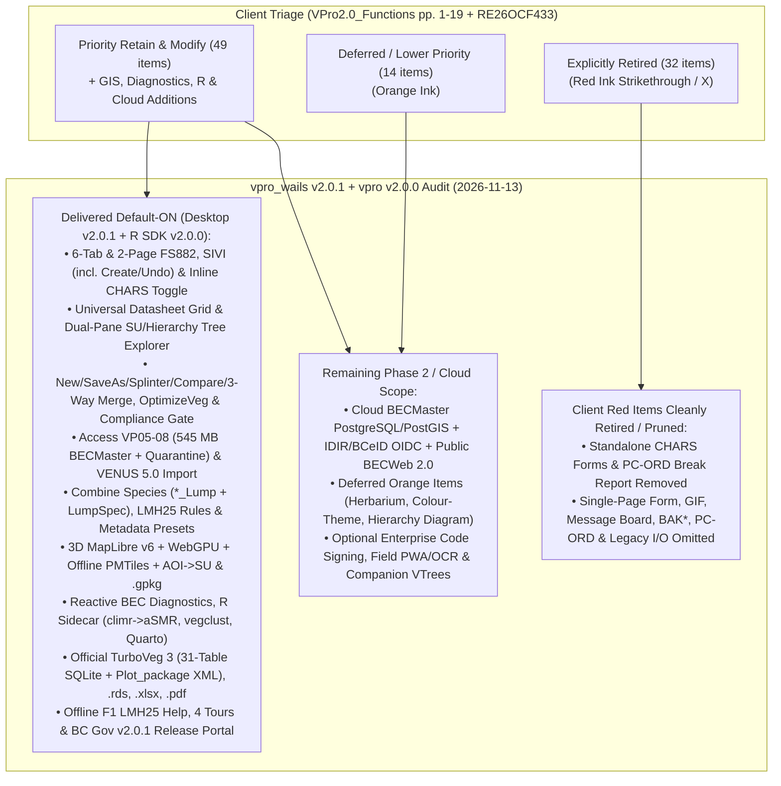

# VPRO Capability & Parity Audit Matrix

> **Navigation:** [Master Index](../00_index.md) | **Present State:** [Domain Model](./domain_model.md) · [Core Workflows](./core_workflows.md) · [System Architecture](./system_architecture.md) · `Capability Matrix` · [Data Dictionary](./data_dictionary.md) | **Evidence:** [Citations Index](../04_evidence_and_sources/citations_index.md) · [Decisions & Gaps](../04_evidence_and_sources/decisions_and_gaps.md)

---

## 1. Audit Methodology & Disposition Legend

This matrix cross-audits **every functional surface** across four authoritative ground-truth baselines:
1. **Legacy Baseline (`VPro64.accdb`):** 108 Forms, 15 Reports, 21 `QueryDefs`, 127 VBA Modules, and companion `VTrees.accdb` / `Diagnostic10.xla` (`VPro64_forAI/`).
2. **Client Triage & Contract Mandate:** Will MacKenzie's ink-coded disposition document (`VPro2.0_Functions to remove-retain-modify.docx` / `.pdf` pp. 1–19, verified via `VproMailExchange` `0040`: **Red = Remove**, **Orange = Deferred/Lower Priority**, **Green/Unmarked = Priority Retain or Modify**) + Executed Contract **`RE26OCF433` Schedule A** (`0072` Contract PDF pp. 10–13) + Email `0035` (direct datasheet editing).
3. **`boostao/vpro` (`v2.0.0` @ `fae33d2`):** Clean-slate headless R companion SDK (`21` `R/*.R` files, `R >= 4.4.0`, zero-note `R CMD check`, qualified on 71,567-plot `BECMaster`) providing concurrent SQLite WAL reads, community matrices, BEC clustering, `sf` GeoPackage export, `LMH25 (2023)` pedological validation, `climr` & Ministry `aSMR` modelling, dual edatopic grids, BEC diagnostics, guarded candidate `*_SU` write-back, 4 scientist vignettes, and Quarto BEC guides.
4. **`boostao/vpro_wails` (`v2.0.1` @ `266921e`):** Go 1.25+ + Wails v3 + Svelte 5 desktop workstation (`12` cohesive domain services across a 4-layer `internal/*` DAG, `24` active views, **default-ON** `release_channel: stable` in `config.yml`).

**Status Legend:**
* `Implemented` — Production code & automated test suites shipped default-ON in `v2.0.1` (`vpro_wails`) / `v2.0.0` (`vpro`).
* `Partial` — Local desktop / SDK implementation complete; multi-user Cloud `BECMaster` PostgreSQL sync or deferred secondary UI pending Phase 2.
* `Deferred` — Marked **Orange / Lower Priority** by client (`Herbarium`, `Colour-Theme`, `Hierarchy Diagram`, `Print All Labels`) and intentionally deferred.
* `Cloud Phase 2` — Multi-user Cloud `BECMaster` PostgreSQL/PostGIS, OIDC accreditation, and public web hosting (`Schedule A 1–2, 6`).
* `Retired` — Marked **Red / Remove** by client (`VPro2.0_Functions`) and omitted or pruned (`SIVICHARSForm`, `PC-ORD Break Report`).

---

## 2. Executive Parity Summary Diagram

---

## 3. Master Function-by-Function Parity Matrix

### 3.1 Session Dashboard, Data Entry Forms & Direct Grid Editing (`VPro2.0_Functions` pp. 1–3, Email `0035`)

| # | Functional Capability | Client Disposition (`VPro2.0_Functions` / `RE26OCF433`) | Legacy `VPro64` Artifact | `vpro` (`v2.0.0` R SDK) | `vpro_wails` (`v2.0.1` Desktop) | Alignment & Verification Notes |
|---|---|---|---|---|---|---|
| 1.1 | **Session Active Selectors** (`Project`, `Site Unit`, `Hierarchy`) | **MODIFY (Priority)** (`p.1`–`p.2`: Session dashboard) | `frmMainMenuFloat` (`Data Centre`) | **Implemented** (Workspace & WAL context readers) | **Implemented** (`App.svelte`, `ContextService.SwitchContext`) | Collapsible left `#project-context` sidebar + 128-bit `contextID` fencing. |
| 1.2 | **FS882 Multi-Tab Form** (Site, Veg, VegOther, Soil/Humus/Min, Other, Audit) | **RETAIN (Priority)** (`p.1`, `Sched A 3.a`) | `FS882-6x4XL` (`98` parent + child subforms) | **Implemented** (Tidy veg/soil/env extractors) | **Implemented** (`FS882Form.svelte`, `internal/plotentry`) | Default-ON; `Enter`-key vertical/field nav, `DD/DM/DMS/UTM`, atomic `
_Audit`. |
| 1.3 | **FS882 Two-Page Form** (`Site/Veg` + `Soil/Terrain`) | **RETAIN (Priority)** (`p.1`, `Sched A 3.a`) | `FS882-8x6XL` | **N/A** (Desktop UI surface) | **Implemented** (`TwoPageEntryEditor.svelte`, `internal/twopage`) | Full parent + veg + soil horizon creation, deletion, and audit restoration (`c864381`). |
| 1.4 | **FS882 Single-Page Form** | **REMOVE** (`p.1` Red strikethrough) | `FS882-1x1`, `FS882-1x1-CHARS` | **Retired** | **Retired** | Correctly omitted. |
| 1.5 | **FS1333 SIVI Form** (`PlotType` G/V/N/O, `14` `SV_*` cols) | **RETAIN (Priority)** (`p.1`, `Sched A 3.a`) | `frmSIVIsite` | **Implemented** (SIVI schema & `LMH25` QA) | **Implemented** (`FS882Form.svelte` `siviParent`, `internal/sivi`) | Includes `New SIVI / FS1333 Plot` creation, undo, deletion, and restoration (`c864381`). |
| 1.6 | **CHARS Arctic Shrub Layers (`Cover5a..5c`)** | **MODIFY (Consolidate)** (`p.3` Red X on 4 separate CHARS forms: use toggle on standard forms) | `FS882-*-CHARS`, `frmSIVIsite-CHARS` | **Implemented** (Columns preserved in tidy readers) | **Implemented (Aligned)** (`extendedShrubs`, `FS882Form` / `TwoPage` / `SIVI`) | Standalone CHARS menus/buttons pruned (`c4cbd1a`, `d630301`); exposed via `"Show extended shrub layers"` toggle. |
| 1.7 | **Direct In-App Datasheet / Table Grid Editing** (sort, bulk edit, copy/paste without forms) | **RETAIN (Mandatory)** (`Email 0035`: *"YES... Ideally plot data could be edited directly in database"*) | Native Access Datasheet + `View Env/Veg Table` buttons | **N/A** (Programmatic `tibble`/`data.table` in R) | **Implemented** (`UniversalDatasheetGrid.svelte`, `internal/datasheet`) | Covers `_Env`, `_Admin`, `_Veg`, `_Humus`, `_Mineral`, `_Other`, `_SU` with sort, global search, TSV paste & audit (`50424d1`). |
| 1.8 | **Combine Species (`*_Lump`) Editor & Declarative `LumpSpec`** | **RETAIN (Priority)** (`p.2` Green box, `Sched A 3.b`) | `USysLumpMaster` (`ActiveX TreeCtrl`) | **Implemented** (`BCPlantTaxonomy v19` + lump harmonization) | **Implemented** (`LumpEditor.svelte`, `internal/lumping`) | Full `*_Lump` CRUD + declarative `LumpSpec` recipes & presets (`d29eb01`). |
| 1.9 | **User Setup & Accreditation Identity** | **RETAIN (Priority)** (`p.2` Green box, `Sched A 1.iv`) | `USysUserSetup`, `USysUserRestrictions` | **Partial** (Guarded write-back checks) | **Partial** (`config.yml` identity; `Navigation.svelte` UI & Cloud OIDC pending) | Local user attribution active; IDIR/BCeID OIDC accreditation scheduled with Cloud `BECMaster`. |
| 1.10 | **User Log** | **RETAIN (Non-Priority)** (`p.2`) | `USysUserLog` | **N/A** | **Implemented** (`UserLogReview.svelte`, `LifecycleService`) | Paginated read-only review of `VPro64.USysUserLog` (default-ON). |
| 1.11 | **Plot Picture Manager** | **RETAIN** (`FS882 Site` tab `p.1` / `Screenshot 091116`) | `frmPictures`, `VPics.accdb :: tblVPics` | **N/A** | **Implemented** (`PictureManager.svelte`, `internal/pictures`) | Auto-seeds `VPics.db` on cold boot (`9a407cb`); default-ON browse, metadata edit, add/delete/restore. |
| 1.12 | **Herbarium & Colour-Theme** | **DEFERRED** (`p.2` Orange boxes) | `frmHerbarium`, `USysComboColourTheme` | **Deferred** | **Deferred** (`Navigation.svelte`) | Intentionally deferred per client Orange triage. |
| 1.13 | **Message Board & GIF Form** | **REMOVE** (`p.2` Red strikethroughs) | `VMessageBoard.accda`, `frmGIF` | **Retired** | **Retired** (`VMessageBoard.db` attached RO only) | Correctly retired. |
| 1.14 | **Companion Mensuration (`VTrees`), CWD & WHA** | **Out of Phase 1 Scope** (Separate `VTrees.accdb` / `LMH25` Cards 4–7) | `VTrees.accdb` (`Ver03` Kozak/SiteTools), `TemplateVPro03.mdb` CWD | **Out of Scope** | **Out of Scope** (Metadata summary flags only) | Tracked in `D-09` ([Decisions & Gaps](../04_evidence_and_sources/decisions_and_gaps.md)) for Phase 2 decision. |

---

### 3.2 Project, Site Unit (`SU`) & Classification Hierarchy Management (`VPro2.0_Functions` pp. 4–7, `Sched A 3.c–g`)

| # | Functional Capability | Client Disposition (`VPro2.0_Functions` / `RE26OCF433`) | Legacy `VPro64` Artifact | `vpro` (`v2.0.0` R SDK) | `vpro_wails` (`v2.0.1` Desktop) | Alignment & Verification Notes |
|---|---|---|---|---|---|---|
| 2.1 | **New Empty Project Creation** | **RETAIN (Priority)** (`p.5`) | `V7mdlCreateTables.CreateTableSet` | **Implemented** | **Implemented** (`ProjectAdminWorkbench.svelte`, `internal/projectops`) | Creates canonical 8-table `VP08` SQLite `.db` in WAL mode (`c864381`). |
| 2.2 | **Project Save As** | **RETAIN (Priority)** (`p.5`) | `V7mdlSaveAs` | **Implemented** | **Implemented** (`ProjectAdminWorkbench.svelte`, `internal/projectops`) | Single-pass DDL/table rewrite (`c887dd8`) preserving audit ownership. |
| 2.3 | **Export Splinter Project** (plots matching active `*_SU`) | **RETAIN (Priority)** (`p.5`, `p.8`) | `V7mdlSplinterProject.ExportSplinter` | **Implemented** (Subset extraction) | **Implemented** (`ProjectAdminWorkbench.svelte`, `internal/projectops`) | Extracts active `*_SU` plot subset + child/metadata records into standalone `.db`. |
| 2.4 | **Merge Projects** (controlled staging $\rightarrow$ master 3-way merge) | **RETAIN (Priority)** (`p.5`, `Sched A 1.i–ii`) | `USysMerge`, `zSmartMerge` | **Partial** (Guarded candidate `*_SU` write-back) | **Implemented (Local)** (`ProjectAdminWorkbench.svelte`, `internal/projectops`) | WAL-resilient snapshot digest + plot/field 3-way conflict resolution + `
_Audit` (`c864381`, `c887dd8`). |
| 2.5 | **Compare Two Projects** (plot/field diff) | **RETAIN (Priority)** (`p.5`) | `V7mdlCompareTwoProjects` | **Implemented** | **Implemented** (`ProjectAdminWorkbench.svelte`, `internal/projectops`) | Categorizes `Added`, `Identical`, `Fast-Forward`, and `Field-Level Conflict` plots. |
| 2.6 | **Project Metadata Forms + Auto-Derivation + Standards Presets** | **MODIFY (Priority)** (`p.2`, `p.5`, `Sched A 3.c.i–ii`) | `frmProjectMetaData`, `VMetaData.accda` | **Implemented** (Metadata readers) | **Implemented (Local)** (`ProjectMetadataEditor.svelte`, `Auto-6`) | Auto-derives plot counts/dates/regions/stamps + `LMH25 (2023)` presets (`c864381`); Cloud sync in Phase 2. |
| 2.7 | **Site Unit (`SU`) Tree View & Drag-and-Drop Plot Assignment** | **RETAIN (Priority)** (`p.1`, `Sched A 3.d`) | `USysAssignSU` (`MSComctlLib.TreeCtrl.2`) | **N/A** (Desktop UI) | **Implemented** (`ClassificationExplorer.svelte`, `internal/classification`) | Virtualized dual-pane `Site Unit -> Plots` tree with drag-and-drop & live inspector (`50424d1`). |
| 2.8 | **Site Unit (`SU`) Table Create, Save As & Tabular Edit** | **RETAIN (Priority)** (`p.1`, `p.6`) | `V7mdlCreateTables`, `Sample_SU` datasheet | **Implemented** (Guarded candidate `*_SU` writer) | **Implemented** (`ClassificationExplorer.svelte`, `UniversalDatasheetGrid.svelte`) | Standalone `New SU`, `Save As`, tree reassignment, and direct `_SU` grid editing. |
| 2.9 | **Bidirectional `SU Into Env` & `Env Into SU` Sync** | **RETAIN (Priority)** (`p.1`, `Sched A 3.f.i`) | `V7mdlSUTableTools1` (had `Sample_SU` bug!) | **Implemented** | **Implemented** (`EnvironmentSUTransfer.svelte`, `ExternalSUEnvironmentTransfer.svelte`) | Transactional with `__VPRO_*SUHistory` rollback; fixes legacy `Sample_SU` bug. |
| 2.10 | **Plot Profiling** (sequential Env/Veg/Lump set algebra + `= NULL` absence + Save as SU) | **RETAIN (Priority)** (`Sched A 3.f.ii`, `SCREENCAPS 091319`) | `V7mdlPlotProfiling` (had `MyMax` Variant bug!) | **Implemented** (`wave2b` plot profiling) | **Implemented** (`ProjectPlotProfileReview.svelte`, `internal/classification`) | Fixes `MyMax` layer `2..7` equality bug; calibrates ACE fixed-decimal cover math. |
| 2.11 | **Create Site Units From Concatenated Env Fields** (into new or **existing** SU table) | **MODIFY** (`p.6` `P021`) | `CreateSuTableFromFilter` (created new SU only) | **Implemented** | **Implemented** (`ClassificationExplorer.svelte`, `internal/classification`) | Supports appending/updating units in an **existing** `*_SU` table (`50424d1`). |
| 2.12 | **Hierarchy Tree View & Flat-Table Hierarchy Editor** | **MODIFY / DEFERRED** (`p.1`, `p.7` `P026`: flat table design; `Sched A 3.e`) | `USysAssignSU`, `V7mdlHierarchyTools` (10-col adjacency list) | **Implemented** (Hierarchy readers) | **Implemented** (`ClassificationExplorer.svelte`, `App.svelte` `hierarchy`) | Collapsible `Hierarchy -> Units` tree (`~` breakpoints) + flat-table view (`50424d1`). |
| 2.13 | **`BECdb v13` (2026) Official Unit Names Integration & Accredited Additions** | **MODIFY / ADD** (`Sched A 3.g.i–ii`) | Static `VLists.MasterSiteUnitList` (`3,504`) | **Implemented** (`BECdb v13` harmonization) | **Partial** (Bundled `BECdb v13` `8,900` series / `6,067` master units via `cmd/standards2026`) | 2026 `BECdb v13` bundled (`6873e74`); live Cloud `BECdb` accredited write API (`3.g.ii`) in Phase 2. |
| 2.14 | **`BAK*` Backup Helpers, `SU From Breaks`, `Save Hierarchy Under Breaks`, Redundant `Classification` Ribbon** | **REMOVE** (`p.4`–`p.7` Red marks) | `V7mdlBackup*`, `V7mdlClipHierarchy` | **Retired** | **Retired** | Correctly omitted. |

---

### 3.3 Data Validation, Import & Export Pipelines (`VPro2.0_Functions` pp. 8–9, 11; `Sched A 1, 2.iv`)

| # | Functional Capability | Client Disposition (`VPro2.0_Functions` / `RE26OCF433`) | Legacy `VPro64` Artifact | `vpro` (`v2.0.0` R SDK) | `vpro_wails` (`v2.0.1` Desktop) | Alignment & Verification Notes |
|---|---|---|---|---|---|---|
| 3.1 | **Mandatory Code Standards & `LMH25 (2023)` Compliance Gate** (`USysTableOfLists`, 1:N FK, pedon/edatopic rules) | **MODIFY (Priority Gate)** (`p.11`, `Sched A 1.i.1`) | `USysValidateData`, `V7mdlReportsValidateEnvData` | **Implemented** (`LMH25 2023` & standards QA) | **Implemented** (`ProjectAdminWorkbench.svelte`, `internal/validation`, `internal/lmh25rules`) | Batch `USysTableOfLists`, FK integrity, numeric/UTF-16 bounds, and live `LMH25` pedon/`rSMR`/`rSNR` checks (`c864381`, `d29eb01`). |
| 3.2 | **Batch Vegetation Species Code Check & Synonym Replacement** | **MODIFY (Priority)** (`p.11`) | `V7mdlSpellCheck2020.CheckForOldCodes` | **Implemented** (`BCPlantTaxonomy v19` check) | **Implemented** (`SpeciesCodeCheck.svelte`, `ValidationService`) | Validated against 2026 `BCPlantTaxonomy v19` (`16,728` rows incl. `Codetype = 'XX'`). |
| 3.3 | **Native VPro Access (`.accdb`/`.mdb`) Translation (`VP05`–`VP08` + `545 MB` `BECMaster`)** | **Priority Core** (`Sched A 1`, `2.iv.1`) | `V7mdlImportVProVer05/06/07` | **Implemented** (`mdbr` / SQLite WAL bridge) | **Implemented** (`internal/accessreader` + `accessimport` on Win/macOS/Linux) | Streaming `545 MB` `BECMaster_fixing.accdb` (`71,567` plots) import with orphan-row quarantine (`6056169`). |
| 3.4 | **`VENUS 5.0` Import** | **RETAIN** (`p.9` unmarked) | `V7mdlImportVenus` (`TemplateVENUS5.mdb`) | **N/A** | **Implemented** (`InterchangeHub.svelte`, `internal/interchange/venus5.go`) | Imports `VENUS 5.0` `.mdb` and XML archives into canonical `VP08` SQLite (`d29eb01`, `7cbcca5`). |
| 3.5 | **Export to R (`.rds` long) & CSV (Long, Wide Matrix & Store `.zip`)** | **MODIFY (Priority)** (`p.8` `P034`, `Sched A 1.iii, 2.iv.2–3`) | `V7mdlExportToR1/2`, `frmR` | **Implemented** (Native R `tibble` / `Matrix`) | **Implemented** (`InterchangeHub.svelte`, `rdsexport.go`, `csvmatrix.go`, `tablecsvbundle.go`) | Pure-Go RData v2/v3 `.rds` writer (zero R install needed) + Long/Wide CSV + Store `.zip` (`d29eb01`). |
| 3.6 | **Export & Import `TurboVeg` Format (`TurboVeg 3` SQLite + `Plot_package` XML)** | **ADD (Priority)** (`p.8` `P033`, `p.9` `P038`, `Sched A 2.iv.4`) | `V7mdlTurboVeg.MakeJuiceFile` (Juice CSV only) | **N/A** (Handled via SQLite/desktop) | **Implemented** (`InterchangeHub.svelte`, `turboveg_sqlite.go`, `turboveg_xml.go`) | Implements **official 31-table `TurboVeg 3` SQLite** (Delphi `TDateTime` + WKT `POINT`) **and** universal `Plot_package` XML I/O (`f131fcc`, `266921e`). |
| 3.7 | **Export & Import User Species List (`VUser.USysUserSpp`) & OGC `GeoPackage` (`.gpkg`)** | **RETAIN / ADD** (`p.8`, GIS interop) | `RibbonImportExport` | **Implemented** (`sf` `.gpkg` export) | **Implemented** (`InterchangeHub.svelte`, `userspecies.go`, `geopackage.go`) | `USysUserSpp` portable manifest I/O + native `.gpkg` (`EPSG:4326` / `EPSG:3005` BC Albers). |
| 3.8 | **Cloud `BECMaster` PostgreSQL Sync, Staging Upload, Accreditation & Download Logging** | **Core Mandate** (`Sched A 1.i–v`, `2.i–iv`) | None (manual file sharing of `.accdb`) | **Partial** (`publish_dataset.R`, `mod_becweb_map.R` @ `68b7d8b`) | **Cloud Phase 2** (Local pre-flight gate & 3-way merge ready) | Server-side PostgreSQL/PostGIS hosting, IDIR/BCeID OIDC, and public portal scheduled for Cloud rollout. |
| 3.9 | **Legacy Imports/Exports** (`VPro 13/15`, `PC-ORD`, `FileMaker Go`, `VENUS 4.2`, manual Master Lists, `User Site Units`, `Level Units CSV`) | **REMOVE** (`p.8`–`p.9` Red strikethroughs) | `V7mdlExportCompactNew`, `V7mdlImportFileMakerGo`, etc. | **Retired** | **Retired** | Correctly omitted. |

---

### 3.4 Phytosociological Reporting, 3D Geospatial, Climate/Edatopic Analytics & Help (`VPro2.0_Functions` pp. 10, 12–16; `Sched A 3.h, 4, 5, 6`)

| # | Functional Capability | Client Disposition (`VPro2.0_Functions` / `RE26OCF433`) | Legacy `VPro64` Artifact | `vpro` (`v2.0.0` R SDK) | `vpro_wails` (`v2.0.1` Desktop) | Alignment & Verification Notes |
|---|---|---|---|---|---|---|
| 4.1 | **Long Vegetation Report (`.xlsx`)** | **RETAIN (Priority)** (`p.10`, `p.13`, `Sched A 4.a`) | `V7mdlReportsLongVeg` (capped at `250` plots!) | **Implemented** | **Implemented** (`LongVegetationReport.svelte`, `internal/vegreport`) | Default-ON; lifts 250-plot limit; supports Layer/Strata/Lifeform/None, thresholds, quality filters. |
| 4.2 | **Summary Vegetation Report (`.xlsx`)** | **RETAIN (Priority)** (`p.10`, `p.12`, `Sched A 4.a–b`) | `V7mdlReportsShortVeg` + `VProSummary.xltm` | **Implemented** (`wave2b` summary reports) | **Implemented** (`SummaryVegetationReport.svelte`, `internal/vegreport`) | Supports 2026 `BCPlantTaxonomy v19` (`7c3ec60`), `By n Plots`, quality & `BEC_Use` filters. |
| 4.3 | **SiteUnit Suffix/Phrase Filter Exclusions (`.support`, `.poor`, `.nudum`)** | **MODIFY / ADD (Priority)** (`p.12` `P054`, `p.13` `P060`) | Manual SU editing only | **Implemented** | **Implemented** (`siteUnitExclusionFilter`, `Summary/Long Veg` & `Classification`) | User-definable SiteUnit suffix/phrase exclusion presets (`50424d1`). |
| 4.4 | **Species Attributes & Combination Veg/Env Reports** | **MODIFY (Fold into Veg Summary)** (`p.10` `P044`, `p.12` Orange, `p.14` `P065`) | `USysSppAttributeReportOptions`, `V7mdlReportCombo1/2` | **Implemented** | **Implemented** (`LifeformSummary.svelte`, `SummaryVegetationReport.svelte`) | Env header rows & 6 species attribute families integrated into Summary Veg. |
| 4.5 | **Long Environment & Summary Environment Reports (`.xlsx`)** | **RETAIN (Priority)** (`p.14`, `p.16`, `Sched A 4.a–b`) | `V7mdlReportsEnv`, `V7mdlReportsSiteUnitDetail` | **Implemented** | **Implemented** (`LongEnvironmentReport.svelte`, `SiteUnitSummary.svelte`) | Quantitative Mean & Interquartile (`25-50-75%`) + qualitative frequencies. |
| 4.6 | **In-App 3D Geospatial Workbench (`MapLibre v6` + `WebGPU` + `PMTiles`), Plot Locations & KML** | **RETAIN / UPGRADE (Priority)** (`p.15` Green loops, `Sched A 2.iii, 3.h, 4.c.iii`) | `V7mdlReportLocation`, `V7mdlGoogleEarth` (`--lon` bug) | **Implemented** (`sf` GeoPackage & `mod_becweb_map.R`) | **Implemented** (`GeospatialWorkbench.svelte`, `PlotLocationReview`, `GoogleEarthReview`) | Offline `bc-overview.pmtiles`, Auto-1 BGC/Ecosection/District PIP stamp, AOI lasso $\rightarrow$ `*_SU`, `.gpkg` & KML (`5213c1f`). |
| 4.7 | **Subzone Matrix, Hierarchy Diagram & Print Plot Label** | **DEFERRED** (`p.15` `P069`) | `V7mdlSubzoneMatrix`, `V7mdlReportsHierarchyDiagram`, `USysBecLabels` | **Deferred** | **Partial** (`SubzoneMatrixReport.svelte` & cross-platform `LiberationSans` `PlotLabelPreview` PDF shipped; `Hierarchy Diagram` & `Print All` deferred) | Exceeds Phase 1 priority on Subzone Matrix & single-label PDF (`f0a4990`). |
| 4.8 | **`PC-ORD Break Report`** | **REMOVE** (`p.15` Red strikethrough) | `USysBreakReport` | **Retired** | **Retired (Pruned)** (`c4cbd1a`) | Pruned from `Navigation.svelte` and production codebase per client Red triage. |
| 4.9 | **Reactive BEC Differential Synthesis (`Diagnostic10.xla` replacement), `climr` $\rightarrow$ `aSMR` Edatopic Grids & Quarto HTML/PDF Unit Guides** | **Contract Deliverable** (`Sched A 4.a.i`, `4.b.ii–iv`, `4.c–e`) | `ExcelTools\Diagnostic10.xla`; external MoF `BEC_Unit_Reporting` | **Implemented** (`wave2b`/`wave2c`/`wave3`: `climr`, `aSMR`, dual edatopic grids, Quarto guides) | **Implemented** (`ClassificationSynthesis.svelte`, `RSidecarWorkbench.svelte`, `internal/diagnostics`, `internal/rsidecar`) | Sub-second in-app `d/dd/cd/c/ic` matrix + LOO outliers + `Diagnostic10.xla` `.xlsx` + R sidecar `climr`/`aSMR`/Quarto (`a2cb579`, `c85d014`). |
| 4.10 | **`BEC_R` Classification Analytics** (BEC Similarity, `vegclust`/Hierarchical Clustering, Dendrograms) & **Help / BC Gov Release Portal** | **Contract Deliverable** (`Sched A 5.a–b`, `6`) | `frmR` + `VPROTestScriptRK.R`; `VPro.chm` & `vuser.ca` | **Implemented** (`wave2a` clustering + 4 vignettes + `pkgdown`) | **Implemented** (`RSidecarWorkbench.svelte`, `HelpDrawer.svelte`, `OnboardingTour.svelte`, `site/` BC Gov `v2.0.1` Portal) | Candidate `*_SU` clustering, 100% offline `F1` `LMH25` help, 4 spotlight tours, and zero-API-call BC Gov portal (`8182ee7`, `aa99f9e`, `56d4062`). |
