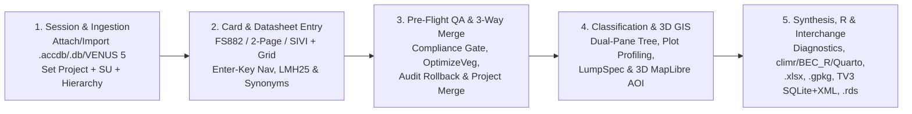
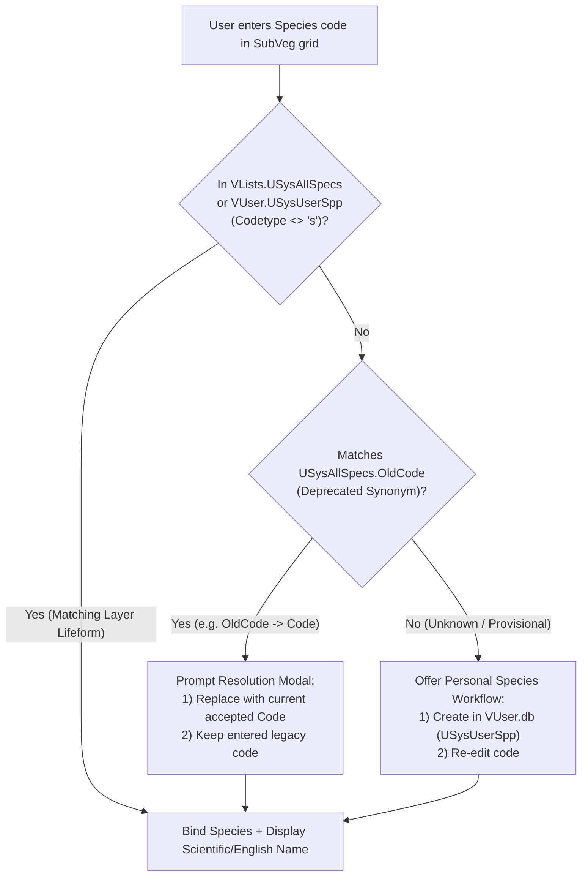
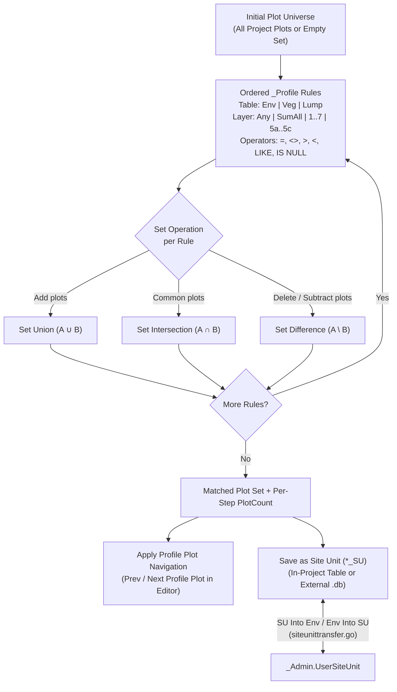

# VPRO Core Operational Workflows

> **Navigation:** [Master Index](../00_index.md) | **Present State:** [Domain Model](./domain_model.md) · `Core Workflows` · [System Architecture](./system_architecture.md) · [Capability Matrix](./capability_matrix.md) · [Data Dictionary](./data_dictionary.md) | **Evidence:** [Citations Index](../04_evidence_and_sources/citations_index.md) · [Decisions & Gaps](../04_evidence_and_sources/decisions_and_gaps.md)

---

## 1. End-to-End Ecological Data Lifecycle

From field sampling through provincial `BECMaster` correlation, VPRO orchestrates **five sequential workflow stages** (`VProXP_Userguide.pdf` PDF pp. 36–40, 46–96; `RE26OCF433` Schedule A Items `1`–`5`; `vpro_wails/contextservice.go`, `vpro_wails/FS882Form.svelte`):



---

## 2. Workflow 1: Session Context Selection & Legacy Access Ingestion

### 2.1 Active Session Context Switching
* **Legacy Access (`frmMainMenuFloat.txt:1579-2140`, `V7mdlSetCurrent.txt:23-135`):** Selecting a Project, Site Unit (`_SU`), or Hierarchy on the floating `Data...` palette deleted and recreated 11 persistent `QueryDefs` (`UsysEnv`, `Filtered_Env`, `UsysVeg`, `USysVegA..D`, etc.) and hot-rebound open forms. *Crucial rule:* Changing the active Project automatically clears the active Site Unit filter (`VProXP_Userguide.pdf` PDF p. 44).
* **Present State (`vpro_wails/App.svelte:1197-1346`, `sqliteprojectservice.go:108-159`):**
  1. Left collapsible `#project-context` sidebar provides selectors for **Project**, **Site Unit**, and **Hierarchy**, plus **Attach SQLite Project**, **Import Access (`.mdb`/`.accdb`)**, and **Reveal in File Explorer** (`projectfileexplorer.go:71-197`).
  2. Calling `ContextService.SwitchContext()` checks for unsaved form drafts first, attaches the selected SQLite files in `mode=ro` to a fresh `:memory:` coordinator, rebuilds temporary `USys*` views (`Filtered_Env` restricts `USysEnv` when an SU is active), and returns a new **128-bit `contextID`** (`contextservice.go:70-100`).

### 2.2 Legacy `.mdb` / `.accdb` Autoconversion Wizard (`VP05`–`VP08`)

```mermaid
sequenceDiagram
    actor User as Ecologist / Technician
    participant UI as App.svelte Import Wizard
    participant CS as ContextService (Go)
    participant MDB as internal/accessreader (CGO libmdb)
    participant IMP as internal/accessimport

    User->>UI: Click "Import Access Database"
    UI->>CS: ChooseAccessDatabaseFile() (Native COM FileDialog)
    CS-->>UI: Selected .mdb/.accdb path
    UI->>CS: InspectAccessDatabase(path)
    CS->>MDB: Open(path), TableDescriptions(), Scan *_Env & *_SU
    MDB-->>CS: Discovered projects, version tags (VP05..VP08), row counts
    CS-->>UI: Eligibility summary (VP05-VP08 eligible; VP02-VP04 rejected)
    User->>UI: Select source project + ChooseNewSQLiteProjectFile()
    UI->>CS: ImportAccessProject(req)
    CS->>IMP: Stage tables in :memory: SQLite + apply VP05/06/07 -> VP08 schema transforms
    IMP->>IMP: Verify source SHA-256 unchanged + run inspectFileContext() FK/index checks
    IMP->>CS: Atomic os.Link() to <Target>.db
    CS-->>UI: Import receipt + optional SwitchContext(<Target>.db)
```

---

## 3. Workflow 2: High-Speed Plot Card Entry & Real-Time Validation

### 3.1 Form Modalities & Paper-Card Alignment
`vpro_wails` implements the retained field-card layouts specified in `VPro2.0_Functions to remove-retain-modify.pdf` (PDF pp. 1, 3) and `RE26OCF433` Schedule A (`3.a`):
1. **Standard Multi-Tab FS882 (`FS882Form.svelte:3498-3565`):** Six tabs mirroring VPro64's `FS882-6x4XL` (`Screenshot 2026-02-12 091116.png`–`091238.png`):
   * `Site & Location` (`site`): **98 stored parent columns** (`88` `Env` + `10` `Admin`, `plotheader.go:25-124`) rendered over compiled Access twip coordinates (`paperLayout.ts` + `resources/fs882-xl-layout.json`), with live `DD` / `DM` / `DMS` / `UTM` coordinate mode switching (`HeaderEditor.svelte:1-220`) and Working Unit source radio (`Env` / `Master` / `SU`, `workingunitservice.go:34-240`).
   * `Vegetation` (`veg`): Strata total covers (`Tree A`, `Shrub B`, `Herb C`, `Moss D`), `SpeciesListComplete`, and sub-grids `SubVegAXL` (`A1..A3, TotalA, B1..B2, TotalB, Collected`), `SubVegCXL` (`C`), and `SubVegDXL` (`Dh, Dw, Dr, Ep`).
   * `Veg Other` (`vegOther`): Forage, phenology, vigour, distribution, and cultural use columns (`LL, AF, DC, UT, VI, PV, PG, FFA, Cultural1..2, Other1..2`).
   * `Soils (Humus & Mineral)` (`soils`): Pedon summary + `SoilHumusXL` (sorted `UpperDepth DESC` for upward upland `L/F/H` horizons) and `SoilMineralXL` (sorted `UpperDepth ASC` downward).
   * `Other Data` (`other`) & `Audit Trail` (`audit`).
2. **Two-Page Complete Entry (`TwoPageEntryEditor.svelte`, `FS882-8x6XL` parity):** Side-by-side `Site + Vegetation` and `Soil + Terrain` spreads (`117` standard / `119` CHARS parent fields, `internal/twopage`), including full Humus/Mineral soil horizon creation, deletion, and audit restoration.
3. **FS1333 SIVI & Inline Extended Shrub Layers (`FS882Form.svelte` `siviParent`, `internal/sivi`):** Supports `New SIVI / FS1333 Plot` creation (with atomic undo), deletion/restoration, `PlotType` (`Ground`, `Visual`, `Note`, `Other`, `Full`), `14` `SV_*` columns, `Collected` cycling (`NULL -> C -> V`), and an inline **`Show extended shrub layers`** toggle exposing CHARS `Cover5a..5c`, `SnowCoverregime`, and `ActiveLayerDepth` on standard FS882, Two-Page, and SIVI forms (retiring standalone CHARS forms per `VPro2.0_Functions` PDF p. 3).
4. **Universal Datasheet Grid (`UniversalDatasheetGrid.svelte`, `internal/datasheet`):** Direct spreadsheet editing across `<P>_Env`, `<P>_Admin`, `<P>_Veg`, `<P>_Humus`, `<P>_Mineral`, `<P>_Other`, and `<Name>_SU` (`Email 0035`) with multi-column sort, active-SU scoping, global search, clipboard TSV paste, find/replace, and atomic `<Project>_Audit` transactions.

### 3.2 Muscle-Memory Keyboard Navigation & Validation Rules
* **`Enter`-Key Traversal (`frontend/src/entry/enterNavigation.ts:1-68`):** Replicates Access subform data-entry ergonomics:
  * On parent field panels (`mode === 'field'`), pressing `Enter` advances sequentially across card fields in physical tab order.
  * Inside child grids (`SubVegA*`, `SubVegCXL`, `SubVegDXL`, `SoilHumusXL`, `SoilMineralXL`, `mode === 'record'`), pressing `Enter` moves **vertically down the same column** to the next row for rapid cover/depth transcription, halting immediately if `aria-invalid="true"` and never auto-committing incomplete rows.
* **Calibrated Access Type & Boundary Validation (`childvalidation.go:11-39`, `vegetationvalidation.go:8-22`, `AGENTS.md:62-94, 134-139`):**
  * Enforces exact UTF-16 code-unit caps (`PlotNumber <= 7`, `Species <= 8`, `Horizon <= 8`, `Texture <= 4`, `Colour <= 14`).
  * Applies IEEE-754 `float32` (`SINGLE`) narrowing *prior* to evaluating `<100` cover constraints to match Jet/ACE rounding behavior (`99.999996` passes; `99.999999` narrows to `100.0` and rejects).
  * **Historical Field Tolerance:** Untouched out-of-range legacy fields on historical plots (e.g., 1980s DEIF records) are omitted from `UPDATE` validation so analysts can fix a single field without being blocked by pre-existing legacy anomalies.

### 3.3 Live Taxonomic Lookup & `NotInList` Synonym Resolution



*(Sources: `vpro_wails/vegetationspeciesreference.go:41-61`, `vegetationspeciesservice.go:75-169`, `personalspecies.go:130-160`, `FS882Form.svelte:2211-2360`.)*

---

## 4. Workflow 3: Data Cleaning, Integrity Verification & Transactional Audit Rollback

### 4.1 Batch Species Cleaning & Duplicate Consolidation
* **Interactive Species Code Check (`vpro_wails/speciescodecheck.go:55-160`, `SpeciesCodeCheck.svelte:1-220`; Legacy `V7mdlSpellCheck2020.txt:3-315`):** Scans all `<Project>_Veg` records (or active SU subset) against `USysAllSpecs` and `USysUserSpp`, flagging obsolete synonyms (`OldCode -> Code`) and unrecognized codes for single-record or project-wide replacement with audit logging.
* **Batch Compliance Validator, Transactional `OptimizeVeg` & 3-Way Project Merge (`internal/validation`, `internal/projectops`):**
  * `ValidationService` & `ProjectAdminWorkbench.svelte` run batch `USysTableOfLists` picklist validation, 1-to-many referential integrity checks, numeric/UTF-16 bounds, and `LMH25 (2023)` pedon/edatopic diagnostics (`internal/lmh25rules`) across entire staging projects (`RE26OCF433` Schedule A `1.i.1`).
  * `OptimizeVeg` (`internal/projectops`) pre-filters duplicate `(PlotNumber, Species)` keys in SQL and consolidates multi-row per-stratum entries inside an atomic SQLite `SAVEPOINT` (fixing legacy non-transactional `DELETE *` and `Sum(Height6)` bugs).
  * Full **Project Lifecycle Suite** supports `New Empty Project`, single-pass DDL `Save Project As`, `Export Splinter Project`, plot/field `Compare Two Projects`, and WAL-resilient **3-Way Project Merge** with conflict resolution and `<Project>_Audit` attribution.

### 4.2 Atomic Audit Trail & Safe Field Restoration
* **Legacy Defect Eliminated (`archive/oct2026-parity-ledgers/FS882-6x4XL-access-contract.md:83-155`):** In Access `Form_BeforeUpdate` (`V7mdlAudit.txt:236-320`), unbound UI checkboxes (`Check369`/`Check371`/`Check373`) and aborted saves wrote orphan/phantom rows into `<Project>_Audit`, while `frmSIVIsite` logged table `"Unknown"`.
* **Transactional SQLite Audit (`vpro_wails/plotrestore.go:15-180`, `vpro/R/plot-crud.R:54-101`):**
  1. Every parent (`_Env`, `_Admin`) and child (`_Veg`, `_Humus`, `_Mineral`, `_Other`) mutation writes its `<Project>_Audit` rows (`BeforeEdit`, `AfterEdit`, `User`, `EditWhen`, child `ID`) inside the **same SQLite `BEGIN IMMEDIATE` transaction**, honoring `AuditStrength` (`0=Off`, `1=Edit`, `2=Edit+Add`, `3=Edit+Add+Delete`).
  2. `RestoreSelectedAuditRecords` rolls back selected field edits with explicit post-restore disposition (`retain` vs. `prune` audit rows) while **refusing destructive `CleanVegPlot` silent row deletion** (`CleanedVegRows == 0` enforced in `plotrestore.go` and `FS882Form.svelte:1710`) and preserving Access's rule skipping `_Veg.Cover*` audit restoration (`V7mdlAudit.txt:174`).

---

## 5. Workflow 4: Plot Profiling, Site Unit (`SU`) Classification & Taxonomic Lumping



* **Calibrated Plot Profiling (`vpro_wails/projectprofiling.go:63-205`, `ProjectPlotProfileReview.svelte`):** Evaluates multi-step environmental, species-layer, species-absence (`IS NULL`), and lumped-taxa (`<Project>_Lump` + 7-char subspecies folding) rules using custom SQLite scalar functions (`vpro_profile_single_sum`, `vpro_profile_cover_decimal_compare`) calibrated to ACE fixed-decimal arithmetic—fixing legacy `V7mdlPlotProfiling.txt:30-46` where undeclared `MyMax` broke equality checks on layers `2..7`!
* **Bidirectional `Env <-> SU` Synchronization (`siteunittransfer.go`, `siteunitenvironment.go`, `siteunitenvironmentexternal.go`):** Because recreating or switching an `*_SU` table changes active unit memberships (`VProXP_Userguide.pdf` PDF p. 74), ecologists persist working classifications into `<Project>_Admin.UserSiteUnit` via **`SU Into Env`** and repopulate `*_SU` tables via **`Env Into SU`** (fixing legacy `V7mdlSUTableTools1.txt:119-125`'s hardcoded `Sample_SU` bug), with full `__VPRO_*SUHistory` rollback receipts.

---

## 6. Workflow 5: Phytosociological Reporting, Spatial Review & Interchange

All analytical reports in `vpro_wails` execute without Microsoft Excel COM automation (`GetObject(, "Excel.Application")` eliminated) and lift legacy Access's hardcoded 250-plot column ceiling (`V7mdlReportsLongVeg.txt:237`), following a two-phase **Preview $\rightarrow$ Guarded File Publication** pattern:

1. **Summary & Long Vegetation Reports (`summaryvegetation*.go`, `vegetationreport.go`, `LongVegetationReport.svelte`, `SummaryVegetationReport.svelte`):**
   * Applies Data Quality plot filtering (`SitePlotQuality`, `VegPlotQuality`, `SoilPlotQuality`, `BEC_Use`, `Include Nulls`), optional subspecies collapse, and `<Name>_Lump` aggregation (summed cover capped at `99%`).
   * Groups taxa by **Layer**, **Strata** (`TotalA`/`TotalB` overrides), **Lifeform** (`1..14`), or **None**, computing `Presence` ($k/n$) and `Mean Cover` ($\sum \text{Cover}/n$) plus optional environmental header summaries and `SU Table` / `ReportSummary` audit tabs, exporting native `.xlsx` workbooks via `excelize/v2`.
2. **Summary & Long Environment Reports (`environmentreport.go`, `siteunitdetailreport.go`, `environmentworkbook.go`, `siteunitsummaryworkbook.go`):** Generates transposed 72-field plot-by-unit Long Environment sheets and quantitative (mean/median/quartiles) + qualitative (frequency) Site Unit Summary workbooks.
3. **Lifeform, Species Attributes & Subzone Matrix (`lifeformsummary.go`, `speciesattributesummary.go`, `internal/reports/subzonematrix/matrix.go`):** Summarizes 14 lifeform classes, 6 autecological trait families (`SRank`, `Wetland_Ind`, `WeedStatus`, `RedBlueList`, `Est_ASMR`, `Climate`), and level-11 BGC subzone matrices.
4. **3D Geospatial Workbench, Diagnostic Synthesis, R Sidecar & Interchange Hub:**
   * **In-App 3D Geospatial (`GeospatialWorkbench.svelte`, `internal/spatial`):** Offline `PMTiles` (`bc-overview.pmtiles` + external `maps/`) rendered with MapLibre GL JS v6 + progressive WebGPU (`deck.gl` v9), NAD83 `UTM <-> DD` geodetic QA, FlatGeobuf point-in-polygon BGC/Ecosection/District auto-stamping, and polygon/lasso AOI $\rightarrow$ `*_SU` selection (plus secondary Google Earth KML 2.1 export).
   * **Reactive BEC Diagnostics & R Analytics (`ClassificationSynthesis.svelte`, `RSidecarWorkbench.svelte`, `internal/diagnostics`, `internal/rsidecar`):** Live differential species (`d, dd, cd, c, ic`), pairwise similarity, LOO misplaced-plot queue, `Diagnostic10.xla`-compatible `.xlsx` export, and out-of-process `Rscript` bridge (`climr` cache $\rightarrow$ Ministry `aSMR`, dual edatopic grids, `vegclust` candidate `*_SU`, and Quarto HTML/PDF unit & BGC guides).
   * **Complete Interchange Hub (`InterchangeHub.svelte`, `internal/interchange`):** `VENUS 5.0` `.mdb`/XML import, **official `TurboVeg 3` 31-table SQLite & universal `Plot_package` XML** import/export, OGC `GeoPackage` (`.gpkg` in `EPSG:4326`/`EPSG:3005`), native R `.rds` export, Long/Wide CSV & deterministic Store-mode `.zip` CSV bundles, `User Species List` (`USysUserSpp`) I/O, and cross-platform `LiberationSans` Plot Folder Label PDFs.
