# VPRO Data Dictionary & Canonical Schema Reference

> **Navigation:** [Master Index](../00_index.md) | **Present State:** [Domain Model](./domain_model.md) · [Core Workflows](./core_workflows.md) · [System Architecture](./system_architecture.md) · [Capability Matrix](./capability_matrix.md) · `Data Dictionary` | **Related:** [Legacy Architecture](../01_history_and_evolution/legacy_architecture.md) · [Citations Index](../04_evidence_and_sources/citations_index.md)

---

## 1. Database Family Topology

Both legacy **VPro 64** (`VPro64.accdb` + `.accda` add-ins) and the modernized **`vpro` (R)** / **`vpro_wails` (Go/Wails)** implementations organize persistent data into a **multi-database family** separating mutable plot projects from provincial reference libraries and personal user extensions (`VPro64/VPro64.accdb`, `vpro/R/startup.R:18-60`, `vpro_wails/databasefamily.go:19-61`, `vpro_wails/sqlitecontext.go:95-248`):

| Logical Database | Legacy Access Artifact | Canonical SQLite Artifact (`vpro` / `vpro_wails`) | Core Tables Contained | Ownership & Mutability |
|---|---|---|---|---|
| **Active Project** | `<File>.accdb` (`
_*` 8 tables + optional tables) | `<Project>.db` (e.g., `projects/Sample.db`, `503,808 B`) | `
_Env`, `
_Admin`, `
_Veg`, `
_Humus`, `
_Mineral`, `
_Other`, `
_Audit`, `
_Metadata` (+ optional `_SU`, `_Hierarchy`, `_Lump`, `_Profile`, `_Herbarium`, `_Theme`, `_table_metadata`, `__VPRO_*`) | **Read/Write** (`c.projectDB` in `vpro_wails/sqlitecontext.go:56-75`) |
| **Program / System Templates** | `VPro64.accdb` (`29,396,992 B`, `BuildDate = 02/23/23`) | `database-family/VPro64.db` | `USys*Table` DDL templates, `LayerCode`, `LifeformCodes`, `UnitLevelCodes`, `USysShortVegSummaryFieldList`, `USysSubzoneMatrixLabels`, `USysBreakTable`, `USysUserLog`, `tblWhatsNew` | **Read-Only** seed (except `USysUserLog` / receipt tables) |
| **Provincial Standards Library** | `VLists.accda` (`8,818,688 B`, `01 Feb. 2023`) | `database-family/VLists.db` (`2026` refresh via `cmd/standards2026` + read-model `.db` files in `resources/`) | `USysAllSpecs` (`16,728` rows, `BCPlantTaxonomy v19`), `USysTableOfLists` (`1,566` rows, `LMH25 2023`), `MasterSiteUnitList` (`6,067` rows), `USysSiteSeriesNames` (`8,900` rows, `BECdb v13`), `USysZoneList` (`331` rows), `USysSppAttributes` (`8,262` rows) | **Read-Only** for standard users; governed via `BECMaster` / `BECdb` |
| **User Workspace Library** | `VUser.accda` (`696,320 B`) | `database-family/VUser.db` | `USysUserSpp` (personal provisional species), `UserSiteUnitList`, `USysSiteUnitAll`, `USysPrefs` | **Read/Write** per local user |
| **Master Project Metadata** | `VMetaData.accda` (`487,424 B`) | `database-family/VMetaData.db` | `ProjectMetadata` (42 cols), `ProjectMetaDataCodes` | **Read-Only / Cloud-Synced** (`VPro2.0_Functions` PDF p. 5) |
| **Plot Photographs Index** | `PlotPictures\VPics.accdb` (`364,544 B`) | `pics/VPics.db` | `tblVPics` (`ID`, `PlotNumber`, `PicDir`, `PicName`, `PicComment`) | **Read/Write** |
| **Legacy Message Board** | `VMessageBoard.accda` (`397,312 B`) | `database-family/VMessageBoard.db` | `tblMessageBoard`, `tblMessageList` | **Deprecated / Removed** (`VPro2.0_Functions` PDF p. 2) |

---

## 2. Entity-Relationship Model (`VP08` Canonical Project + Classification + Libraries)

```mermaid
erDiagram
    PROJECT_ENV ||--|| PROJECT_ADMIN : "PlotNumber = Plot (1:1 CASCADE)"
    PROJECT_ENV ||--o{ PROJECT_VEG : "PlotNumber (1:N CASCADE)"
    PROJECT_ENV ||--o{ PROJECT_HUMUS : "PlotNumber (1:N CASCADE)"
    PROJECT_ENV ||--o{ PROJECT_MINERAL : "PlotNumber (1:N CASCADE)"
    PROJECT_ENV ||--o{ PROJECT_OTHER : "PlotNumber (1:N CASCADE)"
    PROJECT_ENV ||--o{ PROJECT_AUDIT : "PlotNumber (1:N CASCADE)"
    PROJECT_METADATA ||--o{ PROJECT_ENV : "ProjectID (logical 1:N)"
    PROJECT_ENV ||--o| SITE_UNIT_SU : "PlotNumber (0..1 active filter)"
    HIERARCHY_NODE ||--o{ HIERARCHY_NODE : "ID = Parent (Adjacency Tree)"
    HIERARCHY_NODE ||--o{ SITE_UNIT_SU : "Name = SiteUnit (logical)"
    MASTER_SITE_UNIT_LIST ||--o{ SITE_UNIT_SU : "SiteSeries = SiteUnit"
    SPECIES_ALL_SPECS ||--o{ PROJECT_VEG : "Code = Species"
    LUMP_TABLE ||--o{ PROJECT_VEG : "SppCode = Species (query-time)"
    PROJECT_ENV ||--o{ VPICS : "PlotNumber"

    PROJECT_ENV {
        varchar_7 PlotNumber PK "Unique plot key"
        varchar_50 FieldNumber "Field card plot ID"
        varchar_30 ProjectID "Links to Metadata"
        datetime Date "Survey date"
        double Latitude "Decimal degrees (NAD83)"
        double Longitude "Decimal degrees"
        varchar_4 Zone "BEC Zone (e.g. SBS, CWH)"
        varchar_8 SubZone "Subzone/Variant/Phase"
        varchar_5 SiteSeries "Field site series"
        varchar_3 MoistureRegime "rSMR 0-8"
        varchar_2 NutrientRegime "rSNR A-F"
        int16 Elevation "Metres"
        single SlopeGradient "Percent"
        int16 Aspect "0-359 deg (999=level)"
        single StrataCoverTree "Strata A %"
        single StrataCoverShrub "Strata B %"
        single StrataCoverHerb "Strata C %"
        single StrataCoverMoss "Strata D %"
        boolean SpeciesListComplete "Complete vs Partial"
        varchar_25 SV_PolygonNumber "FS1333 SIVI (14 SV_* cols)"
        single ActiveLayerDepth "CHARS permafrost cm"
    }

    PROJECT_ADMIN {
        varchar_7 Plot PK,FK "1:1 to Env.PlotNumber"
        int16 StartDate "Year 1900-2500"
        varchar_10 PlotType "Ground/Visual/Note/FS882"
        varchar_15 SitePlotQuality "Poor/Fair/Good/Excellent"
        varchar_15 VegPlotQuality "Poor/Fair/Good/Excellent"
        varchar_15 SoilPlotQuality "Poor/Fair/Good/Excellent"
        varchar_100 UserSiteUnit "Working classification"
        varchar_100 BECSiteUnit "Custodian-locked BEC unit"
        single HumusThickness "Computed cm"
        varchar_255 GIS_BGC "Spatial BGC overlay"
        varchar_255 BEC_Use "QC suitability flag"
        single StrataCoverTotal "Computed total cover"
    }

    PROJECT_VEG {
        varchar_7 PlotNumber FK "Indexed (no composite PK)"
        varchar_8 Species "7/8-char plant code"
        int32 ID "Row identifier (non-unique in Access)"
        single Cover1_Cover3 "Tree layers A1, A2, A3 %"
        single TotalA "Strata A total override %"
        single Cover4_Cover5c "Shrub B1, B2 + CHARS 5a-5c %"
        single TotalB "Strata B total override %"
        varchar_255 HeightB "Legacy VARCHAR quirk!"
        single Cover6 "Herb layer C %"
        single Cover7_Cover10 "Dh, Dw, Dr, Ep %"
        varchar_1 Collected "Voucher C or V"
        int16 LL_to_Other2 "12 Veg Other forage/phenology cols"
    }

    PROJECT_HUMUS {
        int32 ID PK "Unique row ID"
        varchar_7 PlotNumber FK "Parent plot"
        varchar_8 Horizon "L, F, H, Of, Om, Oh"
        single UpperDepth "cm (> LowerDepth in upland!)"
        single LowerDepth "cm"
        int16 vonPost "1-10 decomposition"
        single HumusFormpH "Horizon pH"
    }

    PROJECT_MINERAL {
        int32 ID PK "Unique row ID"
        varchar_7 PlotNumber FK "Parent plot"
        varchar_8 Horizon "A, B, C, R, W"
        single UpperDepth "cm (< LowerDepth downward)"
        single LowerDepth "cm"
        varchar_1 PitDepthLimit "Plus (+) flag"
        varchar_14 Colour "Munsell Hue Val/Chroma"
        varchar_4 Texture "Fine-earth texture"
        int16 PercentCoarseFragsTotal "G+C+S %"
    }

    PROJECT_OTHER {
        int32 ID PK "Unique row ID"
        varchar_7 PlotNumber FK "Parent plot"
        varchar_50 DataName "Custom attribute key"
        varchar_255 DataItem "Custom value"
    }

    PROJECT_AUDIT {
        int32 ID "Target child row ID"
        varchar_7 PlotNumber FK "Edited plot"
        varchar_100 User "Editor identity"
        varchar_50 Table "Target table suffix"
        varchar_100 EditField "Column name"
        timestamp EditWhen "Mutation timestamp"
        text BeforeEdit "Prior value"
        text AfterEdit "New value"
        boolean Restore "Rollback selection flag"
    }

    PROJECT_METADATA {
        int32 ID PK "Unique row ID"
        varchar_20 ProjectID "Width 20 vs Env 30!"
        int16 StartDate "Year 1900-2500"
        varchar_255 ProjectTitle "Study title"
        varchar_255 EcosysCollectionStandard "DEIF/LMH25 standard"
        int32 BAPID "<= 99999"
    }

    SITE_UNIT_SU {
        varchar_7 PlotNumber UK "1 unit per plot in SU"
        varchar_255 SiteUnit "Assigned unit code"
    }

    HIERARCHY_NODE {
        int32 ID PK "Node ID"
        varchar_255 Name UK "Unit/branch (~ prefix = break)"
        int32 Parent FK "Parent node ID"
        int16 Level "1 (Superclass) to 11 (Site Series)"
    }

    LUMP_TABLE {
        varchar_50 LumpCode "Target combined taxon"
        varchar_8 SppCode UK "Source species code"
        boolean Use "Active flag (-1/0)"
    }

    MASTER_SITE_UNIT_LIST {
        int32 ID PK "Master unit ID"
        varchar_50 SiteSeries "ZZZZsssvp/## mask"
        varchar_120 SiteSeriesLongName "English name"
        int16 Level "Default 11"
    }

    SPECIES_ALL_SPECS {
        varchar_255 Code "Accepted 7/8-char code"
        varchar_255 OldCode "Synonym code"
        varchar_255 ScientificName "Latin binomial"
        int32 Lifeform "1-14 lifeform class"
        varchar_255 Codetype "u=accepted, s=synonym"
    }

    VPICS {
        int32 ID PK "Photo row ID"
        varchar_7 PlotNumber "Linked plot"
        varchar_255 PicDir "Directory path"
        varchar_255 PicName "Image filename"
    }
```

---

## 3. Core Project Entities (`VP08` 8-Table Canonical Specification)

Every valid `VP08` project (in `VPro64.accdb`, `BECMaster_fixing.accdb`, `vpro/data-raw/projects/Sample_*.sql`, and `vpro_wails/sqlitecontext.go:332-360`) consists of **eight required tables** sharing a `<Project>_` prefix, tagged via Access `TableDef.Properties("Description")` or SQLite `_table_metadata (table_name TEXT PRIMARY KEY, description TEXT)`.

### 3.1 `<Project>_Env` — Plot Site, Location, Soil Summary, SIVI & CHARS (`112 Columns`, Tag `VP08`)
Verified identically across `VPro64.accdb :: Sample_Env`, `BECMaster_fixing.accdb` (71,567 rows), `vpro/data-raw/projects/Sample_Env.sql:2-121`, and `vpro_wails/projectcreationddl.go`:
* **Primary Key & Indexes:** `PlotNumber VARCHAR(7) NOT NULL` (`uidx_
_Env_PlotNumber`), `idx_
_Env_ProjectID` (`ProjectID`), `idx_
_Env_AirPhotoNum` (`AirPhotoNum`).
* **Column Groups (All 112 Columns):**
  1. **Identity & Survey Header (`Cols 0–9`):** `PlotNumber (Text 7, PK)`, `FieldNumber (Text 50)`, `ProjectID (Text 30)`, `FSRegionDistrict (Text 7)`, `Date (DateTime)`, `SiteSurveyor (Text 30)`, `PlotRepresenting (Text 255)`, `Location (Text 255)`, `Ecosection (Text 3)`, `NtsMapSheet (Text 8)`.
  2. **Georeferencing (`Cols 10–18`):** `Longitude (Double / Float64 — positive West in legacy BC plots, converted on KML/map output)`, `Latitude (Double / Float64)`, `UTMZone (Text 2 — Zones 8..11 in BC)`, `UTMEasting (Single)`, `UTMNorthing (Single)`, `LocationAccuracy (Int16, m)`, `AirPhotoNum (Text 20)`, `XCoord (Single)`, `YCoord (Single)`.
  3. **Field BEC & Edatopic Classification (`Cols 19–29`):** `Zone (Text 4)`, `SubZone (Text 8)`, `SiteSeries (Text 5)`, `SiteModifier1 (Text 5, GIF/SIVI)`, `SiteModifier2 (Text 5)`, `TransDistrib (Text 3, codes 1–8)`, `RealmClass (Text 5, 35 non-forested codes)`, `MapUnit (Text 15)`, `SnowCoverregime (Text 1, CHARS SCR)`, `MoistureRegime (Text 3, rSMR 0–8)`, `NutrientRegime (Text 2, rSNR A–F)`.
  4. **Stand Structure, Topography & Exposure (`Cols 30–47`):** `SuccessionalStatus (Text 3)`, `StructuralStage (Text 6, 1a–7b incl. 2023 3c/3d)`, `StructuralStageMod (Text 1)`, `StandAge (Int16, yr)`, `Elevation (Int16, m)`, `SlopeGradient (Single, %)`, `Aspect (Int16, 0–359 or 999 level)`, `MesoSlopePosition (Text 3)`, `SurfaceShape (Text 3)`, `SurfaceTopographyType (Text 3)`, `SurfaceTopographySize (Text 2)`, `WaterSource (Text 5)`, `Photo (Text 50)`, `Exposure1 (Text 2)`, `Exposure2 (Text 2)`, `SiteDisturbance1 (Text 8)`, `SiteDisturbance2 (Text 8)`, `SiteDisturbance3 (Text 8)`.
  5. **Surface Substrate & Site Notes (`Cols 48–54`):** `SubstrateDecWood`, `SubstrateBedRock`, `SubstrateRocks`, `SubstrateMineralSoil`, `SubstrateOrganicMatter`, `SubstrateWater` (all `Single`, domain sum = `100%`), `SiteNotes (Memo)`.
  6. **Geology & Two-Stratum Terrain (`Cols 55–69`):** `SoilSurveyor (Text 30)`, `BedrockGeology1..3 (Text 4 x3)`, `CoarseFragLith1..3 (Text 12 x3)`, `TerrainTextureSurf (Text 3)`, `SurficialMaterialSurf (Text 6)`, `SurfaceExpSurf (Text 3)`, `GeoMorProSurf (Text 3)`, `TerrainTextureSubSurf (Text 3)`, `SurficialMaterialSubSurf (Text 6)`, `SurfaceExpSubSurf (Text 3)`, `GeoMorProSubSurf (Text 3)`.
  7. **Pedon Hydrology, Soil & Humus Summary (`Cols 70–85, 92–93`):** `FloodingRegimeFreq (Text 7)`, `MoistureRegimeSub (Text 3)`, `FloodingRegimeDur (Text 2)`, `SoilDrainage (Text 5)`, `SeepageDepth (Int16, 999=absent)`, `RootRestrictingType (Text 1)`, `RootRestrictingDepth (Int16)`, `RootZoneParticleSize (Text 6)`, `RootingDepth (Int16)`, `SoilClassSubGroup (Text 4)`, `SoilClassGroup (Text 4)`, `HumusForm (Text 4)`, `HumusFormPhase (Text 50)`, `pHMethodCodeMineral (Text 3)`, `pHMethodCodeOrganic (Text 3)`, `SoilNotes (Memo)`, `HydroGeoSystem (Text 3)`, `HydroGeoSubSystem (Text 2)`.
  8. **Vegetation Summary & Session Flags (`Cols 86–91, 94–96`):** `VegSurveyor (Text 30)`, `StrataCoverTree`, `StrataCoverShrub`, `StrataCoverHerb`, `StrataCoverMoss` (`Single x4`), `VegNotes (Memo)`, `SpeciesListComplete (Boolean)`, `Temporary (Text 100)`, `Flag (Boolean)`.
  9. **FS1333 SIVI & CHARS Extensions (`Cols 97–111`):** `SV_PolygonNumber (Text 25)`, `SV_FloodPlain (Boolean, Default 0)`, `SV_StandAgeEstMeas (Text 2)`, `SV_StandHeight (Single)`, `SV_StandHeightEstMeas (Text 2)`, `SV_CanopyComposition (Text 50)`, `SV_SoilDepth (Single)`, `SV_RootZoneTexture (Text 100)`, `SV_PercentCoarseFrags (Single)`, `SV_GleyingMottlingCM (Single)`, `SV_WaterTableCM (Single)`, `SV_FullCruiseCard (Text 50)`, `SV_AhorizonType (Text 5)`, `SV_AhorizonDepth (Single)`, `ActiveLayerDepth (Single, CHARS)`.

### 3.2 `<Project>_Admin` — Administrative, QA & Classification Record (`20 Columns`, Tag `VP08`)
Split out of `<Project>_Env` in `VP08` (`VPro 19/64`) and rejoined 1:1 via `USysEnv` (`INNER JOIN [
_Admin] ON [
_Env].PlotNumber = [
_Admin].Plot`) (`VPro64_forAI/Modules/V7mdlSetCurrent.txt:23-135`; `vpro/data-raw/projects/Sample_Admin.sql:2-26`):

| Col # | Column Name | Type & Width | Constraints & Ecological / System Semantics |
|---:|---|---|---|
| `0` | `Plot` | `Text(7)` (`Text(255)` in `Sample_Admin` template drift!) | `NOT NULL`, `UNIQUE`, `FK -> 
_Env(PlotNumber) ON UPDATE CASCADE ON DELETE CASCADE` |
| `1` | `StartDate` | `Int16` | Validation `Between 1900 And 2500`; intended composite metadata key year |
| `2` | `PlotType` | `Text(10)` | `Ground`, `Visual`, `Note`, `FS882`, `Other`, `Full` |
| `3` | `PlotSize` | `Single` | Plot area in $\text{m}^2$ (standard FS882 = `400`) |
| `4` | `ProvinceStateTerritory` | `Text(255)` | Jurisdiction code (e.g., `BC`, `YT`, `NT`, `NU`, `AB`) |
| `5–7` | `SitePlotQuality`, `VegPlotQuality`, `SoilPlotQuality` | `Text(15)` each | `Poor`, `Fair`, `Good`, `Excellent` (mapped `1..4` in report QC filters) |
| `8` | `UpdatedFromCards` | `Boolean` | Entry & card verification complete flag (formerly `Complete`) |
| `9` | `EnteredBy` | `Text(50)` | Data entry technician name/initials |
| `10` | `UserSiteUnit` | `Text(100)` | Analyst's working unit assignment (`SU Into Env` / `Env Into SU` target) |
| `11` | `BECSiteUnit` | `Text(100)` | **Custodian-restricted** corporate BEC correlation unit |
| `12–13` | `SiteUnitShortName`, `SiteUnitLongName` | `Text(50)`, `Text(100)` | Cached unit short/long names |
| `14` | `OfficeNotes` | `Memo` | Post-survey review & correlation notes |
| `15` | `HumusThickness` | `Single` | Calculated organic mantle thickness ($\text{cm}$, protected field) |
| `16–17` | `GIS_BGC`, `GIS_BGC_VER` | `Text(255)`, `Int16` | Intersected provincial BGC polygon label & map version (added Dec 8, 2017) |
| `18` | `BEC_Use` | `Text(255)` | BEC master suitability code (added Oct 16, 2019; filtered in Summary Veg QC) |
| `19` | `StrataCoverTotal` | `Single` | Calculated total vegetation cover (protected field) |

### 3.3 `<Project>_Veg` — Wide Multi-Strata Species Observations (`44 Columns`, Tag `VP08`)
Stores vertical canopy cover, height, voucher status, and cultural/forage attributes (`VPro64.accdb :: Sample_Veg`; `vpro/data-raw/projects/Sample_Veg.sql:2-53`; `vpro_wails/plotchild.go:23-65`):
* **Critical Schema Quirks:**
  1. **No Composite Primary Key on `(PlotNumber, Species)` and Non-Unique `ID`:** Dropped after `VP06` because Access subforms (`SubVegA`, `SubVegC`, `SubVegD`) insert separate partial rows when the same species occurs in multiple strata (e.g., *Tsuga heterophylla* in `A2`, `B2`, and `D` seedlings) until consolidated by `OptimizeVeg` (`VPro64_forAI/Modules/V7mdlOptimizeVeg.txt:4-63`). SQLite preserves this exact contract (`vpro/data-raw/projects/Sample_Veg.sql:46-52`).
  2. **`HeightB` Type Anomaly:** Column `22` (`HeightB`) is `VARCHAR(255)` in Access `VP08` and SQLite, whereas `Height1..6` and `HeightA` are `Single` (`Float32`)!
* **Layer-to-Column Mapping (`LayerCode` & `LMH25_2023_web.pdf` PDF pp. 104–117):**

| Columns | Field Card Code | Ecological Layer Definition |
|---|---|---|
| `PlotNumber (Text 7)`, `Species (Text 8)`, `Layer (Text 2)`, `ID (Int32)`, `Flag (Bool)` | Plot + `GENUSPP#` | Foreign key to `_Env(PlotNumber) CASCADE`; 7/8-char code in `USysAllSpecs` / `USysUserSpp` |
| `Cover1`, `Height1` | **`A1`** (`Layer 1`) | Dominant / emergent / veteran trees ($>10\text{ m}$) |
| `Cover2`, `Height2` | **`A2`** (`Layer 2`) | Main tree canopy ($>10\text{ m}$) |
| `Cover3`, `Height3` | **`A3`** (`Layer 3`) | Sub-canopy / suppressed trees ($>10\text{ m}$) |
| `TotalA`, `HeightA` | **`A`** (`Strata A`) | Total tree stratum cover % & height m (overrides `Cover1+2+3` in strata rollups) |
| `Cover4`, `Height4` | **`B1`** (`Layer 4`) | Tall shrubs & tree regen ($2\text{–}10\text{ m}$) |
| `Cover5`, `Height5` | **`B2`** (`Layer 5`) | Low shrubs ($0.15\text{–}2\text{ m}$) |
| `Cover5a..5c`, `Height5a..5c` | **`B2a`, `B2b`, `B2c`** | **CHARS** extended Arctic/subarctic shrub height sub-layers (added Oct 14, 2014) |
| `TotalB`, `HeightB (Text 255)` | **`B`** (`Strata B`) | Total shrub stratum cover % & height (overrides `Cover4+5+5a..5c` in strata rollups) |
| `Cover6`, `Height6` | **`C`** (`Layer 6`) | Herb layer + 76 specified dwarf woody species ($<15\text{ cm}$, `LMH25` Table 3.1) |
| `Cover7` | **`D` / `Dh`** (`Layer 7`) | Bryophytes, terrestrial lichens, liverworts & $<2\text{ yr}$ seedlings on humus/soil |
| `Cover8` | **`Dw`** (`Layer 8`) | Epixyls — bryophytes/lichens on decaying wood |
| `Cover9` | **`Dr`** (`Layer 9`) | Epiliths — bryophytes/lichens on rock |
| `Cover10` | **`E` / `Ep`** (`Layer 10`) | Epiphytes — bryophytes/lichens on living trees/shrubs |
| `Collected (Text 1)` | **`?`** | Voucher specimen status (`NULL`, `'C'` collected, `'V'` verified in SIVI) |
| `LL (Int32)`, `AF`, `DC`, `UT`, `VI (Int16)`, `PV (Int32)`, `PG`, `FFA`, `Cultural1..2`, `Other1..2 (Int16)` | **`Veg Other`** (`LMH25` App. 3.1) | Lichen Loading (`0–5`), Available Forage ($\text{g/m}^2$), Distribution (`1–9`), Utilization (`0–5`), Vigour (`0–4`), Phenology Veg/Gen, Fruit/Flower (`0–6`), Cultural/NTQ & custom codes |

### 3.4 `<Project>_Humus` (`18 Columns`) & `<Project>_Mineral` (`28 Columns`) — Soil Pedon Tables
* **`<Project>_Humus` (`vpro/data-raw/projects/Sample_Humus.sql:2-24`):** `ID (PK)`, `PlotNumber (FK CASCADE)`, `Horizon (Text 8: L, F, H, Of, Om, Oh, S)`, `UpperDepth (Single)`, `LowerDepth (Single)`, `HumusStructureDegree (Text 1)`, `HumusStructureKind (Text 5)`, `MycelAbundance (Text 1)`, `FecalAbundance (Text 1)`, `RootsAbundance (Text 6)`, `RootsSize (Text 6)`, `vonPost (Int16, 1–10)`, `HumusFormpH (Single)`, `Consistence (Text 2)`, `Character (Text 2)`, `Fauna (Text 4)`, `Comment (Memo)`, `Flag (Boolean)`. Ordered in `vpro`/`vpro_wails` by `UpperDepth DESC, Horizon DESC, ID` to reflect upward measurement from `0 cm` (`vpro/R/plot-soil.R:1-90`).
* **`<Project>_Mineral` (`vpro/data-raw/projects/Sample_Mineral.sql:2-34`):** `ID (PK)`, `PlotNumber (FK CASCADE)`, `Horizon (Text 8: A, B, C, R, W + modifiers)`, `UpperDepth (Single)`, `LowerDepth (Single)`, `PitDepthLimit (Text 1: '+')`, `Colour (Text 14: Munsell)`, `ASP (Int16: 1–8)`, `Texture (Text 4)`, `PercentCoarseFragsGravel`, `PercentCoarseFragsCobbles`, `PercentCoarseFragsStones`, `PercentCoarseFragsTotal` (`Int16 x4`), `PercentCoarseFragsShape (Text 1: R/S/A/T)`, `RootsAbundance (Text 6)`, `RootsSize (Text 6)`, `MineralStructureClass (Text 3)`, `MineralStructureKind (Text 7)`, `MineralFormpH (Single)`, `MottlesAbundance (Text 1)`, `MottlesSize (Text 1)`, `MottlesContrast (Text 1)`, `ClayFilmsFreq (Text 2)`, `ClayFilmThickness (Text 3)`, `Effervescence (Text 2)`, `Porosity (Text 1)`, `Comments (Memo)`, `Flag (Boolean)`. Ordered by `UpperDepth ASC, Horizon ASC, ID`.

### 3.5 `<Project>_Other` (`11 Columns`), `<Project>_Audit` (`11 Columns`) & `<Project>_Metadata` (`75 Columns`)
* **`<Project>_Other` (`Sample_Other.sql:2-17`):** `ID (PK)`, `PlotNumber (FK CASCADE)`, `DataName (Text 50)`, `DataItem (Text 255)`, `UserItem1..3 (Text 255 x3)`, `UserFlag1..3 (Boolean x3)`, `Flag (Boolean)`.
* **`<Project>_Audit` (`Sample_Audit.sql:2-19`):** `Project (Text 100)`, `User (Text 100)`, `PlotNumber (Text 7, FK CASCADE)`, `Table (Text 50)`, `EditField (Text 100)`, `EditWhen (Timestamp, indexed)`, `BeforeEdit (Text)`, `AfterEdit (Text)`, `Restore (Boolean)`, `Flag (Boolean)`, `ID (Int32, target child row ID — NOT AutoNumber PK!)`.
* **`<Project>_Metadata` (`Sample_Metadata.sql:2-85`, Tag `VP07` / `VP08`):** `ID (PK)`, `ProjectID (Text 20 — note width mismatch vs Env.ProjectID Text 30!)`, `StartDate (Int16, 1900–2500)`, `EndDate (Int16)`, agency/leader/study-area text fields, methodology codes (`ProjectType`, `EcosysCollectionStandard`, `VegCoverMethod`, `PlotMethod`, `MensurationMethod`, `GeoRefMethod`, `Datum`, `CoordinateSystem`), 9 `Collected* (Int16: 1=complete, 2=partial, 3=none)` + `DataQuality*` pairs (`Site, Veg, Soil, Terrain, Mens, CWD, WildTree, SoilChem, WildlifeHabitatAssessment`), library stamps (`AllSpecs`, `TableOfLists`), 15 `Cover*Description` fields (`A1..Cover10`), `BAPID (Int32 <= 99999)`, `DateLastEdited`, `Notes`.

---

## 4. Classification, Profiling, Lumping & Reference Entities

| Entity / Table Pattern | Cols | Tag | Key Schema & Domain Role |
|---|---:|---|---|
| **`<Name>_SU`** | `2` | `VP04` | `PlotNumber VARCHAR(7) UNIQUE`, `SiteUnit VARCHAR(255)` (indexed). Simultaneous **plot subset filter** (via `Filtered_Env` / `USysEnv`) and **working site-series mapping** (`Sample_SU.sql:2-9`). Companion `_vpro_su_policy` tracks `ordinary` / `master` / `working` protection (`vpro/R/su-context.R:26-41`). |
| **`<Name>_Hierarchy`** | `10` | `VP04` | `ID INTEGER PK`, `Name VARCHAR(255) UNIQUE`, `Parent INTEGER`, `Level SMALLINT (1..11)`, `Tag`, `MyOrder`, `ChildID`, `StartChild`, `LastChild`, `Flag`. Adjacency-list tree; `'~'` prefix on `Name` marks report/export **breakpoints** (`Sample_Hierarchy.sql:2-19`; scheduled for flat-table redesign per `VPro2.0_Functions` PDF p. 7). |
| **`<Name>_Lump`** | `3` | `VP05` | `LumpCode VARCHAR(50)`, `SppCode VARCHAR(8) UNIQUE`, `Use BOOLEAN`. Non-destructive query-time species synonym/complex folding (`Sample_Lump.sql:2-9`). |
| **`<Name>_Profile`** | `9` | `VP05-2` | `Order SMALLINT`, `Table`, `Field`, `Operator`, `Layer`, `Species`, `Criteria`, `Operation`, `PlotCount INTEGER`. Sequential set-algebra query steps (`Sample_Profile.sql:2-12`). |
| **`<Name>_Herbarium`** | `33` | `VP06` | `RecID PK`, `AccessionNumber`, `PlotNumber`, `Species`, `Collectors`, `Photo (BLOB)`, DMS coords, `Print` flag (`VPro64.accdb :: Sample_Herbarium`). |
| **`<Name>_Theme`** | `7` | `VP05` | `LumpCode`, `SppCode UNIQUE`, `ScientificName UNIQUE`, `ColourCode`, `PatternCode`, `FontColour`, `Use` (`VPro64.accdb :: Sample_Theme`). |
| **`VLists.USysAllSpecs`** | `26` | `2026-02-09 (v19)` | `16,728` rows (`16,250` in 2023 `VLists.accda`): `Code`, `OldCode`, `ScientificName`, `EnglishName`, `ShortenedGuideName`, `Lifeform (Int32)`, `Codetype ('u'/'x'/'XX' accepted, 's' synonym)`, `TaxonLevel`, `Report`. Indexed in SQLite read-models. |
| **`VLists.USysTableOfLists`** | `10` | `LMH25 (2023)` | `1,566` rows (`1,558` in 2023 + `LMH25 2023` additions): `ListName`, `ListFilter`, `ItemOrder`, `Item`, `ItemDescription`, `FieldUsedIn`, `ValidateLoops`, `Validate (Bool)`. Master picklist & environment validation dictionary. |
| **`VLists.MasterSiteUnitList`** | `5` | `BECdb v13 (2026)` | `6,067` rows (`3,504` in 2023; paired with `8,900` rows in `USysSiteSeriesNames` & `331` in `USysZoneList`): `ID PK`, `SiteSeries` (`ZZZZsssvp/##` 12-char mask), `SiteSeriesLongName`, `SiteSeriesScientificName`, `Level (11)`. Unioned with `VUser.UserSiteUnitList`. |
| **`VLists.USysSppAttributes`** | `29` | `BEC 04April2012` | `8,262` rows: `Code`, `Climate`, `Est_ASMR`, `Est_SNR`, `Wetland_Ind`, `WeedStatus`, `RedBlueList`, `SRank`, `GBear*`, `Cow_Forage`, `Poison_*`. |

---

## 5. Modern SQLite Compatibility Views & Durable `__VPRO_*` Provenance Tables (`vpro_wails`)

To preserve 100% query compatibility with Access's rewritten `QueryDefs` without mutating shared database files on context switches, both `vpro` (in DuckDB `:memory:`, `vpro/R/project-context.R:268-396`) and `vpro_wails` (in pinned SQLite `:memory:`, `vpro_wails/sqlitecontext.go:363-444`) synthesize **temporary session views**:
* `Filtered_Env`, `USysEnv` (`
_Env INNER JOIN 
_Admin`, restricted by `EXISTS (SELECT 1 FROM <SU>_SU ...)` when an SU is active), `USysVeg`, `USysVegA`, `USysVegB`, `USysVegC`, `USysVegD`, `USysHumus`, `USysMineral`, `USysOther`, `USysAuditTrail`, `USysMetadata`, `MasterSiteUnitList`, `MasterUnitList_Hierarchy`, `USysSU`, and `USysHierarchy`.

Additionally, `vpro_wails` introduces **strict-schema `__VPRO_*` technical tables** inside target `.db` files to prevent Access `GenUniqueID()` deleted-ID collisions and guarantee idempotent recovery if the UI disconnects mid-write (`vpro_wails/plotchild.go:506`, `vpro_wails/twopageparentwrite.go:28-34`, `vpro_wails/siviparentwrite.go:14-15`):

| `__VPRO_*` Table Family | Host `.db` | Architectural Purpose |
|---|---|---|
| `__VPRO_ChildIdentity`, `__VPRO_ProfileIdentity`, `__VPRO_PictureCreationIdentity`, `__VPRO_PictureDeletionIdentity` | `<Project>.db` / `VPics.db` | Monotonic / collision-free 32-bit `ID` reservation across child deletions and rollbacks (`plotchild.go:506`, `projectprofileidentity.go:63`, `picturecreation.go:22`). |
| `__VPRO_TwoPage*History` (`Parent`, `CHARSParent`, `Soil`, `Vegetation`) | `<Project>.db` | Idempotent `RequestID` commit receipts and structured field-level recovery history for Two-Page FS882 editors (`twopageparentwrite.go:28-34`, `twopagesoilwrite.go:15`). |
| `__VPRO_SIVI*History` (15 SIVI lifecycle/field receipt tables) | `<Project>.db` | Atomic Undo/Restore receipts for SIVI/FS1333 & CHARS parent/child mutations (`siviparentwrite.go:14-15`, `sivicreationundo.go:18-19`, `sivideletionrestore.go:18-19`). |
| `__VPRO_MetadataEditHistory`, `__VPRO_Profile*History`, `__VPRO_SUEnvironmentHistory`, `__VPRO_EnvironmentSUHistory` | `<Project>.db` / `<SU>.db` | Full reversible provenance for Project Metadata, Plot Profiling rules, and bulk `Env <-> SU` classification transfers (`projectmetadatahistory.go:12`, `siteunittransfer.go:147`). |

---

## 6. Legacy Schema Version Lineage (`VP02`–`VP08` & Companion Schemas)

| Schema Tag | Application Era | Structural Delta & Import Support in `vpro_wails` (`accessprojectimport.go:73-294, 770-833`) |
|---|---|---|
| **`VP02`–`VP04`** | VPro 97 / 2000 / 2002 | Pre-XP tables (`USysV2Veg` normalized 4-col veg; `*_SU` & `*_Hierarchy` introduced at `VP04`). **Unsupported** for direct import in `vpro_wails` (`accessprojectimport.go:416-421`). |
| **`VP05`** | VPro XP / 03 (`TemplateVPro03.mdb`) | `Env` (105 cols, split DMS `LatitudeDegrees/Minutes/Seconds`), `Veg` (62 cols incl. `Dist1..10`, `Vig1..10`, `Extra1..10`), plus integrated `_TreePlot`, `_Trees`, `_CWD`, `_CWDPiling`. **Auto-converted to `VP08`** in `vpro_wails` (`ImportVPro05` parity). |
| **`VP06`** | VPro 07 / 13 (`TemplateVPro13.accdb`) | ACE `.accdb`; `Env` (105 cols, decimal degrees `Single`), `Veg` (36 cols, composite PK `PlotNumber+Species`); Mensuration moved to `VTrees.accdb`. **Auto-converted to `VP08`** in `vpro_wails` (`ImportVPro06` parity). |
| **`VP07`** | VPro 15 (`TemplateVPro15.accdb`) | `Env` expanded to 131 cols (SIVI + CHARS fields); `Veg` expanded to 44 cols (CHARS `Cover5a..5c` + `Veg Other`, PK dropped); added 75-col `Metadata`. **Auto-converted to `VP08`** in `vpro_wails` (`ImportVPro07` parity). |
| **`VP08`** | VPro 19 / 64 (`VPro64.accdb`) | **Canonical 8-table schema:** Split 20 admin/QA/BEC columns into `
_Admin`; widened `Latitude`/`Longitude` to `Double`; renamed 14 SIVI columns to `SV_*`. **Direct lossless import** in both `vpro` and `vpro_wails`. |
| **`VTrees Ver03`** | `VTrees.accdb` (`VPRO_ACCESS_1\VTrees\`) | Companion Mensuration DB: `
_TreePlot` (26 cols, composite PK `PlotNumber, SubPlot, MeasurementID`), `
_Trees` (41 cols), `tblTaperCoefficients` (74 Kozak rows), `tblTaperGVAF` (189 rows). Not yet in `vpro_wails`. |
