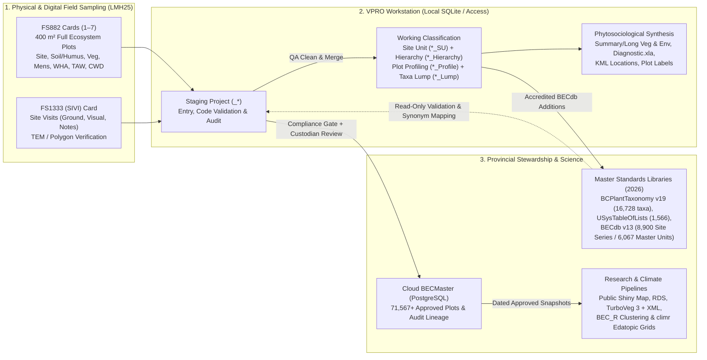

# VPRO Domain Model & Ecological User Personas

> **Navigation:** [Master Index](../00_index.md) | **Present State:** `Domain Model` · [Core Workflows](./core_workflows.md) · [System Architecture](./system_architecture.md) · [Capability Matrix](./capability_matrix.md) · [Data Dictionary](./data_dictionary.md) | **Evidence:** [Citations Index](../04_evidence_and_sources/citations_index.md) · [Decisions & Gaps](../04_evidence_and_sources/decisions_and_gaps.md)

---

## 1. Domain Context: Biogeoclimatic Ecosystem Classification (BEC)

**VPRO (Vegetation Resources Inventory / Plot Management Program)** is the primary plot-data management, taxonomic harmonization, hierarchical site-series classification, and phytosociological reporting workstation for British Columbia's **Biogeoclimatic Ecosystem Classification (BEC)** program and Terrestrial Ecosystem Mapping (**TEM** / **SIBEC**) initiatives (`VProXP_Userguide.pdf` PDF pp. 13–21; `LMH25_2023_web.pdf` PDF pp. 4, 270–272).

In ecological informatics, VPRO occupies the same functional niche for Western North American forest/arctic ecosystems that **TurboVeg** + **JUICE** occupy in European Braun-Blanquet phytosociology (`VProXP_Userguide.pdf` PDF pp. 15, 17; `VproMailExchange` `0031`–`0034`), with specialized domain extensions for:

1. **Climatic & Edaphic Dual-Axis Classification:** Pairing regional climate units (**Biogeoclimatic Zone $\rightarrow$ Subzone $\rightarrow$ Variant $\rightarrow$ Phase**, e.g., `SBS dk 1` or `ICH mc 1a`) with local site soil moisture (**rSMR `0–8`** / actual **aSMR**) and soil nutrient (**rSNR `A–F`**) regimes on the **Edatopic Grid** to delineate **Site Series** (`ZZZZsssvp/##`, e.g., `SBS dk 1 /01`) (`LMH25_2023_web.pdf` PDF pp. 15–22; `VProXP_Userguide.pdf` PDF p. 72).
2. **Multi-Strata Vertical Forest & Arctic Canopy Recording:** Capturing overlapping crown cover across tree (`A1, A2, A3, TotalA`), shrub (`B1, B2, Cover5a..5c [CHARS], TotalB`), herb/dwarf-shrub (`C`), bryophyte/lichen/seedling (`Dh, Dw, Dr`), and epiphyte (`Ep`) strata, where crown overlap makes strata non-additive ($\text{Total } A \le A_1 + A_2 + A_3$) (`LMH25_2023_web.pdf` PDF pp. 104–111; `VPro64.accdb :: Sample_Veg`).
3. **Soil Pedon & Organic Humus Stratigraphy:** Differentiating upland organic horizons (`L, F, H` measured **upward** from the mineral interface `0`, where `UpperDepth > LowerDepth`) from wetland/organic soils (`Of, Om, Oh` measured **downward** from `0`, cross-validated against von Post `1–10`) and mineral horizons (`A, B, C, R, W` measured **downward**) (`LMH25_2023_web.pdf` PDF pp. 68–91).
4. **Dynamic Working vs. Corporate Classification:** Decoupling immutable field plot observations (`<Project>_Env`, `<Project>_Veg`, `<Project>_Humus`, `<Project>_Mineral`) from mutable classification hypotheses (`<Name>_SU` Site Unit tables, `<Name>_Hierarchy` trees, `<Name>_Lump` species-combining tables) while protecting accredited provincial assignments (`<Project>_Admin.BECSiteUnit`) (`VProXP_Userguide.pdf` PDF pp. 21–26, 36–38; `vpro_wails/workingunitservice.go:34-240`).

---

## 2. Core User Personas & Operational Profiles

Cross-referencing the executed contract `RE26OCF433` (`VproMailExchange/vpro_exports/0072.../RE26OCF433 - BEC Data Transfer -for signature.pdf` PDF pp. 10–13), `VProXP_Userguide.pdf` (PDF pp. 36–65), `LMH25_2023_web.pdf`, and `vpro_wails` workflows establishes **three primary operational personas** plus two governance/public boundary roles.

### 2.1 Persona 1: Field Technicians & Data Entry Contractors
* **Representative Actors:** Seasonal ecology field crews, TEM/SIBEC mapping contractors, forest technicians transcribing physical waterproof **FS882** (HRE 2008/03) or **FS1333 SIVI** (HRE 2015/01) cards—or entering offline digital field plots—into staging projects (`RE26OCF433` Schedule A Item `3.a`, Outcome 6; `VProXP_Userguide.pdf` PDF pp. 36, 46–53).
* **Primary Goals:**
  * High-velocity, heads-down keyboard transcription matching the exact spatial layout and field numbering of paper **FS882** (`6-tab` or `2-page` layout) and **FS1333 SIVI** forms without mouse context-switching (`vpro_wails/frontend/src/enterNavigation.ts:1-68`; `VProXP_Userguide.pdf` PDF p. 48).
  * Immediate "as-you-type" feedback on 7/8-character plant codes (`GENUSPP` / `GENUSPP#`), automatic resolution of deprecated taxonomic synonyms (`OldCode -> Code`), and local capture of provisional unknown voucher codes (`Moss1`, `Carex_sp1`) in a personal **User Species List** (`VUser.USysUserSpp`) (`VProXP_Userguide.pdf` PDF pp. 52–53; `vpro_wails/vegetationspeciesservice.go:75-169`).
  * Coordinate entry in whatever notation is printed on the GPS/field card—Decimal Degrees (`DD`), Degrees Decimal Minutes (`DM`), Degrees Minutes Seconds (`DMS`), or `UTM` (`Zone 8–11`, `NAD83`)—with lossless persistence (`LMH25_2023_web.pdf` PDF p. 14; `vpro_wails/frontend/src/HeaderEditor.svelte:1-220`).
  * Attaching and previewing geo-referenced plot photographs (`[PlotNumber]-[label].jpg` / `tblVPics`) and printing physical plot-card folder labels (`VProXP_Userguide.pdf` PDF p. 105; `vpro_wails/plotlabelpdf.go:25-180`).
* **Key Pain Points in Legacy Access:**
  * Accidental creation of duplicate per-stratum species rows or orphan child records if a form closes abnormally (`VPro64.accdb :: Sample_Veg` lacks a composite primary key; `forensics_access_vba` §3.3.3).
  * Re-introduction of ~1 m coordinate drift because legacy VBA DMS converters used 32-bit `Single` intermediates even after `Latitude`/`Longitude` were widened to `Double` (`VPro64_forAI/Modules/V7mdlCoordTools.txt:29`).
  * Unprotected `ESC` or accidental edits overwriting cells unless Plot Locking and transactional Audit Trail are active (`archive/oct2026-parity-ledgers/FS882-6x4XL-access-contract.md:83-155`).

### 2.2 Persona 2: BEC Classification Ecologists, Reviewers & Data Custodians
* **Representative Actors:** Regional Research Ecologists, Provincial BEC Correlators (e.g., Will MacKenzie, Kiri Daust), and QA reviewers curating regional/provincial plot masters (`BECMaster_fixing.accdb` with **71,567 plots** and **1,651,842 vegetation rows**) (`RE26OCF433` Schedule A Items `1.i–iv`, `3.b–h`, `4`; `VPRO_ACCESS_1/VPro64/BECMaster_fixing.accdb`).
* **Primary Goals:**
  * **Compliance & Cross-Table QA:** Validating incoming contractor datasets against provincial code tables (`USysTableOfLists`, `USysAllSpecs`), checking 1-to-many referential integrity, resolving outdated species synonyms across entire projects (`Check Spp Codes`), consolidating split species rows (`Optimize Vegetation`), and reviewing field-level edit histories (`*_Audit`) with selective rollback (`VPro2.0_Functions` PDF p. 11; `VProXP_Userguide.pdf` PDF pp. 58–61; `vpro_wails/speciescodecheck.go:55-160`, `vpro_wails/plotrestore.go:15-180`).
  * **Direct Datasheet / Bulk Grid Editing:** Sorting plot tables directly in spreadsheet/datasheet mode (without form chrome) to spot outliers, copy/paste across records, and perform rapid QA cleaning—explicitly confirmed as mandatory by Will MacKenzie (`VproMailExchange` `0035`, `2026-03-13`: *"YES... Ideally plot data could be edited directly in database"*).
  * **Iterative Classification Synthesis:** Filtering plots via multi-step set-algebra **Plot Profiling** (`Add plots`, `Common plots`, `Subtract plots`, including species-absence `= NULL` queries), assigning plots into working **Site Unit (`*_SU`)** tables, organizing units into phytosociological **Hierarchies (`*_Hierarchy`)**, combining infraspecific/cryptic taxa via **Lump tables (`*_Lump`)**, and synchronizing working classifications (`SU Into Env` / `Env Into SU`) (`VProXP_Userguide.pdf` PDF pp. 62–83, 97–99; `vpro_wails/projectprofiling.go:63-205`).
  * **Publication & Field Guide Authoring:** Generating multi-tab Excel Long/Summary Vegetation and Environment workbooks, running differential species diagnostics (`Diagnostic10.xla` / `BEC_R`), excluding low-quality or `.support`/`.poor`/`.nudum` units, and publishing unit summaries to `BECdb` (`RE26OCF433` Schedule A Items `3.g`, `4.a–e`; `VPro2.0_Functions` PDF pp. 10–16).
* **Governance Sub-Role (BECMaster Custodian):** Holds accredited write privileges to `<Project>_Admin.BECSiteUnit`, provincial code/taxonomy libraries, and controlled staging-to-`BECMaster` merges (`RE26OCF433` Schedule A Items `1.i`, `1.iv`; `vpro/R/plot-crud.R:107-109, 189-198`).

### 2.3 Persona 3: Quantitative Researchers, Modellers & Climate Scientists
* **Representative Actors:** Forest biometricians, climate-change resilience modellers (e.g., **CCISS** — Climate Change Informed Species Selection), academic vegetation scientists, wildlife biologists, and public data consumers (`RE26OCF433` Schedule A Items `1.iii`, `2`, `4.b.iii–iv`, `5`; `VproMailExchange` `0106`, `0031`–`0034`).
* **Primary Goals:**
  * **Bulk Standardized Extraction:** Querying approved `BECMaster` plot snapshots by attribute or spatial polygon and exporting clean relational or matrix datasets in **R `.rds` (long)**, **CSV (long/wide)**, **TurboVeg** (`.sqlite` / `.dbf`), or **VPro SQLite/Access** formats (`RE26OCF433` Schedule A Item `2.iv`; `VPro2.0_Functions` PDF pp. 8–9).
  * **Programmatic Headless Pipelines (`vpro` R & `BEC_R`):** Running reproducible R/DuckDB scripts without GUI interaction to compute BEC pairwise similarity, fuzzy noise clustering (`vegclust`), Bray-Curtis NMDS (`vegan::metaMDS`), dendrograms, indicator species correlations, and Mensuration/Site Index metrics (`RE26OCF433` Schedule A Item `5`; `VPro64/R/VPROTestScriptRK.R`; `vpro/NAMESPACE:3-110`).
  * **Climate & Edatopic Coupling (`climr`):** Joining georeferenced plot coordinates (`Latitude`, `Longitude`, `Elevation`) with downscaled historical/projected climate normals from `climr`, converting climatic moisture deficit (**CMD**) to actual soil moisture regime (**aSMR**), and rendering relative/actual edatopic grids (`RE26OCF433` Schedule A Items `4.b.ii–iv`).

### 2.4 Persona Comparison Matrix

| Dimension | Persona 1: Field Technician / Entry Crew | Persona 2: BEC Ecologist / Reviewer / Custodian | Persona 3: Researcher / Climate Scientist |
|---|---|---|---|
| **Primary Physical/Data Artifact** | Waterproof `FS882(1–7)` & `FS1333 (SIVI)` field cards; plot photos | Staging & Master `.db`/`.accdb` projects, `*_SU`, `*_Hierarchy`, `*_Lump`, `BECdb` | Approved `BECMaster` `.rds`/SQLite snapshots, `TurboVeg`, spatial layers |
| **Typical Dataset Scale** | `10` – `300` plots per field season / contract | `500` – `71,567+` plots across BGC zones/regions | `1,000` – `71,567+` plots province-wide |
| **Connectivity Assumption** | **100% Offline** (field camp / remote district office) | **Hybrid** (offline regional synthesis + cloud sync/merge) | **Online / Programmatic** (RStudio, Posit, Shiny portal, HPC) |
| **Interaction Modality** | Form-centric (`Enter`-key flow, code pickers, 2-page & 6-tab FS882) | Dual-mode: **Direct Datasheet Grid** + Tree/Profile/Report workbenches | Headless R API (`vpro`, `BEC_R`, `climr`), SQL/DuckDB, Map download |
| **Write Permissions** | Read/Write on local staging project + local `VUser.USysUserSpp` | Read/Write on working projects/`SU`/`Hierarchy`; Custodian-gated `BECSiteUnit` & `BECMaster` | Read-Only on approved `BECMaster` snapshots (all downloads logged per `1.v`) |
| **Primary Validation Needs** | Picklist membership, synonym prompts, substrate `=100%`, horizon depth sign | Standards compliance gate (`1.i.1`), duplicate species merge, project diff, audit restore | Taxonomic consistency (`Lump`), `BEC_Use` / `DataQuality` filtering, datum (`NAD83`) accuracy |

---

## 3. Physical Field Card to Digital Domain Mapping (`LMH25` 2015 vs. 2023)

The BC *Field Manual for Describing Terrestrial Ecosystems, 2nd Edition* (`Lmh25_2015.pdf` and `LMH25_2023_web.pdf`) defines **8 standardized field forms** (`LMH25_2023_web.pdf` PDF p. 4). VPRO implements the core ecological plot forms directly in the **VP08** 8-table project model, while specialized forestry/wildlife companion cards were historically split into `VTrees.accdb`, `TemplateVPro03.mdb`, or `VENUS 5.0`:

| LMH25 Sec | Physical Card ID | Domain Scope & Key Field Count (`LMH25_2023_web.pdf`) | Legacy VPro64 Coverage | Modern `vpro` / `vpro_wails` Coverage |
|---|---|---|---|---|
| **Sec 1** | **`FS882(1)` — `SITE`** | **Site Description** (`37` fields, `400 m²` standard plot: Location, NAD83 UTM/Lat-Long, BGC, rSMR `0–8`, rSNR `A–F`, Structural Stage `1–7b`, Slope, Aspect `0–359`/`999`, Disturbance, Exposure, 6 Substrates summing to `100%`; PDF pp. 8–43) | `<Project>_Env` + `<Project>_Admin` via `FS882-6x4XL` & `FS882-8x6XL` | **Implemented** in `vpro` (`R/plot-crud.R`) and `vpro_wails` (`FS882Form.svelte`, `TwoPageEntryEditor.svelte`) |
| **Sec 2** | **`FS882(2)` — `SOIL`** | **Soil Description & Humus** (`34` fields: Bedrock/CF lithology, 2-layer Terrain, CSSC Soil Subgroup/Great Group, 16 Humus Forms, Hydrogeomorphic, Rooting/Drainage/Flooding, Organic Horizons `L/F/H/O`, Mineral Horizons `A/B/C/R/W`; PDF pp. 44–99) | `<Project>_Env` (summary) + `<Project>_Humus` (18 cols) + `<Project>_Mineral` (28 cols) | **Implemented** in `vpro` (`R/plot-soil.R`) and `vpro_wails` (`FS882Form.svelte`, `TwoPageSoilPanel.svelte`) |
| **Sec 3** | **`FS882(3)` — `VEG`** | **Vegetation** (`10` fields + App. 3.1: Tree `A1–A3`, Shrub `B1–B2` [+ CHARS `5a–5c`], Herb `C` incl. 76 dwarf woody spp., Moss/Lichen `Dh/Dw/Dr`, Epiphyte `Ep`, Cover `0.1–100%`, `LL/AF/DC/UT/VI/PV/PG/FFA/NTQ`; PDF pp. 100–117) | `<Project>_Env` (strata totals) + `<Project>_Veg` (44 cols) via `SubVegA/C/D` & `Veg Other` | **Implemented** in `vpro` (`R/plot-vegetation.R`) and `vpro_wails` (`FS882Form.svelte` `veg` + `vegOther` tabs, `TwoPageVegetationPanel.svelte`) |
| **Sec 4** | **`FS882(4)` — `MENS`** | **Mensuration** (`12` fields in 2023: Prism `BAF` `5–16` trees / fixed plot, `DBH`, `Ht`, `Age`, Crown/Tree Class, 8 Pathological Indicators `1–7`, Damage, TAW link; PDF pp. 118–135) | Split out after `VP05` into standalone **`VTrees.accdb`** (`Ver03`: `*_TreePlot` 26 cols, `*_Trees` 41 cols, Kozak taper & SiteTools) | **Metadata fields only** (`MensurationMethod`, `SV_FullCruiseCard`); standalone tree-level tables/UI **not yet ported** (`vpro_wails/projectmetadatafields.go:19-35`) |
| **Sec 5** | **`FS882(5)` — `WHA`** | **Wildlife Habitat Assessment** (`41` fields: Vertebrate habitat suitability `1–6`, Evidence of Use, abbreviated TAW & 30 m CWD; PDF pp. 136–169) | External (`VENUS 4.2/5.0` `tblWildlife*` templates only; not in `VP08`) | **Metadata flag only** (`CollectedWildlifeHabitatAssessment` in `*_Metadata`) |
| **Sec 6** | **`FS882(6)` — `TAW`** | **Tree Attributes for Wildlife** (`17` fields: Standing/fallen wildlife trees, clinometer trig height, bark/crown/wood/lichen/cavity use; PDF pp. 170–183) | Partially captured in `VTrees.accdb :: Sample_Trees` cols `27–33` & `VENUS 5.0` | **Metadata flag only** (`CollectedWildTree` in `*_Metadata`) |
| **Sec 7** | **`FS882(7)` — `CWD`** | **Coarse Woody Debris** (`13` fields: Two orthogonal `24 m` transects, pieces `>7.5 cm`, Decay `1–5`, Tilt, Length, Piling; PDF pp. 184–197) | Legacy `TemplateVPro03.mdb` (`*_CWD`, `*_CWDPiling`), CWD ribbon prototypes (`CWD01..03.xml`), & `VENUS 5.0` | **Metadata flag only** (`CollectedCWD` in `*_Metadata`) |
| **Sec 8** | **`FS1333` — `SIVI`** | **Site Visit Form** (`52` fields: Plot Types `G` Ground, `V` Visual, `N` Notes, `O` Other; Polygon#, Map Label w/ 20 Site Modifiers, Floodplain, Stand Ht/Comp, RZ Texture/CF%, Gleying; PDF pp. 198–221) | `<Project>_Env` (`14` `SV_*` columns + `SiteModifier1/2`) + `<Project>_Admin` (`PlotType`) via `frmSIVIsite` | **Implemented** in `vpro` and `vpro_wails` (`FS882Form.svelte` `siviParent`, `New SIVI / FS1333 Plot`, inline extended shrub toggle) |

---

## 4. Essential Ecological Domain Invariants

Any valid VPRO implementation (desktop, web, or batch R) must preserve seven domain invariants derived from `LMH25_2023_web.pdf`, `VProXP_Userguide.pdf`, and `VPro64.accdb`:

1. **Non-Additive Canopy Cover (`LMH25_2023_web.pdf` PDF pp. 110–111; `V7mdlCreateTables.txt:334-393`):** Individual species covers within a layer and sub-layer covers within a stratum overlap vertically. When aggregating sub-layers (`Cover1..3` $\rightarrow$ `Strata A`, `Cover4..5c` $\rightarrow$ `Strata B`) for reporting, explicit field `TotalA` / `TotalB` estimates **override** summed sub-layers; when `TotalA`/`TotalB` is `NULL`, summed sub-layers are capped at **`99%`**.
2. **Directional Soil Horizon Depth Sign (`LMH25_2023_web.pdf` PDF pp. 71, 79):**
   * Upland Humus (`L, F, H` above mineral soil): `0 cm` is the mineral-organic boundary; `UpperDepth > LowerDepth` (e.g., `L 12–9 cm`, `Fm 9–2 cm`, `Hh 2–0 cm`).
   * Wetland Organic (`Of, Om, Oh`) & All Mineral Horizons (`A, B, C, R, W`): `0 cm` is the surface/mineral top; `UpperDepth < LowerDepth` (e.g., `Ah 0–5 cm`, `Bm 5–20 cm`).
3. **2023 LMH25 Vocabulary Extensions (`LMH25_2023_web.pdf` PDF pp. 6, 29–39, 68, 73, 225–228, 263–267):** Code libraries (`USysTableOfLists` / `USysAllSpecs`) must include 2023 additions—Structural Stages `3c` & `3d`, canopy modifiers `v` (veterans) & `k` (krummholz) on stages `3–7`, Wind disturbance subtypes `A.w.th` & `A.w.br`, Cold aspect exposure `CO`, Subirrigated flood duration `S`, von Post-to-`Of/Om/Oh` cross-checks, and 2022 tree taxonomy (`Yc` *Callitropsis nootkatensis*, `Pa`, `Plc`, `Acx`, `Gp`)—without invalidating historical pre-2023 plots (`vpro_wails/AGENTS.md:134-139`).
4. **Unit-Scoped Mean Cover Standard (`VPro2.0_Functions` PDF pp. 12–13; `V7mdlReportsShortVeg.txt:1357-1399`):** BEC Summary and Long Vegetation statistics standardize on **`By n Plots`** ($\text{Mean Cover} = \sum \text{Cover} / N_{\text{unit plots}}$, treating absences as `0`), retiring the legacy `Characteristic Cover` ($\sum \text{Cover} / k_{\text{present}}$) toggle.
5. **Working vs. Accredited Classification Separation (`VProXP_Userguide.pdf` PDF pp. 44, 65, 74; `FS882-8x6XL.txt:9734`):** `<Name>_SU.SiteUnit` is an analyst's mutable working hypothesis; `<Project>_Admin.UserSiteUnit` persists a plot's working assignment across SU switches (`SU Into Env` / `Env Into SU`); `<Project>_Admin.BECSiteUnit` is the official provincial correlation locked to accredited custodians.
6. **Non-Destructive Taxonomic Lumping (`VProXP_Userguide.pdf` PDF pp. 97–99; `V7mdlLumping.txt:11-92`):** Combining subspecies/varieties (`8-char -> 7-char`) or applying a `<Name>_Lump` table (`SppCode -> LumpCode`) occurs strictly at query/profile/report time and **never mutates** raw field codes in `<Project>_Veg`.
7. **Pre-Merge Staging & Auditability (`VProXP_Userguide.pdf` PDF pp. 36–40; `RE26OCF433` Schedule A `1.i–ii`):** Field plots enter an isolated staging project first, pass mandatory code/integrity validation, record field-level mutations in `<Project>_Audit` (`BeforeEdit`, `AfterEdit`, `User`, `EditWhen`), and undergo project comparison before controlled merge into a regional or provincial master database.
