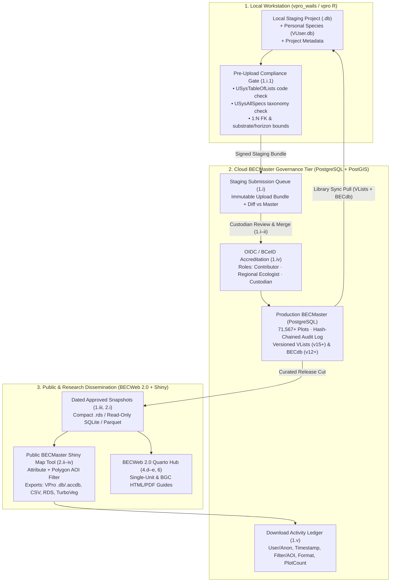
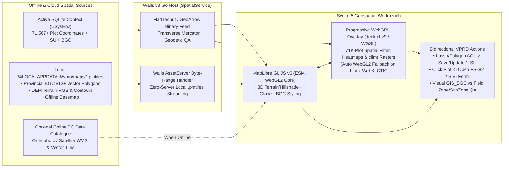
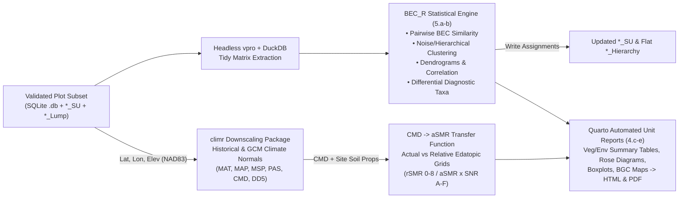

# Data Governance, Spatial Interoperability, Interchange & Climate Analytics

> **Navigation:** [Master Index](../00_index.md) | **Future Architecture:** [Transition & Adoption](./transition_and_adoption.md) · [Next-Gen Entry & OCR](./next_gen_entry_ocr.md) · `Analytics & Governance` · [Target Stack Recommendation](./target_stack_recommendation.md) · [Automations & Abstractions](./intelligent_automation_and_abstractions.md) · [Docs, Help & Release Portal](./documentation_help_and_release_portal.md) | **Related:** [Data Dictionary](../02_present_state/data_dictionary.md) · [Decisions & Gaps](../04_evidence_and_sources/decisions_and_gaps.md)

---

## 1. Provincial Data Governance & Accredited Cloud `BECMaster` Architecture

Legacy VPro relied on emailing `.accdb` files and hardcoding plaintext passwords (`"Del"` in `V7mdlAttachSU.txt:185`, `"MasterMaker"` in `V7mdlCreateTables.txt:545`) or single usernames (`"Will MacKenzie"` in `FS882-8x6XL.txt:9734`). Executed Contract **`RE26OCF433` Schedule A** (`0072` Contract PDF pp. 10–12, Items `1.i–v`, `2.i–iv`, `3.c`, `3.g`) defines a **four-tier governed provincial data pipeline**:

### 1.1 Role-Based Accreditation (`Schedule A 1.iv`, `3.g.ii`)
Replace hardcoded VBA usernames with **BC Gov OIDC (`IDIR` / `BCeID`) JWT claims** mapped to four explicit capability tiers (extending `vpro/R/project-context.R:86-197` `authorize(permission, resource)`):
1. **Public / Anonymous Consumer:** Query and download **approved dated snapshots** only (`2.i`); zero access to unreviewed staging uploads or sensitive/embargoed Red/Blue-listed rare-plant coordinates (`USysSppAttributes.RedBlueList`); every export logged (`1.v`).
2. **Accredited Field Contributor:** Submit validated staging projects (`1.i`) and Project Metadata (`3.c`) to the review queue; pull read-only `VLists` and `BECdb` updates.
3. **Accredited Regional BEC Ecologist:** Propose new/updated classification units into `BECdb` (`3.g.ii`), author regional `*_SU` and flat `*_Hierarchy` tables, and edit unlocked regional plots with mandatory `<Project>_Audit` attribution.
4. **BECMaster Data Custodian:** Approve staging-to-`BECMaster` merges (`1.i–ii`), edit protected fields (`BECSiteUnit`, `BEC_Use`, `GIS_BGC`, `vpro/R/plot-crud.R:107-109`), publish versioned `USysAllSpecs` / `USysTableOfLists` releases, and cut dated public `.rds`/SQLite snapshots (`1.iii`).

### 1.2 Tamper-Evident Audit Trails & Reference Library Versioning
* **Unified Audit & Provenance Ledger:** Retain the `VP08` `<Project>_Audit` table for plot-level rollback compatibility while adding server-side append-only PostgreSQL audit partitions (`txid`, `actor_idir`, `source_bundle_sha256`, `before_jsonb`, `after_jsonb`, `prev_hash`) so merges and rollbacks are cryptographically traceable.
* **Pinned Reference Library Stamps:** Stamp every project's `<Project>_Metadata.AllSpecs` and `TableOfLists` (`Sample_Metadata.sql:56-57`) with semantic library versions (e.g., `PlantSpeciesList_v15_2023-02-01`, `BECdb_v13_2026`), allowing reproducible historical re-runs of `Summary Vegetation` reports even after provincial taxonomy evolves.

---

## 2. Consolidated In-App Geospatial Workbench & Geodetic Governance

Legacy VPro relied on exporting KML 2.1 files and shelling out to `googleearth.exe` (`V7mdlGoogleEarth.txt`, which double-negated signed longitudes `--125.4`) because MS Access had no hardware-accelerated map canvas, while storing `Latitude`/`Longitude` (truncated through 32-bit `Single` DMS intermediates in `V7mdlCoordTools.txt:29`) independently of `UTMZone`/`UTMEasting`/`UTMNorthing`. `vpro_wails` currently implements KML 2.1 preparation (`googleearthkml.go:47-109`) and distinct coordinate review (`plotlocationreport.go`).

In VPRO 2.0, **external KML handoffs are replaced as the primary workflow by a native, offline-first in-app geospatial workbench** satisfying `RE26OCF433` Schedule A `2.iii` (polygon AOI selection), `3.h` (plot & SU spatial visualization), and `4.c.iii` (colour-themed BGC range maps) directly inside `vpro_wails`.

### 2.1 In-App MapLibre GL JS v6 + WebGPU + `PMTiles` Architecture

* **MapLibre GL JS v6 (`v6.17+`, ESM-only):** Integrates directly into `vpro_wails`'s Vite 8 + Svelte 5 bundle without `worker-src blob:` CSP workarounds. Its WebGL2 engine natively renders 3D DEM terrain extrusion/hillshade (replacing Google Earth's 3D slope/aspect/elevation reconnaissance), colour-themed BGC v13 subzone/variant polygons, and tens of thousands of clustered or symbol-coded plots at 60 fps.
* **Progressive WebGPU Acceleration (`deck.gl` v9 / `luma.gl` or Custom WGSL Compute):** Paired atop MapLibre v6 on **Windows (`WebView2` / D3D12)** and **macOS (`WKWebView` / Metal)** for compute-heavy overlays—instant lasso/polygon spatial joins across all `71,567+` `BECMaster` plots, dynamic `climr` climate-surface rendering, and species-prominence heatmaps—while automatically falling back to WebGL2 on Linux `WebKitGTK` where WebGPU support varies by driver.
* **100% Offline Tile Delivery via `PMTiles`:** Provincial BGC boundaries, DEM terrain-RGB, and topographic base layers ship as single-file `.pmtiles` archives served locally via HTTP `Range` requests inside Wails v3's Go `AssetServer`—requiring zero external tile server in remote field camps while seamlessly layering BC Government WMS orthoimagery when online.
* **Bidirectional Classification & Editor Loop:**
  1. **Spatial AOI $\rightarrow$ `*_SU`:** Draw a polygon/lasso or click a BGC polygon on the map to filter `Plots`, feed `Plot Profiling`, or write directly into an active `*_SU` Site Unit table (`Schedule A 2.iii`).
  2. **Map $\leftrightarrow$ Card Sync:** Clicking any plot pin opens or focuses its `FS882Form.svelte` / datasheet row; editing coordinates in `HeaderEditor.svelte` updates the map pin live with 3D terrain aspect/elevation cross-check.

### 2.2 Secondary Spatial Interchange Standards (`GeoPackage`, `Shapefile`, `GeoJSON`, `KML`)

With interactive visualization consolidated inside the app, file exports serve external GIS interoperability (QGIS, ArcGIS Pro, and Public BECMaster downloads):

| Format | Standard / CRS | Role in BEC Ecosystem | Implementation Strategy |
|---|---|---|---|
| **OGC GeoPackage (`.gpkg`)** | **Primary GIS Export** (`EPSG:4326` NAD83/WGS84 or **`EPSG:3005` NAD83 / BC Albers**) | Native SQLite container! Carries full `Env`+`Admin` attributes without 10-char column truncation, optional `Veg`/`Soil` relational tables, and BGC polygon layers in one `.gpkg` file for QGIS / ArcGIS Pro. | Generate directly from Go/SQLite (`gpkg_contents`, `gpkg_geometry_columns`, standard GP binary point headers) or `sf::st_write(..., dsn = "*.gpkg")` in R. |
| **FlatGeobuf / GeoArrow** | Cloud-Native Binary (`EPSG:4326`) | Zero-parse IPC transport between Go `SpatialService` and Svelte 5 MapLibre/WebGPU layers, plus Public BECMaster portal streaming (`Schedule A 2.iii`). | Stream binary buffers directly from SQLite (`USysEnv`) or PostGIS. |
| **ESRI Shapefile (`.shp/.shx/.dbf/.prj`)** | Legacy GIS Interchange (`EPSG:3005` / `EPSG:4326`) | Optional export for forestry licensees on legacy GIS toolchains; note dBase `.dbf` truncates field names to `10` ASCII chars and strings to `254` bytes. | Provide a deterministic `VP08 -> 10-char DBF` column crosswalk dictionary inside a `.zip` bundle alongside `.gpkg`. |
| **Google Earth KML 2.1 (`.kml` / `.kmz`)** | `EPSG:4326` (`lon,lat,elev`) | Retained strictly as a lightweight secondary export (`vpro_wails/googleearthkml.go`); **no longer required** for routine plot/terrain inspection once in-app MapLibre 3D is active. | Already implemented; keep as export-only option under unified `ImportExportService`. |

### 2.3 Geodetic & Spatial QA Rules
1. **Datum & Sign Normalization:** Enforce `NAD83` (`LMH25_2023_web.pdf` PDF p. 14; flag legacy `NAD27` plots via `<Project>_Metadata.Datum == '1'` for NTv2 grid shift before GIS overlay), normalize Western Hemisphere longitudes to signed negative `[-140.0, -114.0]` for BC (`[48.0, 60.0]` N, extended to `[60.0, 84.0]` N for CHARS Arctic plots), and cross-check `UTMZone (8..11)` + `UTMEasting/Northing` against `Latitude/Longitude` via pure-Go Transverse Mercator math (visually flagging discrepancies `> LocationAccuracy` or `> 100 m` directly on the in-app map).
2. **Automated `GIS_BGC` Point-in-Polygon Stamp:** Intersect plot coordinates against local BGC spatial polygons (e.g., `BGC v13` seen in `BECMaster_fixing.accdb`), populating `<Project>_Admin.GIS_BGC` and `GIS_BGC_VER` and visually highlighting mismatches against field-called `Zone` + `SubZone` on the MapLibre canvas.

---

## 3. TurboVeg, R (`.rds`) & Analytical Interchange Architecture

### 3.1 Resolving the `TurboVeg2` vs. `TurboVeg3` Specification (`Emails 0031–0034`, `Schedule A 2.iv.4`) — **Delivered in `v2.0.1`**
Forensic analysis of `VPro64_forAI/Modules/V7mdlTurboVeg.txt` revealed that legacy VPro 64 only wrote a Juice CSV matrix (`MakeJuiceFile`), while TurboVeg author Stephan Hennekens confirmed (`VproMailExchange` `0033`, `0031`) two distinct target architectures:
* **TurboVeg 3 (`Turboveg3` — Primary Modern Target):** Official **31-table SQLite** single-file database (`https://www.synbiosys.alterra.nl/turboveg3/`), removing dBase 8-character/254-byte limits and avoiding unregistered Turboveg3's 250-plot export cap when VPro writes the SQLite target directly.
* **TurboVeg 2 / JUICE Compatibility (`Plot_package` XML):** **TurboVeg XML** (`<Plot_package>`) is natively imported and exported by **TurboVeg 2**, **TurboVeg 3**, and **JUICE** without dBase `.dbf` truncation.

**Implemented Dual-Target Adapter (`internal/interchange/turboveg_sqlite.go` & `turboveg_xml.go`, `266921e`):**
1. Ships **both** official **31-table TurboVeg 3 SQLite** export/import (including calibrated Delphi `TDateTime` `1899-12-30` epoch encoding, WKT `POINT(lon lat)` geometry, GUIDs, header/remarks/abundance tables, and species dictionary crosswalks) **and** universal **TurboVeg `Plot_package` XML** export/import (handling UTF-8 and Windows-1252/ISO-8859-1 encodings plus Braun-Blanquet cover-scale midpoints)—eliminating format lock-in regardless of which version external phytosociologists run.
2. Maps VPro's 10+ layers cleanly via an explicit layer crosswalk (`1..3/TotalA -> Tree`, `4..5c/TotalB -> Shrub`, `6 -> Herb`, `7..9 -> Moss/Cryptogam`, `10 -> Epiphyte`), preserving exact IEEE-754 `float32` `% Cover` values and transactional `<Project>_Audit` records on import without legacy `MakeJuiceFile`'s lossy integer quantization (`V7mdlTurboVeg.txt:115-130`).

### 3.2 Native R `.rds` (Long) & Wide/Long CSV Interchange (`Schedule A 1.iii, 2.iv.2–3`, `VPro2.0_Functions` p. 8) — **Delivered in `v2.0.1`**
* **CSV Long & Wide (`internal/interchange/csvmatrix.go`, `tablecsvbundle.go`):** Provides user-selectable **Long Tidy CSV** (`PlotNumber, SiteUnit, Layer, Species, Cover, Height`) and **Wide Plot-by-Species Matrix CSV** alongside raw 8-table archival Store `.zip` bundles.
* **R `.rds` (Long Format, `internal/interchange/rdsexport.go`):** Pure-Go R Serialization Format v2/v3 `.rds` writer generating compressed typed `data.frame` bundles (`env`, `admin`, `veg_long`, `humus`, `mineral`, `su`, `metadata`) directly on machines without R installed, complemented by native `vpro` `v2.0.0` R SDK WAL readers.

---

## 4. Climate (`climr`), Edatopic Grids & `BEC_R` Classification Pipeline

Contract `RE26OCF433` Schedule A Items `4.b.ii–iv`, `4.c–e`, and `5.a–b` elevate VPRO from passive data storage to an integrated **climate-edaphic classification engine** (`Links for BEC data systems.md` `L009–L022`):

* **Replacing `Diagnostic10.xla` (`Schedule A 4.a.i`):** Formalize the BEC inside/outside differential species rules (`d`, `dd`, `cd`, `c`, `ic` from `VPro64_forAI/Modules/V7mdlDiagnostic.txt:57-170` and `vpro/R/diagnostic-classification.R`) inside `BEC_R` so differential highlighting is written directly into `excelize` `.xlsx` workbooks **and** Quarto HTML/PDF unit guides—while maintaining optional `Diagnostic10.xla` macro compatibility for legacy Excel reviewers.
* **Dynamic Edatopic & Climate Summaries (`Schedule A 4.b.ii–iv`):** Couple plot coordinates and elevation with `climr` to attach plot-level climate variables, compute relative `(rSMR, rSNR)` plot-count heatmaps by BGC unit, transform Climatic Moisture Deficit (`CMD`) + water-holding capacity/seepage into actual Soil Moisture Regime (`aSMR`), and render publication-ready single-unit (`4.d`) and multi-unit BGC (`4.e`) reports via Quarto.
