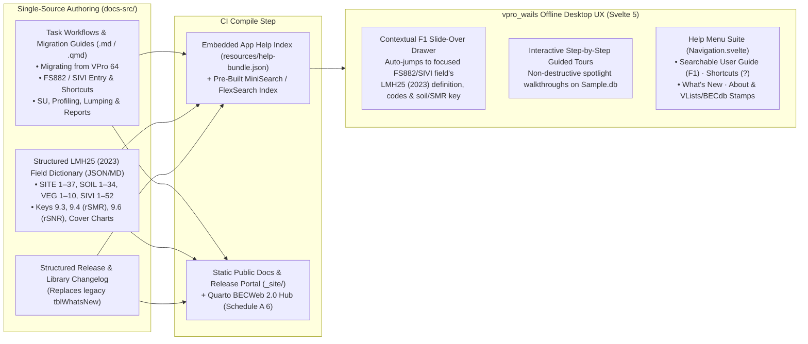
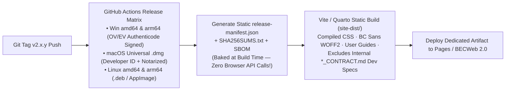

# In-App Contextual Help, Guided Onboarding & Official Release Portal Architecture

> **Navigation:** [Master Index](../00_index.md) | **Future Architecture:** [Transition & Adoption](./transition_and_adoption.md) · [Next-Gen Entry & OCR](./next_gen_entry_ocr.md) · [Analytics & Governance](./analytics_and_governance.md) · [Target Stack Recommendation](./target_stack_recommendation.md) · [Automations & Abstractions](./intelligent_automation_and_abstractions.md) · `Docs, Help & Release Portal` | **Related:** [Capability Matrix](../02_present_state/capability_matrix.md) · [Decisions & Gaps](../04_evidence_and_sources/decisions_and_gaps.md)

---

## 1. Historical Deficit Audit & `v2.0.1` Resolution Summary

Cross-examining legacy `VPro64` documentation assets against the October 2026 `vpro_wails` baseline (`51d29cf`) identified two user-facing delivery gaps—**both now remediated in Wave 5 (`2928fd7`, `8182ee7`, `aa99f9e`, `56d4062`)**:

### 1.1 Pre-Wave 5 In-App Help Deficit $\rightarrow$ Resolved in `HelpService` (`8182ee7`)
* **Legacy Baseline (`VPro64`):** Shipped compiled offline HTML Help (`VPro.chm`), **26 task-specific PDF/DOCX guides** (`VPro64/Helpfiles/`), `F12` contextual help (`Macros/AutoKeys.txt`), inline `LMH25` code legends on data-entry tabs (`Veg Other`), `About VPro` (`USysAbout`), and a 48-entry startup `What's New` log (`tblWhatsNew`).
* **Pre-Wave 5 State (`51d29cf`) $\rightarrow$ `v2.0.1` Production State:** Formerly a single disabled `What's New` stub; now ships a full **100% offline `HelpService` + `HelpDrawer.svelte` + `OnboardingTour.svelte`** compiled from `docs-src/*.json` into embedded `resources/help_bundle.json` (context-sensitive `F1` `LMH25 (2023)` field inspector, 4 guided tours, `?` keyboard shortcut cheat-sheet, `What's New` unread counter, lock-safe `Reset Workspace to Sample`, and `About VPro & Standards Libraries`).

### 1.2 Pre-Wave 5 Deployment Portal Audit $\rightarrow$ Resolved in `site/` (`aa99f9e`, `56d4062`)
The October 2026 draft page (`docs/index.html` @ `51d29cf`) had five production defects, all resolved in the current **`site/` $\rightarrow$ `site/dist` BC Gov Design System portal** deployed by `.github/workflows/pages.yml`:
1. **Compiled CSS & Self-Hosted `BC Sans` WOFF2 (Play CDN Eliminated):** Removed runtime `cdn.tailwindcss.com` and consumer emojis in favor of self-hosted `BCSans-*.woff2` + `ibm-plex-mono-*.woff2` (`site/fonts/`) and compiled BC Gov Design System CSS (`#003366` BC Navy, `#FCBA19` Gold).
2. **Accurate `VPro` & `vuser.ca` Branding:** Corrected product identity to **`VPro`** (*VENUS — Vegetation and Environment NexUS — Professional*), historical lineage to **`VPro 64` (`vuser.ca`)**, macOS bundle to **`VPro.app`**, and embedded the official 9-clause `BECWeb` Data Use Agreement (`docs-src/data_use_agreement.json`).
3. **Zero-Rate-Limit Static `release-manifest.json` (`scripts/release.py sync-release-manifest`):** Eliminated browser `api.github.com` calls (`60 req/hr` corporate NAT exhaustion), hydrating `site/release-manifest.json` at CI build time with populated `<noscript>` direct download links and copyable SHA-256 badges (`v2.0.1` published `2026-11-13`).
4. **Isolated Public Artifact (`site/dist` vs. `archive/oct2026-parity-ledgers/`):** `.github/workflows/pages.yml` uploads strictly `site/dist`, keeping archived engineering contracts out of GitHub Pages.
5. **Phase 1 Unsigned Checksum Policy (`D-02`) & Phase 2 Code Signing Option:** Phase 1 installers publish unsigned (`"unsignedNotice": true`) with explicit `SHA256SUMS.txt` verification; optional OV/EV Authenticode and Apple Developer ID notarization remain ready to enable once funded by BC Gov / MoF.

---

## 2. Single-Source Documentation & Offline In-App Help Architecture

To eliminate drift between web documentation (`BECWeb 2.0` / Release Portal) and offline field laptops, VPRO 2.0 adopts a **Single-Source Markdown/Quarto Pipeline** feeding both the static website and an embedded, 100% offline **In-App Help & `LMH25` Reference Drawer**:

### 2.1 Four Core In-App Help Capabilities (`HelpService` + `HelpDrawer.svelte`)

1. **Context-Sensitive `F1` Field & `LMH25 (2023)` Inspector (`100% Offline`):**
   * Bind a `data-help-id` attribute (e.g., `site.moisture_regime`, `humus.upper_depth`, `veg.cover6`, `sivi.plot_type`) to every input in `HeaderEditor.svelte`, `FS882Form.svelte`, `TwoPageEntryEditor.svelte`, and report option panels.
   * Pressing **`F1`** (or clicking the subtle `?` icon on any section header) opens a non-modal right-hand **Help Drawer** pinned directly to that field's **`LMH25 (2023)`** specification: field number, measurement unit, valid picklist codes (`USysTableOfLists`), directional rules (e.g., upward upland humus depth `12 -> 9 cm`), interactive `rSMR`/`rSNR` decision keys (`Keys 9.3–9.6`), and the visual `% Cover` comparison chart (`LMH25_2023_web.pdf` p. 274).
2. **"Coming from VPro 64" Interactive Guided Tours (`OnboardingTour.svelte`):**
   * Ship **four 90-second interactive spotlight walkthroughs** running safely against `Sample.db`:
     * *Tour 1 — Session & Access Import:* Left `#project-context` sidebar (replaces floating `Data Centre`) + importing `.mdb`/`.accdb` (`VP05`–`VP08`) into SQLite.
     * *Tour 2 — Fast Card & Datasheet Entry:* `Enter`-key horizontal field vs. vertical subgrid navigation, `NotInList` synonym prompts, CHARS layer toggle, and direct Datasheet Grid editing.
     * *Tour 3 — Classification & Plot Profiling:* Building sequential `Env/Veg/Lump` rules, `SU Into Env` / `Env Into SU`, and dual-pane `SU`/`Hierarchy` tree assignment.
     * *Tour 4 — In-App 3D Map, Diagnostics & `.xlsx` Workbooks:* MapLibre 3D terrain/BGC QA, live differential diagnostics, and publishing `.xlsx`/`.gpkg`/TurboVeg outputs.
3. **Keyboard Shortcut Overlay (`Ctrl+/` or `?`):** Instant modal cheat-sheet listing every keyboard accelerator (`Enter`, `Shift+Enter`, `Ctrl+Tab`, `Ctrl+F` Find Plot, `Ctrl+S` Save, `F1` Field Help, `Esc` revert).
4. **Functional `Help` Menu (`Navigation.svelte:78`):**
   * `VPRO User Guide & LMH25 Reference (F1)`
   * `Interactive Walkthroughs`
   * `Keyboard Shortcuts (?)`
   * `What's New / Release Notes` (highlighting unread updates since last launch, preserving `VPro64` `frmWhatsNew` behavior)
   * `Reset Workspace to Sample` (safe non-destructive recovery, replacing Orange-marked `Set all to Sample` on `VPro2.0_Functions` p. 19)
   * `About VPRO & Standards Libraries` (displays exact app build SHA, SQLite schema `VP08`, active `VLists` species list version/hash, `BECdb` version, and support contact).

---

## 3. Official BC Government-Standard Release & Documentation Portal

### 3.1 Visual Design System & Institutional Polish (`@bcgov/design-tokens`)
To replace `vuser.ca` (`http://vuser.ca/vpro64/index.htm`) and unify seamlessly with **`BECWeb 2.0` (`RE26OCF433` Schedule A `6`)**, the public release and documentation portal must adhere to the **BC Government Digital Design System** (` WCAG 2.1 AA+`):

| Design Token / Element | Specification | Replaces in Draft `docs/index.html` |
|---|---|---|
| **Typography** | **`BC Sans`** (`@bcgov/bc-sans` self-hosted WOFF2) for UI/headings + **`IBM Plex Mono`** for checksums, CLI snippets, and BEC codes (`SBS dk 1 /01`). | System generic sans + uncompiled CDN styles. |
| **Color Palette** | **BC Navy (`#003366`)** primary header/authority bar with **BC Gold (`#FCBA19`)** `2px–4px` bottom rule; **Surface White (`#FFFFFF`)** & **Light Neutral (`#F2F2F2`)**; **Text (`#313132`)**; **Semantic Status** (`#2E8540` Verified/Success, `#FCBA19` Advisory, `#D8292F` Alert); subtle forest accent (`#1E5128`) reserved strictly for BEC program secondary badges. | Consumer emerald gradients & Tailwind Play CDN. |
| **Iconography & Tone** | Clean monochrome **Lucide / official platform SVG icons** (Windows, Apple, Linux, Checksum Shield, Book, Map); **zero emojis**; authoritative plain-language government technical writing. | Emojis (`🌲 🪟 🍎 🐧`) & `"Wails Edition"` internal naming. |
| **Branding & Crest Governance** | Official product name **`VPro`** (*VENUS — Vegetation and Environment NexUS — Professional*), branded for **B.C. Ministry of Forests, Research Branch — Biogeoclimatic Ecosystem Classification (BEC) Program** (`https://www.for.gov.bc.ca/hre/becweb/`). Fix historical copy to **`VPro 64`** & **`vuser.ca`**, and embed the official 9-clause **MoF BEC Data Use Agreement & citation block** (`BECWeb/resources/information-requests/Data-request-use.html`) on public dataset downloads. | Inaccurate `"VPRO 6.x & vprouser.ca"`, `"Wails Edition"`, & generic footer. |

### 3.2 Zero-Rate-Limit Static Release Architecture & Code Signing

1. **Eliminate Runtime `api.github.com` Calls (`release-manifest.json`):**
   * During `.github/workflows/release.yml`, generate a signed static **`release-manifest.json`** (containing latest stable version, optional preview/RC channel metadata, exact byte sizes, release dates, direct asset URLs, SHA-256 digests, and bundled `VLists`/`BECdb` versions) and commit/inject it into the static site build.
   * Result: **Zero `60 req/hr` IP rate-limiting** on `gov.bc.ca` networks, instant first-paint rendering with `<noscript>` static fallback links already populated in HTML, and clean support for both **Preview/RC** and **Stable** channels during client UAT (`Email 0003`).
2. **Isolate Public Site Source (`site/` vs. `docs/`):**
   * Move internal engineering parity specs (`docs/*_CONTRACT.md`, `MIGRATION_EVIDENCE.md`) out of the published web root; compile the portal with Vite/Tailwind CLI (or Quarto) into `site/dist` and upload *only* `site/dist` in `.github/workflows/pages.yml` (removing `enablement: true` once Pages is configured in repo settings to prevent `HTTP 403/404` deploy failures).
3. **Enterprise Code Signing & Trusted Installers:**
   * **Windows (`amd64` & `arm64`):** Sign both `vpro.exe` and the NSIS installer via **Azure Trusted Signing / OV-EV Authenticode** so BC Government Windows 11 Defender SmartScreen & AppLocker trust the installer without command-line workarounds.
   * **macOS (`Universal .dmg`):** Rename bundle from `vpro-wails.app` to **`VPRO.app`**, sign with Apple `Developer ID Application`, and `xcrun notarytool` staple so Gatekeeper opens cleanly on first click.
4. **Rich Release Portal Information Architecture:**
   * **Hero & One-Click Smart Download:** Auto-detected OS/arch primary installer button + file size, release date, bundled **Provincial Species List (`v15+`) / `BECdb (`v12+`)** stamps, and one-click copyable SHA-256 badge.
   * **"Migrating from VPro 64" Quick-Start Strip:** 3 visual cards (*1. Install VPRO 2.0 — No Access Runtime Needed*, *2. Import Existing `.accdb`/`.mdb` Projects*, *3. Sync Standards & Export Reports*).
   * **Searchable Online Documentation & `LMH25 (2023)` Field Reference:** Same content as the in-app `F1` drawer, deep-linkable by URL for email/Teams support.
   * **Version Archive & Changelog Ledger:** Clean tabular release history (mirroring the clarity ecologists valued on `vuser.ca`, upgraded to modern government standards) plus direct links to `BECWeb 2.0` and the Public `BECMaster` map portal.
