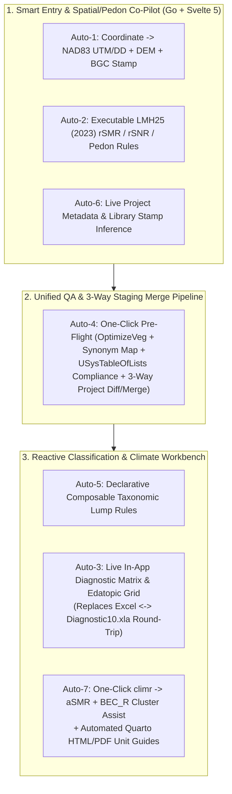
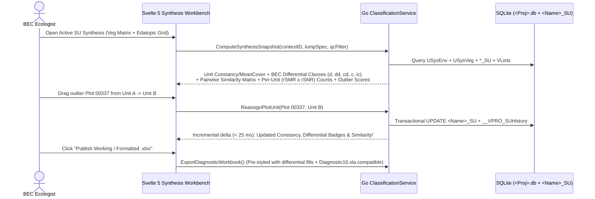

# Intelligent Domain Automations & Higher-Level Abstractions Blueprint

> **Navigation:** [Master Index](../00_index.md) | **Future Architecture:** [Transition & Adoption](./transition_and_adoption.md) · [Next-Gen Entry & OCR](./next_gen_entry_ocr.md) · [Analytics & Governance](./analytics_and_governance.md) · [Target Stack Recommendation](./target_stack_recommendation.md) · `Automations & Abstractions` · [Docs, Help & Release Portal](./documentation_help_and_release_portal.md) | **Related:** [Capability Matrix](../02_present_state/capability_matrix.md) · [Data Dictionary](../02_present_state/data_dictionary.md)

---

## 1. Engineering Intent: Implementation-Ready Specifications for VPRO Finalization

Legacy VPro 64 forced ecologists and field technicians to execute multi-step manual choreography across MS Access forms, standalone validation dialogs, Excel `.xla` macros (`Diagnostic10.xla`), Google Earth, and external R scripts.

This document specifies **seven concrete, evidence-backed automations and higher-level abstractions** designed directly for implementation in **`boostao/vpro_wails`** (Go `1.25` + Svelte `5` + SQLite) and **`boostao/vpro` / `BEC_R`**. Every automation **suggests or previews non-destructively first**, preserving user control and recording accepted writes through `<Project>_Audit`.

---

## 2. Automation 1: Coordinate-Driven Geodetic, Administrative & DEM Auto-Attribution

* **Manual Pain Eliminated:** Legacy `V7mdlCoordTools.txt` had zero `UTM <-> Lat/Lon` projection math, truncated DMS through `Single` floats (`~1 m` error), and required users to manually look up `GIS_BGC`, `Ecosection`, `FSRegionDistrict`, `NtsMapSheet`, `Elevation`, `SlopeGradient`, and `Aspect`.
* **Target Touchpoints in `vpro_wails`:** `coordinateservice.go`, `SpatialService` (`internal/spatial/`), `frontend/src/entry/CoordinateFields.svelte`, and MapLibre `PMTiles` layers.
* **Implementation Contract:**
  1. **Bidirectional `NAD83` Projection (`EPSG:4269` $\leftrightarrow$ `EPSG:26907..26911`):** Entering `Latitude`/`Longitude` (`DD`, `DM`, or `DMS`) automatically computes `UTMZone (7..11)`, `UTMEasting`, and `UTMNorthing` (and vice versa). If both are entered from a paper card and diverge by `> max(LocationAccuracy, 50m)`, render an inline geodetic warning badge + dual pins on the MapLibre canvas.
  2. **Point-in-Polygon Administrative & BGC Stamp (`SuggestSpatialAttributes(lat, lon)`):** Query local `.pmtiles` / R-tree index (`BGC v13+`, BC Ecosections, Natural Resource Regions/Districts, BCGS 1:20k MapSheet grid) to offer one-click population of:
     * `
_Admin.GIS_BGC` & `GIS_BGC_VER` (and flag mismatch if field `
_Env.Zone + SubZone != GIS_BGC`)
     * `
_Env.Ecosection` (`Text 3`), `
_Env.FSRegionDistrict` (`RCB.DMH`, etc., `LMH25_2023_web.pdf` App. 1.1 p. 42), `
_Env.NtsMapSheet` (`93H015`), and `
_Admin.ProvinceStateTerritory`.
  3. **DEM Terrain Cross-Check:** Sample local Terrain-RGB `.pmtiles` at `(lat, lon)` to display expected `Elevation (m)`, `Slope (%)`, and `Aspect (0–359°)` next to card inputs—catching transposed digits (e.g., `1850 m` vs `1580 m` or North/South aspect inversions) immediately.

---

## 3. Automation 2: Executable `LMH25 (2023)` Edatopic & Pedon Rule Engine

* **Manual Pain Eliminated:** Walking paper Keys `9.3`, `9.4`, and `9.6` (`LMH25_2023_web.pdf` PDF pp. 225–228) and Table `2.23` (`p. 73`) by hand, plus manual summation of `HumusThickness`, `StrataCoverTotal`, and `Substrate*`.
* **Target Touchpoints:** New Go package `internal/lmh25rules/` exposed via `PlotEntryService.EvaluatePlotDiagnostics(draft)` + non-blocking suggestion chips in `HeaderEditor.svelte` and `FS882Form.svelte`.
* **Deterministic Rule Set:**
  1. **Auto-Calculated Derived Fields (Live on Draft Change):**
     * `
_Admin.HumusThickness`: Computed automatically from `
_Humus` upland `L/F/H` horizons ($\max(\text{UpperDepth}) - \min(\text{LowerDepth})$ above `0 cm`) unless explicitly overridden by custodian.
     * `
_Admin.StrataCoverTotal` & `Substrate` Sum Bar: Live `0–100%` progress bar across all 6 `Substrate*` fields (`LMH25_2023_web.pdf` pp. 40–41: must equal `100%` when any non-null substrate is present).
  2. **Soil Horizon Consistency Checks (`
_Humus` & `
_Mineral`):**
     * **Directional Sign:** Enforce `UpperDepth > LowerDepth` on upland `L/F/H` horizons vs. `UpperDepth < LowerDepth` on `Of/Om/Oh` (when `SoilClassGroup` is in Organic Order `F, M, H, FO`) and all mineral `A/B/C/R/W` horizons (`LMH25_2023_web.pdf` pp. 71, 79).
     * **Contiguity:** Flag gaps or overlaps where `Horizon[i].LowerDepth != Horizon[i+1].UpperDepth`.
     * **von Post Cross-Check (`Table 2.23`, p. 73):** Flag if `Horizon` starts with `Of` and `vonPost NOT IN (1..4)`, `Om` and `vonPost NOT IN (5..6)`, or `Oh` and `vonPost NOT IN (7..10)`.
  3. **Live `rSMR (0–8)` & `rSNR (A–F)` Key Inference (`Keys 9.3, 9.4, 9.6`, pp. 225–228):**
     * Evaluate `MesoSlopePosition` (`CR, UP, MD, LW, TO, DP, LV`), `SlopeGradient`, `Aspect` (insolation vs. cold aspect), `SeepageDepth` / `WaterSource`, `SoilDrainage`, `RootRestrictingDepth`, `SV_SoilDepth`, `RootZoneParticleSize` / `PercentCoarseFragsTotal`, `HumusForm` (`Mor` vs. `Moder` vs. `Mull`), `Ah` presence/depth, and Munsell Value (`B value <= 3` dark vs. `>= 7` light) to display a **"Keyed rSMR / rSNR"** badge beside the field-called values—highlighting plots where field calls diverge by $\ge 2$ classes.

---

## 4. Automation 3: Reactive In-App Diagnostic & Edatopic Synthesis Workbench

* **Manual Pain Eliminated:** Retires the multi-application loop: *Export Summary Veg `.xlsx` $\rightarrow$ launch Excel $\rightarrow$ load `Diagnostic10.xla` (`EA6EF4E1...`) $\rightarrow$ run Pairwise/Differential macros $\rightarrow$ manually switch back to VPro to reassign outlier plots in `*_SU` $\rightarrow$ re-export* (`RE26OCF433` Schedule A `4.a.i`, `4.b.ii`).
* **Target Touchpoints:** New `ClassificationSynthesisView.svelte` + Go `ClassificationService` (`internal/diagnostics/` porting `V7mdlDiagnostic.txt:57-170`, `Diagnostic10.xla :: mdlPairwise.bas`, and `vpro/R/diagnostic-classification.R`).

* **Built-In Outlier & Misplacement Detector:** Automatically compute each plot's **chord/Sørensen similarity to its assigned `SiteUnit` centroid vs. nearest rival `SiteUnit`** (`Diagnostic10.xla :: Similarity.bas` `(LowestTotal * 2) / GrandTotal`), surfacing a sorted **"Candidate Misplaced Plots"** queue so ecologists can review the top 5% anomalous plots immediately.

---

## 5. Automation 4: One-Click "Pre-Flight QA & 3-Way Project Merge" Pipeline

* **Manual Pain Eliminated:** Consolidates **five separate legacy manual workflows** (`ValidateEnvData`, `Check Spp Codes`, `OptimizeVeg`, `CompareTwoProjects`, and `USysMerge` — `VPro2.0_Functions` PDF pp. 5, 11; `RE26OCF433` Schedule A `1.i–ii`) into a single deterministic, transactional wizard.
* **Target Touchpoints:** `ValidationService` + `ProjectMergeService` in `vpro_wails` (porting `vpro/R/environment-validation.R`, `integrity-validation.R`, `vegetation-duplicates.R`) + Cloud `BECMaster` upload endpoint.
* **Four-Step Automated Pipeline (`RunProjectPreflightAndDiff`):**
  1. **Schema & FK Integrity Check:** Detect orphan `_Veg`, `_Humus`, `_Mineral`, `_Other`, `_Audit` rows (`PlotNumber NOT IN _Env`) and missing 1:1 `_Admin` rows; quarantine or repair transactionally.
  2. **Safe Transactional `OptimizeVeg` & Duplicate Resolution:** Group split multi-row species entries `(PlotNumber, Species)` across sub-layers inside a `SAVEPOINT` (fixing legacy `CombineSppCovers` bug that summed `Height6` instead of `Max(Height6)` in `V7mdlSpellCheck2020.txt:185`), previewing exact before/after row counts.
  3. **Standards & Taxonomy Gate (`Schedule A 1.i.1`):** Validate all `USysTableOfLists` (`Validate = Yes`) columns, numeric bounds, and `USysAllSpecs` codes—offering one-click batch `OldCode -> Code` synonym upgrade and packaging any remaining unknown codes from `VUser.USysUserSpp` into an attached `UserSpeciesManifest`.
  4. **Plot & Cell-Level 3-Way Diff (`Compare & Merge`):** When merging `Staging.db` into `Master.db` (or PostgreSQL `BECMaster`), categorize every plot as `Added`, `Identical`, `Modified (Fast-Forward)`, or `Field-Level Conflict`, rendering a side-by-side diff table with per-plot/per-field `Accept Source` / `Keep Target` controls and atomic `<Project>_Audit` attribution.

---

## 6. Automation 5: Declarative, Rule-Based Taxonomic Lumping (`LumpSpec`)

* **Manual Pain Eliminated:** Manually maintaining hundreds of static `SppCode -> LumpCode` rows in `<Name>_Lump` (`USysLumpMaster`) that silently go stale whenever new species or subspecies enter a project (`VProXP_Userguide.pdf` PDF pp. 97–99; `Schedule A 3.b`).
* **Target Touchpoints:** New `LumpEditor.svelte` + Go `ClassificationService` (`internal/lumping/`).
* **Higher-Level Abstraction:** Alongside classic `<Name>_Lump` table CRUD (for full backward compatibility), support **Declarative Lump Recipes** compiled into a cached SQLite view at query/report time:
  * `collapse_infraspecific: true` — Folds all 8-char subspecies/varieties (`Right(Code,1) IN ('1'..'8')`) to their 7-char parent species (`V7mdlLumping.txt:11-50`).
  * `collapse_seedling_and_dead_suffixes: true` — Optionally folds `_D` (seedling in moss layer) and `_X` (dead standing) codes (`VLists` 2017/2020 additions) into parent species.
  * `genus_rollups: ["CARE*", "SALI*", "SPHA*", "CLAD*"]` — Rolls specified genera or lifeforms (`Lifeform IN (9,10,11)` non-vasculars) to 8-letter upper-taxa codes (`YearOfChange = '2022'` in `USysAllSpecs`).
  * `preset: "BEC_Provincial_Correlation_2026"` — Versioned, cloud-synced standard lump profiles curated in `BECMaster`.

---

## 7. Automation 6: Live Auto-Derived Project Metadata (`Schedule A 3.c.ii`)

* **Manual Pain Eliminated:** Hand-counting FS882 vs. SIVI plots, date ranges, regions, and collection completeness across 75 `<Project>_Metadata` columns (`Sample_Metadata.sql:2-85`).
* **Target Touchpoints:** `ProjectMetadataEditor.svelte` (`"Auto-Populate from Plots & Standards"` action mandated by `RE26OCF433` Schedule A `3.c.ii`).
* **Exact SQLite Aggregation Rules (Per `ProjectID`):**
  * `StartDate` / `EndDate`: `MIN(CAST(strftime('%Y', Date) AS INTEGER))` / `MAX(...)` from `
_Env`.
  * `NumberOfFS882Plots` vs. `NumberOfSiteVisits`: Count plots grouped by `
_Admin.PlotType` (`'FS882'`/`'Full'` vs. `'Ground'`/`'Visual'`/`'Note'`).
  * `GeographicStudyRegion`: Distinct `FSRegionDistrict` prefixes mapped via `region-codes.db`.
  * `CollectedSite`, `CollectedVeg`, `CollectedSoil`, `CollectedTerrain` (`1=Complete, 2=Partial, 3=None`): Inferred from % of plots in `ProjectID` having populated `_Env`, `_Veg` (`SpeciesListComplete`), `_Humus`/`_Mineral`, and `SurficialMaterialSurf` rows.
  * `AllSpecs` & `TableOfLists`: Auto-stamped from active `VLists.db` `_table_metadata` version description + SHA-256 short digest.
  * **Standards Preset Templates:** One-click presets (`LMH25 (2023) Standard FS882`, `LMH25 FS1333 SIVI Ground`, `DEIF 1980 Historical`, `CHARS Arctic`) filling `EcosysCollectionStandard`, `VegCoverMethod`, `PlotMethod`, `Datum ('2' = NAD83)`, and all 15 `Cover*Description` columns (`A1..Cover10`).

---

## 8. Automation 7: Integrated `climr` $\rightarrow$ `aSMR` + `BEC_R` Classification & Report Pipeline

* **Manual Pain Eliminated:** Exporting CSVs by hand, running standalone R scripts for climate normals, manually converting CMD to aSMR, copying cluster memberships back into `*_SU`, and assembling Word/PDF unit descriptions (`RE26OCF433` Schedule A `4.b.iii–iv, 4.c–e, 5.a–b`).
* **Target Touchpoints:** `vpro_wails` R Sidecar / Cloud Job Runner (`Target Stack Recommendation` §4.3) invoking `vpro` + `BEC_R` + `climr` + Quarto.
* **End-to-End Automated Workflow:**
  1. **Cached Plot Climate Table (`__VPRO_PlotClimate` in `<Project>.db`):** Given `(PlotNumber, Latitude, Longitude, Elevation)`, batch-fetch downscaled `climr` historical (`1961–1990`, `1991–2020`) and GCM normals (`MAT, MWMT, MCMT, MAP, MSP, PAS, CMD, DD5, NFFD`) once and cache locally keyed by coordinate hash.
  2. **Automated `CMD -> aSMR` & Dual Edatopic Grids (`Schedule A 4.b.ii, 4.b.iv`):** Combine cached `CMD` with plot `MoistureRegime (rSMR)`, `SeepageDepth`, `SoilDrainage`, and `RootZoneParticleSize` via the Ministry `CMD -> aSMR` transfer function to render side-by-side **Relative `(rSMR × rSNR)`** and **Actual `(aSMR × rSNR)`** heatmaps per BGC unit.
  3. **Assisted `BEC_R` Clustering $\rightarrow$ Candidate `*_SU` (`Schedule A 5.b.i–iv`):** Run `vegclust` noise clustering / hierarchical clustering / indicator correlation from inside VPRO and materialize results directly as a reviewable **`<Name>_ClusterCandidate_SU`** table + interactive dendrogram—never overwriting the user's active `*_SU` without confirmation.
  4. **Single-Command Quarto Unit & BGC Publication (`Schedule A 4.c–e`):** Render single-unit (`4.d`) or full-BGC (`4.e`) HTML & PDF guides combining formatted Veg/Env summary tables, BGC range map, edatopic grids, aspect rose diagram, site boxplots, and authored narrative markdown.

---

## 9. Implementation Status & Production Package Mapping (`v2.0.1`)

All seven automations are **implemented and verified** across `boostao/vpro_wails` (`v2.0.1`) and `boostao/vpro` (`v2.0.0`):

| ID | Automation / Abstraction | Primary User Persona | Production Implementation (`vpro_wails` / `vpro`) | Status (`2026-11-13`) |
|---|---|---|---|---|
| **`Auto-2`** | `LMH25 (2023)` Pedon, Substrate, `HumusThickness` & `rSMR/rSNR` Live Checks | Field Crew & Ecologist | `internal/lmh25rules/`, `PlotEntryService`, `lmh25Diagnostics.test.cjs` | **Delivered** (`d29eb01`, `824c831`) |
| **`Auto-6`** | Auto-Derived `ProjectMetadata` + Standards Presets (`Sched A 3.c.ii`) | Field Crew & Custodian | `internal/projectops/`, `ProjectMetadataEditor.svelte`, `projectMetadataPresets.test.cjs` | **Delivered** (`c864381`) |
| **`Auto-1`** | `NAD83` `UTM <-> DD` Projection + `.pmtiles` BGC/Admin/DEM Auto-Stamp | Field Crew & Ecologist | `internal/spatial/`, `GeospatialWorkbench.svelte`, `resources/maps/bc-overview.pmtiles` | **Delivered** (`5213c1f`, `2ee02e1`) |
| **`Auto-4`** | Unified Pre-Flight QA + Safe `OptimizeVeg` + 3-Way Project Diff/Merge | Ecologist & Custodian | `internal/projectops/`, `internal/validation/`, `ProjectAdminWorkbench.svelte` | **Delivered** (`c864381`, `c887dd8`) |
| **`Auto-5`** | Declarative `LumpSpec` Recipes + Provincial Presets (`Sched A 3.b`) | Ecologist & Researcher | `internal/lumping/`, `LumpEditor.svelte`, `lumpEditor.test.cjs` | **Delivered** (`d29eb01`) |
| **`Auto-3`** | Reactive In-App Diagnostic Matrix, Outlier Queue & Edatopic Grid | BEC Ecologist | `internal/diagnostics/`, `ClassificationSynthesis.svelte` (`71.5k`-plot qualified) | **Delivered** (`a2cb579`, `2ee02e1`) |
| **`Auto-7`** | Cached `climr` $\rightarrow$ `aSMR` + `BEC_R` Cluster Assist + Quarto Guides | Ecologist & Climate Scientist | `internal/rsidecar/` + `vpro` `v2.0.0` (`fae33d2`), `RSidecarWorkbench.svelte` | **Delivered** (`c85d014`, `4e39985`) |
