# Next-Generation Field Capture & Field Card ECR/OCR Architecture

> **Navigation:** [Master Index](../00_index.md) | **Future Architecture:** [Transition & Adoption](./transition_and_adoption.md) · `Next-Gen Entry & OCR` · [Analytics & Governance](./analytics_and_governance.md) · [Target Stack Recommendation](./target_stack_recommendation.md) · [Automations & Abstractions](./intelligent_automation_and_abstractions.md) · [Docs, Help & Release Portal](./documentation_help_and_release_portal.md) | **Related:** [Domain Model](../02_present_state/domain_model.md) · [Decisions & Gaps](../04_evidence_and_sources/decisions_and_gaps.md)

---

## 1. Forensic Provenance & Scope Clarification (ECR, Fillable PDFs & Contract Evolution)

Before designing automated card ingestion, forensic inspection of the project archives establishes three critical ground-truth facts that frame technical scope:

1. **Terminology Disambiguation ("ECR" vs. "OCR/ICR"):**
   * In BC BEC literature (`LMH25_2023_web.pdf` PDF p. 4), *"Ecological Classification Reconnaissance Form"* is the historical name of the precursor field card superseded by `FS882` and `FS1333 (SIVI)`. In modern digitization engineering, **ECR / ICR / HTR** refers to *Electronic Character Recognition / Intelligent Character Recognition / Handwritten Text Recognition* of physical paper field cards.
2. **Contract Scope Evolution (`Draft Schedule A` vs. `Email 0076` / Executed `RE26OCF433`):**
   * In the Jan 20, 2026 Draft Schedule A (`_BEC_data_system_fs1a_schedule_of_services_v2 (13).docx` `P052`; `.md` `L177–L178`), Outcome 6 explicitly targeted: *"Build tools for efficient off-line field collection of plot data from any device **or from standard paper field forms**."*
   * In the Feb 6, 2026 revised Schedule A (`VproMailExchange/vpro_exports/0076_Re Updates/_BEC_data_system_fs1a_schedule_of_services_v2 (13).docx` `P073`), Will MacKenzie revised Outcome 6 to: *"Build tools for efficient off-line **digital** collection of plot data from any device and import into the data system"*—and zero emails in `VproMailExchange` (`0001`–`0106`) specify paper-card OCR requirements.
3. **Existing Legacy Digital Card Precedent (`VPro64` Fillable PDF-XML Staging):**
   * `VPro64.accdb` already contains a wide-slot card ingestion subsystem (`VPro64_forAI/Modules/V7mdlImportXmlPdf.txt`, `Forms/frmImportXML-FS882.txt`) backed by three staging tables—**`USysPg1`** (`53` cols: Site/Location), **`USysPg2`** (`234` cols: Soil/Terrain + `HumusHorizon01..05` + `MineralHorizon01..06`), and **`USysPg3`** (`196` cols: Vegetation slots `TR01..07`, `SH01..10`, `HE01..18`, `MO01..09`, `OT01..08`)—which unpacks fixed form slots into normalized `UsysEnv`, `UsysVeg`, `UsysHumus`, and `UsysMineral`!

**Architectural Conclusion:** Next-generation capture must pair **(A) an offline-first mobile/tablet digital field app** (eliminating new paper transcription) with **(B) a modular ECR/OCR + Human-in-the-Loop (HITL) card ingestion pipeline** (for historical archives and crews still using Rite-in-the-Rain waterproof `FS882`/`FS1333` sheets), converging on the same canonical `VP08` validation and staging contract.

---

## 2. Feasibility Analysis of Physical `FS882` & `FS1333` Card Recognition

Physical BEC field forms (`LMH25_2023_web.pdf` PDF pp. 10, 47, 102, 120, 200–201) pose specialized optical challenges distinct from standard office invoices:

| Physical Card Characteristic | Recognition Risk | Engineering Mitigation |
|---|---|---|
| **Dense Comb Boxes & Fixed Grid Slots** (`FS882(1)` 37 fields, `FS882(2)` 34 fields, `FS882(3)` 2-column species/layer matrix, `FS1333` 2-page spread) | Skew, barrel distortion, or folded corners shift crop boxes into adjacent layer columns (`A1` vs `A2` vs `B1`). | Anchor template registration using printed form corner borders, section headers (`SITE`, `SOIL`, `VEG`, `SIVI`), and homography perspective dewarping (`OpenCV` / WebAssembly). |
| **Graphite Pencil on Yellow/White Waterproof Paper ("Rite in the Rain")** | Low contrast, rain droplets, soil/humus smudges, erased/overwritten species codes, margin overflow notes. | Adaptive CLAHE illumination normalization + pencil-stroke contrast enhancement; flag low-confidence / crossed-out regions for mandatory HITL review. |
| **Handwritten 7/8-Char Botanical Codes (`GENUSPP#`)** | High glyph confusion (`I`/`1`/`l`, `O`/`0`, `U`/`V`, `S`/`5`, e.g., `PSEUMEN` vs `PSEVMEN`, `VACCALA` vs `VACCA1A`). | **Closed-World Lexicon Decoding:** Constrain candidate codes via weighted Levenshtein / phonetic / confusion-matrix trie over `VLists.USysAllSpecs` (`16,250` codes + `OldCode` synonyms) stratified by layer (`A/B` vs `C` vs `D`). |
| **Domain-Specific Symbols & Sentinels** | `+` in `PitDepthLimit`, `--` (`100%`) vs `00` (`0%`) bark, `999` level aspect / absent seepage, upward humus depths (`12` to `9`), trace covers (`0.1`, `.5`). | Field-specific regex grammars + cross-field ecological constraint solver (e.g., 6 substrates summing to `100%`; monotonic horizon depth continuity). |

---

## 3. End-to-End Ingestion Pipeline Architecture (Edge Capture vs. Desktop Inference)

### 3.1 Deployment Mode Trade-Offs

| Pipeline Stage | Option A: Edge Mobile Capture App (iOS / Android PWA or Native) | Option B: Local Desktop Inference (`vpro_wails` Offline Bundle) | Option C: Governed Cloud VLM API (Ministry Azure / AWS Bedrock) |
|---|---|---|---|
| **Best Role** | **Real-time image capture quality gate** (auto-crop, glare/blur rejection) **OR native digital plot entry** in field camps | **Offline office/camp batch card transcription** without sending crown/Indigenous plot locations to external APIs | **Highest zero-shot HTR accuracy** on messy cursive notes (`SiteNotes`, `Location`, `VegNotes`) when online |
| **Hardware Target** | Ruggedized field tablet / smartphone (`0` connectivity required) | Standard BC Ministry Windows x64/ARM64 laptop (`CPU` / `DirectML` / `ONNX Runtime`, `8–16 GB` RAM) | Cloud GPU endpoint (`GPT-4o` / `Claude` / `Qwen2.5-VL` / Azure Document Intelligence) |
| **Privacy & Sovereignty** | 100% local on device | **100% local on workstation** (safe for sensitive Red/Blue listed species & cultural `Cultural1..2` fields) | Requires BC Gov FOIPPA / data-residency compliance & opt-in policy |

**Recommended Architecture:** **Hybrid Edge-Guided Capture + Local-First Desktop Extraction with Optional Cloud VLM Escalation**, feeding a mandatory **Human-in-the-Loop (HITL) Verification Workbench** inside `vpro_wails`.

### 3.2 Multi-Stage Card Ingestion & Validation Data Flow

```mermaid
flowchart TB
    subgraph Capture["1. Acquisition & Pre-Processing"]
        Scan["Flatbed Batch PDF/TIFF Scan<br/>or Mobile Guided Camera Capture"]
        Dewarp["Page Classifier & Homography Dewarp<br/>Identify Form: FS882(1/2/3) vs FS1333 (p.1/p.2)<br/>Check Blur/Glare & Deskew to Canonical DPI"]
    end

    subgraph Extract["2. Zone Segmentation & Hybrid HTR/VLM"]
        Zones["Template Zone Slicer<br/>Crop Numbered Comb Boxes, Horizon Rows,<br/>Veg Stratum Cells & Free-Text Memo Blocks"]
        HTR["Local ONNX HTR / Vision-Language Model<br/>(Or Accredited Cloud VLM when Online)<br/>Emit Token Candidates + Log-Probabilities + BBoxes"]
    end

    subgraph Constrain["3. Ecological Lexicon & Constraint Solver (Go)"]
        Lex["Constrained Vocabulary Resolver<br/>• Species Trie: USysAllSpecs (16,250) + USysUserSpp<br/>• Env/Soil Codes: USysTableOfLists (1,558)<br/>• BGC Crosswalk: Zone -> SubZone -> SiteSeries"]
        Rules["Cross-Field Domain Validator (LMH25)<br/>• 6 Surface Substrates == 100%<br/>• Upland Humus UpperDepth > LowerDepth (to 0)<br/>• Mineral UpperDepth < LowerDepth<br/>• vonPost 1-4=Of, 5-6=Om, 7-10=Oh<br/>• NAD83 UTM Zone 8-11 vs Lat/Lon Bounds"]
    end

    subgraph Review["4. Human-in-the-Loop (HITL) Workbench (Svelte 5)"]
        StageDB["SQLite OCR Staging Tables<br/>(__VPRO_CardBatch, __VPRO_CardFieldCandidate)<br/>(Modernized USysPg1..USysPg3)"]
        SplitUI["Synchronized Split-Screen Reviewer<br/>Left: Zoomed Cropped Card Image Overlay<br/>Right: FS882/SIVI Form (Green/Amber/Red Confidence)"]
        Commit["Atomic Promotion Transaction<br/>Write <Proj>_Env, _Admin, _Veg, _Humus, _Mineral<br/>+ _Audit (UpdatedFromCards=TRUE) + VPics Card Scan"]
    end

    Scan --> Dewarp --> Zones --> HTR --> Lex --> Rules --> StageDB --> SplitUI --> Commit
```

---

## 4. Schema Mapping & Confidence-Scored Staging Design

Modernizing VPro 64's wide `USysPg1..USysPg3` XML staging concept (`V7mdlImportXmlPdf.txt`) into normalized, provenance-preserving SQLite staging tables guarantees that **raw OCR output never pollutes canonical `<Project>_*` tables prior to human sign-off**:

### 4.1 Staging Schema (`<StagingProject>.db`)

| Staging Table | Key Columns | Purpose |
|---|---|---|
| **`__VPRO_CardBatch`** | `BatchID (PK)`, `CreatedAt`, `CreatedBy`, `FormEdition ('LMH25_2015' \| 'LMH25_2023')`, `EngineID`, `SourceArchiveSHA256`, `Status ('queued' \| 'reviewing' \| 'committed')` | Tracks scan batch metadata, model version, and immutable source PDF/image hash. |
| **`__VPRO_CardPage`** | `PageID (PK)`, `BatchID (FK)`, `SourceFile`, `PageIndex`, `DetectedFormType ('FS882_SITE' \| 'FS882_SOIL' \| 'FS882_VEG' \| 'FS1333_P1' \| 'FS1333_P2')`, `PlotNumberCandidate`, `HomographyMatrixJSON`, `DewarpedImageURI` | Links physical scanned pages into multi-page plot packets grouped by `PlotNumber`. |
| **`__VPRO_CardFieldCandidate`** | `CandidateID (PK)`, `PageID (FK)`, `TargetTable ('_Env' \| '_Admin' \| '_Veg' \| '_Humus' \| '_Mineral')`, `RowSlotIndex`, `TargetColumn`, `BBoxJSON (x,y,w,h)`, `RawOCRText`, `ResolvedValue`, `TopAlternativesJSON`, `Confidence (0.0..1.0)`, `ConstraintStatus ('pass' \| 'auto_corrected' \| 'conflict' \| 'invalid')`, `ReviewerDecision ('pending' \| 'accepted' \| 'edited')` | Stores every extracted cell, its exact pixel bounding box on the dewarped card, lexicon-resolved code, and reviewer sign-off. |

### 4.2 Ecological Constraint-Guided Post-Correction Examples
1. **Joint Species + Layer Lifeform Disambiguation:** If HTR reads `TSUGHET` (`0.68`) vs. `TSUGMER` (`0.30`) in column `Cover2` (`A2` main canopy) on a plot whose `Zone = CWH` and `SubZone = vm1`, the lexicon solver boosts `TSUGHET` (Lifeform `1` Conifer tree, high CWHvm1 constancy) and flags any herb lifeform (`5..8`) accidentally placed in `Cover1..5` (`SubVegA`).
2. **Substrate Sum Checksum (`SITE Field 36`):** Because `SubstrateDecWood + BedRock + Rocks + MineralSoil + OrganicMatter + Water` **must equal `100%`** (`LMH25_2023_web.pdf` PDF pp. 40–41), if 5 boxes read `0, 0, 5, 10, 85` (`sum = 100`) and the 6th box has a faint smudge scored `0` (`0.82`) vs `8` (`0.18`), the arithmetic constraint confirms `0`; if the sum is `92%` (`!= 100%`), all 6 boxes are highlighted **Red (`conflict`)** in HITL review.
3. **Soil Horizon Boundary Chaining (`SOIL Fields 17 & 25`):** Consecutive horizons share exact boundary depths (`L: 12 -> 9`, `Fm: 9 -> 2`, `Hh: 2 -> 0`; `Ah: 0 -> 5`, `Bm: 5 -> 28`). Reading `9` as `4` on `Fm.UpperDepth` immediately violates `prev.LowerDepth == curr.UpperDepth`, pinpointing the exact digit for one-keystroke correction.

---

## 5. Human-in-the-Loop (HITL) Review UX & Offline Digital Companion

### 5.1 Split-Screen Verification Workbench (`vpro_wails`)
To preserve field-technician speed (`Persona 1`) and ecologist data trust (`Persona 2`):
* **Confidence Tiering:**
  * **High Confidence (`>= 0.97` + `ConstraintStatus == 'pass'`):** Pre-filled in green; skipped by `Tab`/`Shift+Enter` "Next Uncertain Field" navigation.
  * **Medium / Auto-Corrected (`0.80–0.97` or synonym/lexicon snapped):** Highlighted **Amber**; displays inline image crop snippet directly above the input box (`Tab` visits every Amber/Red cell in sequence).
  * **Low Confidence / Rule Conflict (`< 0.80` or `ConstraintStatus != 'pass'`):** Highlighted **Red**; **blocks `Commit Plot to Staging Project`** until explicitly accepted or edited by a human reviewer.
* **Permanent Archival Link:** Upon commit, the dewarped card scan is automatically indexed in `VPics.db` (`[PlotNumber]-card1.png`) and `<Project>_Admin.UpdatedFromCards` is set to `TRUE` with full provenance recorded in `<Project>_Audit`.

### 5.2 Offline Digital Field Collection (`Outcome 6` Alignment)
For crews transitioning away from paper cards altogether (`0076` Schedule A Outcome 6):
* Package the Svelte 5 `FS882` / `FS1333 SIVI` entry components and embedded SQLite/IndexedDB code catalogues (`USysAllSpecs`, `USysTableOfLists`, `bec.db`) as an **offline-capable Progressive Web App (PWA) / tablet build** exporting deterministic VPro `.db` staging files or `.zip` CSV/manifest bundles (`tablecsvbundle.go` format) via USB, AirDrop, or online staging upload—eliminating handwriting OCR entirely for newly collected plots.
