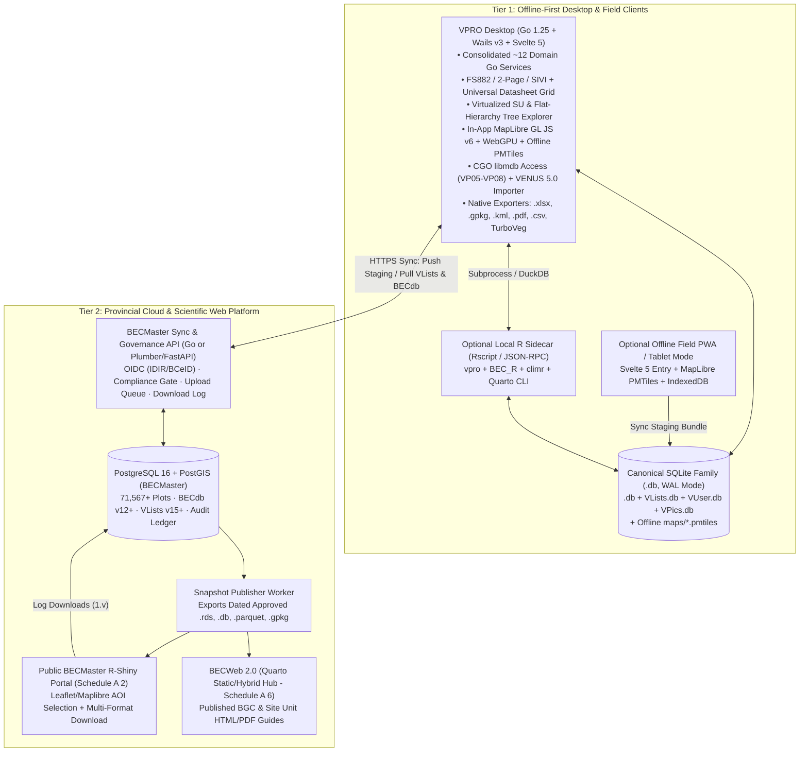

# Target Technology Stack Evaluation & Architectural Recommendation

> **Navigation:** [Master Index](../00_index.md) | **Future Architecture:** [Transition & Adoption](./transition_and_adoption.md) · [Next-Gen Entry & OCR](./next_gen_entry_ocr.md) · [Analytics & Governance](./analytics_and_governance.md) · `Target Stack Recommendation` · [Automations & Abstractions](./intelligent_automation_and_abstractions.md) · [Docs, Help & Release Portal](./documentation_help_and_release_portal.md) | **Related:** [System Architecture](../02_present_state/system_architecture.md) · [Decisions & Gaps](../04_evidence_and_sources/decisions_and_gaps.md)

---

## 1. Architectural Context: Reconciling Desktop Ergonomics with Contractual R/Cloud Mandates

A central finding of this forensic audit is the tension between two real-world engineering requirements documented in `VPRO_ACCESS`:

1. **The Contractual Analytics & Cloud Mandate (`RE26OCF433` Schedule A `1.01`, `1`–`6`):** Explicitly calls for an integrated local and cloud BEC system built with **R, R-Shiny, PostgreSQL, RDS, `BEC_R`, `climr`, and Quarto**—reflecting the BC Ministry BEC research team's (Will MacKenzie, Kiri Daust) existing R ecosystem (`CCISS_ShinyApp_v12`, `BEC_R_working`, `BEC_Classification_Analysis`, `BEC_Unit_Reporting`, `BECWeb2.0`; `Links for BEC data systems.md` `L001–L029`).
2. **The Offline Workstation & UX Reality (`VproMailExchange` `0017`, `0035`, `0003`; `archive/oct2026-parity-ledgers/CLIENT_SCOPE.md`):** Field technicians and regional ecologists require a fast, zero-R-setup, offline Windows/macOS/Linux desktop installer (`< 30 MB` binary) with sub-millisecond `Enter`-key cell navigation across 4,500-line FS882 forms, transactional local SQLite files, native OS file dialogs, and direct `.mdb`/`.accdb` binary import—capabilities where browser-hosted R-Shiny suffers latency, single-threaded R event-loop blocking, and fragile local R/Rtools packaging (`vpro` Shiny prototype reset in Sep 2026).

**Core Recommendation:** Formalize a **federated two-tier target stack** (with written contract alignment under `RE26OCF433` renewal) that uses **each runtime strictly where it excels**, bound together by a **single canonical SQLite (`VP08`) + PostgreSQL (`BECMaster`) data contract**:
* **Tier 1 — Local Desktop Workstation (`vpro_wails`):** **Go `1.25+` + Wails v3 + Svelte 5 + SQLite (`WAL`) + Vendored `libmdb`** for offline entry, datasheet grid editing, classification trees, Access migration, and `.xlsx`/`.kml`/`.pdf`/`.gpkg`/TurboVeg interchange—with an optional local `Rscript` subprocess bridge when `R` + `BEC_R` + `climr` are installed.
* **Tier 2 — Scientific Compute, Cloud Stewardship & Public Web (`vpro` + `BEC_R` + Cloud):** **Headless `vpro` & `BEC_R` R packages + DuckDB + PostgreSQL/PostGIS (`BECMaster`) + R-Shiny (`BEC_plots_Shiny`) + Quarto (`BECWeb 2.0`)** for multivariate clustering, `climr` edatopic modelling, automated HTML/PDF unit guides, cloud staging review, and public map downloads.

---

## 2. Comparative Stack Trade-Off Matrix

| Evaluation Criterion | Option 1: Pure R-Shiny Desktop + Web (`Electron/R-Portable` + `Shiny`) | Option 2: Pure Go/Wails Desktop Only (`vpro_wails` Alone) | **Option 3 (Recommended): Federated Wails Desktop + Headless `vpro`/`BEC_R` + Cloud Postgres/Shiny/Quarto** |
|---|---|---|---|
| **Offline Windows Install Size & Reliability (`Email 0003`)** | Poor (`400–900 MB` bundled R + CRAN binaries; antivirus false positives; slow cold start) | **Excellent** (`~15–25 MB` single NSIS `.exe` using OS WebView2; instant startup) | **Excellent** (`~15–25 MB` core desktop `.exe`; optional R analytics unlocked automatically if R/Posit is present or run in cloud) |
| **FS882 Keyboard & Datasheet Latency (`Email 0035`)** | Moderate/Poor (Shiny websocket round-trip per cell edit; single-threaded R session blocks during reports) | **Excellent** (In-process Svelte 5 Runes + Go goroutines + local SQLite `< 1 ms` reads) | **Excellent** (Handled natively by Svelte 5 + Go SQLite) |
| **Legacy `.mdb`/`.accdb` Ingestion** | Requires C-compiled `mdbr`/`mdbtoolr` Rtools toolchain on user PC | **Excellent** (Statically compiled CGO `libmdb` inside `.exe` for `VP05`–`VP08`) | **Excellent** (Shared `VP08` SQLite `.db` produced by Wails or R `mdbr`) |
| **Multivariate Ecology & Climate (`BEC_R`, `vegan`, `vegclust`, `climr`)** | **Native** (direct R function calls) | Poor (re-implementing `climr` rasters, `vegclust`, & MoF R scripts in Go is high-risk duplication) | **Native** (Executes canonical `vpro` + `BEC_R` + `climr` R packages directly against the same `.db` files!) |
| **Contract `RE26OCF433` Compliance (`Schedule A 1.01`)** | High on stack wording, high UX/packaging risk | **Contractual Divergence Risk** if R/Shiny/Postgres/Quarto deliverables (`1, 2, 4.d–e, 5, 6`) are neglected | **100% Aligned** once desktop Wails UI is recorded via contract Schedule A addendum |
| **Long-Term MoF Maintainability** | Familiar R code for MoF ecologists, brittle reactive Shiny spaghetti (`37` modules) | Strongly typed Go + Svelte 5 (`605` Go + `181` JS test files), unfamiliar Go to R-only staff | Clean boundary: MoF scientists own ecological math in `BEC_R`/Quarto; software engineers maintain stable Go/Svelte shell |

---

## 3. Recommended Target Architecture Diagram

---

## 4. Concrete Stack Refinements & Delivered Engineering Decisions (`v2.0.1` + `vpro` `v2.0.0`)

### 4.1 Consolidated `vpro_wails` Backend Services & Release-Channel Config (**Delivered**)
* **Service Consolidation (`86 -> 12` Domain Services, `0cb5e76`, `d0353dd`):** Decomposed the flat root package into a 4-layer acyclic `internal/*` DAG and consolidated the 86 granular Wails bindings into **strictly 12 cohesive domain services** in `main.go:831-844` (`LifecycleService`, `ContextService`, `PlotEntryService`, `DatasheetService`, `ClassificationService`, `ValidationService`, `ImportExportService`, `VegetationReportService`, `EnvironmentReportService`, `SpatialService`, `PictureService`, `HelpService`).
* **Retired Build-Time/Env Feature-Flag Sprawl (`c4cbd1a`):** Replaced the historical `125` `VITE_*` + `78+` `VPRO_*` boolean gates (`archive/oct2026-parity-ledgers/`) with `release_channel: stable | experimental` in `config.yml`, keeping all validated desktop workflows **on by default** in standard builds.

### 4.2 SQLite Driver, CGO Footprint & Cross-Platform Build Strategy (**Delivered**)
* **`mattn/go-sqlite3` (`CGO_ENABLED=1`) + SQLite `WAL` + Hardened Cross-Platform `libmdb` (`62ae643`, `6848960`):**
  * **Windows (`amd64` & `arm64`):** `.github/workflows/release.yml` pins architecture-matched MinGW/LLVM-MinGW toolchains (`scripts/release-windows.ps1`) and links `-static` / `-extldflags=-static` (`internal/accessreader/reader.go:12`, `build/windows/Taskfile.yml`), validated by `scripts/release.py validate_pe_imports` to reject any non-inbox Windows DLL imports.
  * **Linux (`amd64` & `arm64`) & macOS Universal (`darwin`):** `internal/accessreader/reader.go:1` builds across `linux || windows || darwin` with `-fvisibility=hidden` so vendored `fakeglib` symbols never collide with GTK4/WebKitGTK on Linux, while macOS ships a verified universal (`x86_64` + `arm64`) `VPro.app` `.dmg`.
  * **SQLite `WAL` & `-tags sqliteonly` Default:** Active `<Project>.db` databases initialize `PRAGMA journal_mode = WAL` (`main.go:401`) so the desktop app and headless `vpro` `v2.0.0` R sidecar read concurrently without locking, while `-tags sqliteonly` omits DuckDB C++ bloat from desktop installers (`~20 MB` Windows NSIS installer).

### 4.3 Desktop-to-R (`vpro` `v2.0.0` / `climr` / Quarto) Out-of-Process Sidecar (**Delivered**)
Implemented in `internal/rsidecar/` (`c85d014`, `03d1218`) and `boostao/vpro` `v2.0.0` (`fae33d2`) over the shared SQLite WAL contract:
1. `vpro_wails` invokes `Rscript --vanilla` with properly quoted paths (and Windows short-path normalization in `internal/rsidecar/shortpath_windows.go`), never opening read-only climate/clustering queries in `rw` mode (`03d1218`).
2. `internal/rsidecar` + `vpro` `v2.0.0` cache downscaled `climr` normals (`__VPRO_PlotClimate`), apply Ministry `CMD -> aSMR` rules, render dual `(rSMR × rSNR)` and `(aSMR × rSNR)` edatopic grids, run `vegclust`/hierarchical clustering into reviewable `<Name>_ClusterCandidate_SU` tables, and render Quarto HTML/PDF single-unit & BGC guides (with graceful R fallback rendering when Quarto CLI is absent).

### 4.4 Frontend Grid, Tree & In-App Geospatial Stack (Svelte 5 + MapLibre v6 + WebGPU)
* **Universal Datasheet Grid:** Adopt a virtualized canvas/DOM data grid compatible with Svelte 5 Runes (or a dedicated lightweight virtual-scroll `<DatasheetGrid>` component modeled on `SubVegAXL` + clipboard TSV parser) capable of rendering `71,567` `
_Env` rows or `1.65M` paginated/virtualized `
_Veg` rows at 60 fps without Access's 2 GB memory ceiling.
* **Virtualized Dual-Pane Tree:** Build a native Svelte 5 virtualized tree (`role="tree"` / `role="treeitem"`, keyboard arrow navigation + HTML5/pointer drag-and-drop) replacing ActiveX `MSComctlLib.TreeCtrl.2` permanently.
* **Consolidated In-App Geospatial Engine (`maplibre-gl` v6 + WebGPU + `PMTiles`):**
  * **Renderer Baseline (`MapLibre GL JS v6.17+`):** Pure ESM bundle (`maplibre-gl.mjs`, zero `blob:` worker CSP issues in Vite 8) running on **WebGL2** across all three Wails v3 WebView runtimes—delivering 3D DEM terrain/hillshade reconnaissance, provincial BGC v13 polygon styling, interactive AOI lasso/polygon plot selection (`-> *_SU`), and click-to-edit plot pins without launching external Google Earth.
  * **Progressive WebGPU Compute/Overlay Layer:** Layer **`deck.gl` v9 (`luma.gl` WebGPU device)** or custom WGSL compute pipelines over MapLibre v6 on **Windows (`Edge WebView2` / D3D12)** and **macOS (`WKWebView` / Metal)** for 71K-plot spatial filtering, density/prominence heatmaps, and `climr` raster overlays, with automatic **WebGL2 fallback** on Linux (`WebKitGTK`).
  * **Zero-Server Offline Tiles (`PMTiles`):** Serve local `.pmtiles` archives (`%LOCALAPPDATA%\vpro\maps\`) via HTTP byte-range support in Wails v3's Go `AssetServer`, streaming active plot coordinates from `SpatialService` as binary FlatGeobuf/GeoArrow buffers.
