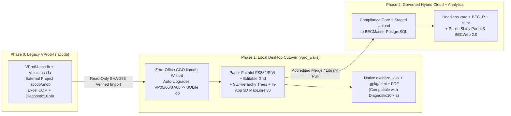

# Zero-Friction Transition, UX Continuity & Data Migration Strategy

> **Navigation:** [Master Index](../00_index.md) | **Future Architecture:** `Transition & Adoption` · [Next-Gen Entry & OCR](./next_gen_entry_ocr.md) · [Analytics & Governance](./analytics_and_governance.md) · [Target Stack Recommendation](./target_stack_recommendation.md) · [Automations & Abstractions](./intelligent_automation_and_abstractions.md) · [Docs, Help & Release Portal](./documentation_help_and_release_portal.md) | **Related:** [Capability Matrix](../02_present_state/capability_matrix.md) · [Decisions & Gaps](../04_evidence_and_sources/decisions_and_gaps.md)

---

## 1. Strategic Objective: Retiring Access Without Breaking Ecological Muscle Memory

Over 25+ years (`VPro 97` $\rightarrow$ `VProXP` $\rightarrow$ `VPro 13/15/19` $\rightarrow$ `VPro 64`), BC Ministry of Forests ecologists and contractors developed deep operational muscle memory around VPro's keyboard-driven card layouts, datasheet grid cleaning, `.accdb` project files, and Excel summary workbooks (`VProXP_Userguide.pdf` PDF pp. 21–65; `VproMailExchange` `0035`, `0040`). Meanwhile, Microsoft Access 365 / 64-bit runtime constraints—broken 32-bit ActiveX controls (`comctl32.ocx` / `mscomctl.ocx`), x64 `Declare PtrSafe` stack/pointer bugs (`V7mdlRibbonPictureBAS.txt:79`), 2 GB file bloat (`BECMaster_fixing.accdb` at `545 MB`), and single-user `QueryDef` mutation—have become unsustainable (`forensics_access_vba` §5.1–5.5).

A zero-friction transition requires **eliminating the Access runtime while preserving 100% of validated mental models, keyboard ergonomics, and historical plot datasets**.

---

## 2. Preserving User Muscle Memory (UX Continuity Rules)

### 2.1 Paper-Card Visual Geometry & Keyboard Flow
1. **Twip-Accurate Card Layouts:** Continue compiling legacy form coordinates (`cmd/fs882layout` $\rightarrow$ `resources/fs882-xl-layout.json`) so field numbers (`SITE 1–37`, `SOIL 1–34`, `VEG 1–10`, `SIVI 1–52`) sit in the exact visual quadrants technicians expect when transcribing paper cards (`vpro_wails/frontend/src/HeaderEditor.svelte`, `LMH25_2023_web.pdf` PDF pp. 10, 47, 102, 200).
2. **Dual-Mode `Enter` & Shortcut Ergonomics (`enterNavigation.ts:1-68`, `VProXP_Userguide.pdf` PDF p. 48):**
   * Preserve horizontal field-to-field `Enter`/`Tab` progression on parent headers and **vertical same-column `Enter` progression** inside `SubVeg*` and `Soil*` subgrids.
   * Add missing legacy power-user shortcuts (`Ctrl+Tab` / `Shift+Ctrl+Tab` to jump between Site, Soil, and Veg subgrids; `Ctrl+F` scoped Plot Find; double-`Esc` to cancel an unsaved child row; `Ctrl+A` quick Species search modal from `Macros/AutoKeys.txt`).
3. **Consolidated CHARS Toggle (`VPro2.0_Functions` PDF p. 3):** Replace the separate `SIVICHARSForm.svelte` and `CHARS` menu entries (`VproMailExchange` `0012`) with a single inline **`[ ] Show extended shrub layers`** checkbox on the standard FS882, Two-Page, and SIVI forms—exposing `Cover5a..5c`, `Height5a..5c`, `SnowCoverregime`, and `ActiveLayerDepth` on demand without duplicating forms.

### 2.2 First-Class Direct Datasheet Grid Editing (`Email 0035` Mandate)
In `VproMailExchange` `0035` (`2026-03-13`), Will MacKenzie confirmed twice (`YES` / `YES`) that power users rely heavily on editing plot tables directly in Access Datasheet mode without form chrome. To satisfy this without Access:
* Generalize `TwoPageEnvironmentTableService` and `TwoPageVegetationTableService` into a **Universal Project Datasheet Workbench** covering `
_Env`, `
_Admin`, `
_Veg`, `
_Humus`, `
_Mineral`, `
_Other`, and `<Name>_SU`.
* Support **multi-column sort, column pinning (`PlotNumber`), range copy/paste from/to Excel, find-and-replace within column**, and inline cell validation—routing every bulk mutation through the exact same SQLite `BEGIN IMMEDIATE` transaction and `<Project>_Audit` writer as the form editors.

### 2.3 Replacing `MSComctlLib.TreeCtrl.2` with a Native Svelte 5 Dual-Pane Classification Explorer
Legacy `USysAssignSU` relied on broken 32-bit/64-bit ActiveX tree controls (`forensics_access_vba` §5.2), while `vpro_wails` currently renders only a flat 4-column read-only table (`App.svelte:1718-1734`). To achieve UX continuity (`RE26OCF433` Schedule A `3.d`, `3.e`; `SCREENCAPS/Screenshot 2026-02-12 091723.png` & `091809.png`):
* Implement a virtualized Svelte 5 **Dual-Pane Classification Explorer**:
  * **Left Pane:** Switchable between `Site Unit -> Plots Tree` (`U` unit folders containing draggable `P` plot leaves, plus an `Unassigned Plots` root bucket), `Hierarchy -> Units Tree` (with `~` breakpoint toggles), and editable `Flat Hierarchy / SU Table` (`VPro2.0_Functions` PDF p. 7).
  * **Right Pane:** Live plot environment + vegetation summary inspector, Master/User `BECdb` unit picker (`ZZZZsssvp/##` mask), and one-click `SU Into Env` / `Env Into SU` sync buttons.

### 2.4 Replacing External Google Earth KML Handoffs with In-App 3D Geospatial (`MapLibre v6` + `WebGPU`)
Legacy VPro exported KML files and launched `googleearth.exe` (`VPro2.0_Functions` PDF p. 15; `RE26OCF433` Schedule A `3.h`) solely because MS Access lacked an embedded GIS canvas. Consolidating geospatial visualization directly inside `vpro_wails` via **MapLibre GL JS v6 (WebGL2) + progressive WebGPU overlays + offline `PMTiles`** eliminates external app switching:
* **3D Terrain & BGC QA:** Inspect plot `Elevation`, `SlopeGradient`, and `Aspect` on extruded 3D DEM hillshade alongside colour-themed provincial BGC v13 polygons—visually flagging `GIS_BGC` vs. field `Zone`/`SubZone` or `UTM` vs. `Lat/Lon` discrepancies in real time.
* **Direct Spatial $\leftrightarrow$ `SU` & Editor Loop:** Lasso/polygon-select plots on the map (`Schedule A 2.iii`) to create or update an active `*_SU` table, or click any plot marker to open `FS882Form.svelte` directly (retaining `.gpkg` and `.kml` strictly as secondary GIS exports).

---

## 3. Lossless Historical Data Migration Architecture

### 3.1 Multi-Generation Access (`.mdb` / `.accdb`) & `VENUS 5.0` Ingestion Matrix

| Legacy Source Format | Schema Signature | Migration Path into Canonical `VP08` SQLite (`.db`) | Current Status & Required Action |
|---|---|---|---|
| **VPro 19 / VPro 64 (`.accdb`)** | `VP08` (8 core tables + `*_SU`, `*_Hierarchy`, `*_Lump`, `*_Profile`) | Direct 1:1 streaming via CGO `libmdb` (`ImportAccessProject` in `internal/interchange/accessprojectimport.go`) + SHA-256 verification + companion `*_SU`, `*_Hierarchy`, `*_Lump`, `*_Profile` import. | **Delivered (`v2.0.1`)** across **Windows, Linux, and macOS (`darwin`)**. |
| **VPro 15 (`.accdb`)** | `VP07` (131-col `Env`, 75-col `Metadata`, no `Admin`) | Splits 19 columns into `
_Admin`, renames 14 `SV_*` columns, normalizes `Metadata`. | **Delivered (`v2.0.1`)** (`ImportVPro07` parity). |
| **VPro 07 / 13 (`.accdb`)** | `VP06` (105-col `Env`, 36-col `Veg`) | Splits `Env`/`Admin` (94 + 12 mapped cols), creates empty `VP08` `Metadata`. | **Delivered (`v2.0.1`)** (`ImportVPro06` parity). |
| **VPro XP / 03 (`.mdb`)** | `VP05` (DMS coords, legacy col names, 62-col `Veg`) | Converts DMS $\rightarrow$ `float64` DD (fixing legacy `Single` truncation!), renames 9 columns, synthesizes `Admin`. | **Delivered (`v2.0.1`)** (`ImportVPro05` parity). |
| **VENUS 5.0 (`.mdb` / `.xml`)** | `TemplateVENUS5.mdb` (`tblEnv`, `tblVegLayer`, `tblVegSpecies`, etc.) | Pivots normalized `tblVegLayer` + `tblVegSpecies` into wide `VP08` `
_Veg` (`internal/interchange/venus5.go`). | **Delivered (`v2.0.1`)** (`InterchangeHub.svelte` `.mdb` & XML import). |
| **`BECMaster_fixing.accdb` (`545 MB`)** | `VP08` (`71,567` plots, `1.65M` veg rows, dropped `Env->Veg` FK) | Streaming batch import into SQLite + automatic orphan-row quarantine report before enabling `PRAGMA foreign_keys = ON`. | **Qualified (`v2.0.1`, `6056169`)** (`internal/integration/becmaster_qualification_test.go`). |

### 3.2 Co-Existence & Round-Trip Compatibility Bridge
During the 6–12 month transition window while external partners still use VPro 64 or Excel macros:
1. **`Diagnostic10.xla` Workbook Compatibility (`RE26OCF433` Schedule A `4.a.i`):** Ensure `SummaryVegetationWorkbookService` (`summaryvegetationworkbook.go`) emits worksheet structure, header row offsets, and Presence/Significance cell encodings compatible with `ExcelTools\Diagnostic10.xla` while `BEC_R` native differential diagnostics are finalized.
2. **Legacy `.accdb` Export / Public Download Option (`Schedule A 2.iv.1`):** Contract item `2.iv.(1)` lists *"Vpro-compatible Access database"* among public download formats. Because `libmdb` is read-only for `.accdb`, provide either:
   * Formal client sign-off replacing `.accdb` public downloads with `.db` (VPro 2.0 SQLite) + `.csv`/`.rds`/`.sqlite` (TurboVeg3), **or**
   * A clean-room template-cloning exporter on the server/Windows helper that copies an empty `TemplateVP08.accdb` and bulk-inserts rows only when legacy `.accdb` download is explicitly requested.

---

## 4. Phased Rollout, Feature-Gate Graduation & Packaging Roadmap

### Stage 1: Cross-Platform Installer Qualification, Official Release Portal & Feature Graduation (**Delivered in `v2.0.0` / `v2.0.1`**)
* **Cross-Platform Release Matrix (`6848960`, `56d4062`):** Shipped self-contained Windows `amd64`/`arm64` NSIS `.exe` installers (statically linking MinGW `winpthreads`/`libgcc` with PE import validation), macOS Universal `.dmg` (`VPro.app`), and Linux `amd64`/`arm64` `.AppImage`/`.deb`/`.tar.gz` archives; Phase 1 packages are unsigned with `SHA256SUMS.txt` verification (`D-02`).
* **BC Gov Design System Release Portal (`aa99f9e`):** Replaced uncompiled CDN drafts and browser `api.github.com` calls with `site/` (`BC Sans`, `#003366` BC Navy, `#FCBA19` Gold) backed by static `release-manifest.json`, while archiving October 2026 internal ledgers under `archive/oct2026-parity-ledgers/`.
* **Default-ON Graduation (`c4cbd1a`):** Enabled SQLite `WAL` mode, graduated all validated workflows to default-ON under `config.yml` `release_channel: stable`, and pruned Red-marked standalone `CHARS` forms and `PC-ORD Break Report`.

### Stage 2: Priority Workstation Parity, Automations & R Companion SDK (**Delivered in `v2.0.1` & `vpro` `v2.0.0`**)
* Delivered all Priority Retain/Modify desktop workflows and `Auto-1`..`Auto-7` in `vpro_wails` `v2.0.1` + `vpro` `v2.0.0`:
  1. **Project Lifecycle Suite (`internal/projectops`):** `New Project`, `Save Project As`, `Export Splinter Project`, `Compare Two Projects`, and WAL-resilient `3-Way Merge`.
  2. **Classification, Datasheet & Taxonomy (`internal/datasheet`, `internal/classification`, `internal/lumping`):** `UniversalDatasheetGrid.svelte`, virtualized dual-pane `ClassificationExplorer.svelte`, `Create SU from Env Fields` (into new or existing SU), SiteUnit `.support`/`.poor`/`.nudum` exclusions, and `LumpEditor.svelte` (`*_Lump` + `LumpSpec`).
  3. **Standards, 3D GIS & Interchange (`internal/spatial`, `internal/interchange`):** Bundled 2026 `BECdb v13` + `BCPlantTaxonomy v19` + `LMH25 (2023)` catalogues, **MapLibre GL JS v6 + WebGPU + offline `PMTiles` workbench**, batch `USysTableOfLists` compliance gate, `VENUS 5.0` import, **official `TurboVeg 3` 31-table SQLite & `Plot_package` XML** import/export, OGC `GeoPackage` (`.gpkg`), R `.rds`, Long/Wide CSV, and `User Species` I/O.
  4. **Workflow Automations (`Auto-1`..`Auto-7`):** Live `LMH25 (2023)` pedon/`rSMR`/`rSNR` diagnostics, auto-derived `ProjectMetadata`, `.pmtiles` BGC/Ecosection/District auto-stamping, reactive in-app BEC Diagnostic synthesis (`internal/diagnostics`), and out-of-process `Rscript` sidecar (`internal/rsidecar`: `climr -> aSMR`, dual edatopic grids, `vegclust`, Quarto HTML/PDF guides).
  5. **Offline In-App `F1` Help & Guided Tours (`HelpService`, `8182ee7`):** Context-sensitive `LMH25 (2023)` field drawer (`F1`), 4 spotlight tours on `Sample.db`, keyboard shortcut modal (`?`), `What's New`, safe `Reset Workspace to Sample`, and `About & Standards Stamps`.

### Stage 3: Multi-User Cloud `BECMaster`, Enterprise Signing & Field PWA/OCR (Phase 2 Renewal Term)
* Deploy the governed **PostgreSQL/PostGIS `BECMaster`** multi-user server (`Schedule A 1.i–v`) with IDIR/BCeID OIDC accreditation, staging submission queue, accredited live `BECdb` unit additions (`3.g.ii`), download activity ledger, and the public **Shiny + Quarto `BECWeb 2.0`** web portal (`Schedule A 2, 6`), alongside optional Ministry-funded Authenticode/Apple notarization and Phase 2 Field Tablet PWA / Paper Card OCR (`Outcome 6`).
