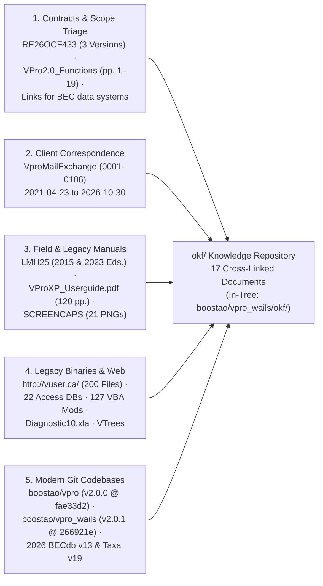

# Master Forensic Citations & Primary Evidence Index

> **Navigation:** [Master Index](../00_index.md) | **Evidence & Sources:** `Citations Index` · [Decisions & Gaps](./decisions_and_gaps.md) | **Sections:** [History](../01_history_and_evolution/version_matrix.md) · [Present State](../02_present_state/system_architecture.md) · [Future Architecture](../03_future_architecture/target_stack_recommendation.md)

---

## 1. Evidence Traceability Architecture

Every historical date, schema column, ecological formula, client requirement, architectural capability, and defect documented across the `okf/` knowledge repository maps directly to verified primary sources across five evidence classes:

---

## 2. Contracts, Triage & Ecosystem Link Documents (Sibling `../VPRO_ACCESS/`)

| Ref ID | Primary Source Path | Exact Page / Paragraph / Line | Claim / Fact Verified & Cross-Link |
|---|---|---|---|
| `CON-01` | `_BEC_data_system_fs1a_schedule_of_services_v2 (13).docx` & `.md` | `.docx` `P001–P057` (pp. 1–2); `.md` `L001–L195` | Draft v2 (`2026-01-20`): 5-workstream R/Shiny/PostgreSQL/Quarto scope; `P052`/`L177–L178` includes *"or from standard paper field forms"* ([Next-Gen Entry & OCR](../03_future_architecture/next_gen_entry_ocr.md)). |
| `CON-02` | `VproMailExchange\vpro_exports\0076_Re Updates\_BEC_data_system_fs1a_schedule_of_services_v2 (13).docx` | `P001–P078` (`rev=342`, `2026-02-06`) | Expanded 6-workstream "long list": adds accreditation (`P012`), download log (`P013`), 4 public download formats (`P018–P022`), `Diagnostic.xla` (`P041`), `climr` & CMD$\rightarrow$aSMR (`P045–P046`), `BEC_R` clustering (`P056–P062`), and revises `P073` to *"off-line digital collection"*. |
| `CON-03` | `VproMailExchange\vpro_exports\0072_...\RE26OCF433 - BEC Data Transfer -for signature.pdf` *(signed in `0064`)* | `PDF pp. 1–20` (`Schedule A` `pp. 10–13`; `Schedule B` `pp. 14–15`; `NRM1235` `pp. 1–3`) | Executed Contract `RE26OCF433` (`$50,000 CAD` + GST, Feb 17–Mar 20, 2026 + 12-mo renewal `3.01`), Province IP ownership, exact `0076` task list ([Capability Matrix](../02_present_state/capability_matrix.md)). |
| `CON-04` | `Links for BEC data systems.docx` & `.md` | `.docx` `P001–P017` (`rId5–rId13`); `.md` `L001–L029` | Official links to `MoF-Skeena-Research/{BEC_plots_Shiny, BEC_R_working, BEC_Classification_Analysis, BECdb_management, bec-unit-reports, BEC_Unit_Reporting, BECWeb2.0}`, `vuser.ca`, and `becweb` ([Analytics & Governance](../03_future_architecture/analytics_and_governance.md)). |
| `TRI-01` | `VPro2.0_Functions to remove-retain-modify.docx` & `.pdf` | `PDF pp. 1–19` (`p.20` blank); `.docx` `P001–P082` + `word/ink/ink1..62.xml` | Authoritative function triage: **32 Remove** (Red), **28 Priority Retain** (Green/unmarked), **21 Modify/Add**, **14 Deferred** (Orange) ([Capability Matrix](../02_present_state/capability_matrix.md)). |

---

## 3. Key Client Emails (`VproMailExchange\vpro_exports\0001`–`0106`)

| Email Folder (`VproMailExchange\vpro_exports\...`) | ISO-8601 Timestamp | Sender $\rightarrow$ Recipient | Verified Decision / Forensic Fact |
|---|---|---|---|
| `0106_CCISS tool\message.eml` *(+ quoted `2021-04-23`)* | `2021-09-03T00:23:33Z` | Will MacKenzie $\rightarrow$ Bruno Tremblay | Prior `CCISS_ShinyApp_v12` & DigitalOcean `BCGOV_DB` PostgreSQL / `BECMap` collaboration; signature `http://vuser.ca/vpro19/index.htm`. |
| `0099_Ecosystem Data and Classification tools\message.eml` | `2025-11-28T18:59:05Z` | Will MacKenzie $\rightarrow$ Bruno Tremblay | Initiates VPro 2.0 modernization (*"move the functions of a programmed ACCESS data base to a more modern solution"*); sig `vpro64/index.htm`. |
| `0083_Updates\message.eml` | `2026-01-30T17:12:12Z` | Bruno Tremblay $\rightarrow$ Will MacKenzie | Confirms extraction of Access artifacts into `VPro64_forAI` and start of R-Shiny mock app. |
| `0040_notes on VPro functions to carry forward or not\message.eml` | `2026-03-11T17:00:11Z` | Will MacKenzie $\rightarrow$ Bruno Tremblay | Defines color-code key for `VPro2.0_Functions`: **Red = ignore/remove**, **Orange = lower priority**. |
| `0037_RE26OCF433 Invoice\invoice_0000030.pdf` | `2026-03-13T16:00:16Z` | Bruno Tremblay $\rightarrow$ Will MacKenzie | Phase 1 invoice `$50,000 + $2,500 GST = $52,500 CAD` (`Issue Date: 2026-03-20`). |
| `0036_...` & `0035_Re Bruno Tremblay shared...` | `2026-03-13T16:25:50Z` | Will MacKenzie $\rightarrow$ Bruno Tremblay | **Client Decision (`D-05`):** Replies **`YES`** twice—direct datasheet/table editing without forms is essential (*"Ideally plot data could be edited directly in database"*). |
| `0034_Export to TurboVeg` .. `0031_RE Export to TurboVeg` | `2026-03-13` – `2026-03-15` | Bruno Tremblay $\leftrightarrow$ Stephan Hennekens (WENR) | Clarifies **Turboveg2** (`.dbf`) vs. **Turboveg3** (`.sqlite`, 250-plot unregistered export cap); Will dropped from CC after `0034` (**open decision `D-04`**). |
| `0017_Re VPro Demo\message.eml` | `2026-10-02T16:14:20Z` | Bruno Tremblay $\rightarrow$ Will MacKenzie | **Architecture Pivot (`D-01`):** Introduces `boostao/vpro_wails` cross-platform desktop UI while keeping `boostao/vpro` R package for headless DB/analytics. |
| `0012_Re VPro Demo\message.eml` & `0011_[Boostaovpro_wails] Run failed...` | `2026-10-16` | Bruno Tremblay / GitHub Actions | Documents CHARS SIVI & PC-ORD Break Report over-builds (`D-03`) and Windows `amd64`/`arm64` CI build failure (`run 38924414719`, `D-02`). |
| `0004_Unavailable friday` & `0003_Re Unavailable friday` | `2026-10-21T22:11:07Z` | Bruno $\leftrightarrow$ Will MacKenzie | Autonomous agent paused Oct 20 for realignment; Will & Kiri request **working Windows install** for office evaluation (`D-02`). |

---

## 4. Field Manuals, User Guides & UI Screencaps (Sibling `../VPRO_ACCESS/`)

| Source Document | Citation Locator | Domain Specification Verified |
|---|---|---|
| `VPRO_ACCESS/VProXP_Userguide.pdf` (`2004`, 120 pp.) | `PDF pp. 21–26, 36–40` | 4-component Access architecture (`VPRO.MDB`, `VLISTS.MDA`, `VUSER.MDA`, `Plot.mdb`), 6-table plot model, and 3 Fundamental Rules of VPro ([Domain Model](../02_present_state/domain_model.md)). |
| `VPRO_ACCESS/VProXP_Userguide.pdf` | `PDF pp. 46–61, 62–86, 87–99, 111–120` | FS882 keyboard shortcuts (`p.48`), synonym validation (`pp.52–58`), `Optimize Vegetation` (`p.60`), 5-step SU & Hierarchy `~` breakpoints (`pp.63–83`), VTab/VENUS/PC-ORD I/O (`pp.54–57, 84–86`), Lump rules (`pp.97–99`), `By N Plots` vs `Characteristic` & Prominence/Goldstream scales (`pp.91–94, 111–112`), 6-table field dictionary (`pp.113–120`). |
| `VPRO_ACCESS/Lmh25_2015.pdf` (271 pp.) & `VPRO_ACCESS/LMH25_2023_web.pdf` (274 pp.) | `2023 PDF pp. 8–43` (`SITE`), `pp. 44–99` (`SOIL`), `pp. 100–117` (`VEG`) | Physical `FS882(1–3)` rules: NAD83 UTM Zones `8–11` (`p.14`), rSMR `0–8` & rSNR `A–F` (`pp.20–22`), Aspect `0–359`/`999` (`p.32`), 6 Substrates summing to `100%` (`pp.40–41`), **upward upland humus depth `UpperDepth > LowerDepth`** (`p.71`), von Post `1–10` $\leftrightarrow$ `Of/Om/Oh` (`p.73`), non-additive canopy cover (`pp.110–111`), 76 C-layer dwarf woody species (`p.106`), and 2023 code additions (`3c, 3d, v, k, A.w.th, A.w.br, CO, S`). |
| `VPRO_ACCESS/LMH25_2023_web.pdf` | `PDF pp. 118–197` (`MENS`, `WHA`, `TAW`, `CWD`), `pp. 198–221` (`FS1333 SIVI`), `pp. 222–274` (`KEYS`) | Prism `5–16` tree rules & 8 pathological indicators (`pp.121–131`), WHA Class 4 `<25%` fix (`p.145`), TAW clinometer trig height (`p.177`), CWD `2 x 24 m` `>7.5 cm` transects (`pp.187–190`), SIVI mandatory matrix by `PlotType` (`pp.202–205, 212–218`), 2023 rSMR/rSNR keys & 2022 tree codes (`pp.225–228, 263–267`). |
| `VPRO_ACCESS/SCREENCAPS/*.png` (`21` files) | `Screenshot 2026-02-12 090945.png` .. `091826.png` + `*_Report_Options.png` | Live VPro 64 UI ground truth: 6 ribbon groups (`091826`), Data Centre (`091034`), 6-tab FS882 (`091116–091238`), 2-Page (`091601`), Single-Page (`091612`), SIVI (`091622, 091642`), Plot Profiling (`091319`), `Assign Site Units` Hierarchy & SU trees (`091723, 091809`). |

---

## 5. Legacy `vuser.ca`, MS Access, DAO & VBA Citations (`VPro64`, `VPro64_forAI`, `VTrees`)

| Subsystem / Finding | Exact File, Module, Table or URL Citation |
|---|---|
| **`VENUSPro 97` Origin & `MSysDb` Lineage** | `http://vuser.ca/vpro64/VPro64-23Feb2023.zip :: VPro64/OldVPro.docx` (`image1.png`, `image2.png`); `MSysDb Created = 2009-06-22 11:09:48.564 UTC` across all `.accdb` builds (`2009–2023`); unlinked `http://vuser.ca/vpro/` (`VProXPFullInstall03May2005.zip`..`VPro03ForKim.zip`) ([Version Matrix](../01_history_and_evolution/version_matrix.md), [Site Archive Manifest](../01_history_and_evolution/site_archive_manifest.md)). |
| **Local Companion SHA-256 Matches** | `Diagnostic10.xla` (`ea6ef4e1...` == `vpro64/Diagnostic10-15June2023.zip`); `VTrees\*` (`27/27` files == `vtrees/VTrees27Jan2020 For Office 2010.zip`, `84ed2779...`); `VLists`, `VUser`, `VMetaData`, `VMessageBoard` == `VPro64-23Feb2023.zip` `.accda` files. |
| **Startup, Registry & 17 Linked Tables** | `VPro64_forAI/Modules/clsVProReg.txt:1-318`, `V7mdlSplash.txt:70-137, 266-680`, `V7mdlSetCurrent.txt:23-164`, `Forms/frmMainMenuFloat.txt:1442-2194` ([Legacy Architecture](../01_history_and_evolution/legacy_architecture.md)). |
| **Lumping, Strata, Diagnostic & Audit Math** | `V7mdlLumping.txt:11-92`, `V7mdlLumpingAttributes.txt:3-77`, `V7mdlCreateTables.txt:334-410`, `V7mdlReportsShortVeg.txt:324-1400`, `V7mdlValueConversions.txt:4-199`, `V7mdlDiagnostic.txt:57-170`, `V7mdlPlotProfiling.txt:30-350`, `V7mdlAudit.txt:158-377`. |
| **x64 `PtrSafe` Crashes, ActiveX & 11 Bugs** | `V7mdlRibbonPictureBAS.txt:34-97` (`bitmap As Long` x64 stack corruption!), `V7mdlUtility.txt:21-30`, `V7mdlFileDialogTools.txt:22`, `VTrees.accdb::mdlAPI:25-50`, `Forms/USysAssignSU.txt:1139-1404` (`comctl32.ocx`), `V7mdlSUTableTools1.txt:119-125` (`Sample_SU` bug), `V7mdlRelationships.txt:154-169`, `V7mdlExportXML.txt:25-39`, `V7mdlGoogleEarth.txt:103`, `BECMaster_fixing.accdb` (`545 MB`, `71,567` plots, dropped `Env->Veg` FK). |

---

## 6. Modern Codebases & 2026 Standards Citations (`boostao/vpro_wails` & `boostao/vpro`)

| Repository & Component | Exact Code Citations |
|---|---|
| **2026 `BECWeb` Standards (`cmd/standards2026`)** | `resources/standards-2026-provenance.json` (`BECdb_v13_2026.accdb` `2026-05-28` SHA-256 `7b19bd03...`, `8,900` `USysSiteSeriesNames`, `6,067` `MasterSiteUnitList`; `BCPlantTaxonomy.accdb` `2026-02-09` v19 SHA-256 `41d60607...`, `16,728` `USysAllSpecs`; `LMH25_2023_web.pdf` SHA-256 `ebf47444...`). |
| **`mdbtoolr` & `go-mdbtools*` Lineage** | `../go-mdbtools-windows-readiness/reader.go:3-195`; `internal/accessreader/reader.go:1-40` (`linux \|\| windows \|\| darwin`, `-fvisibility=hidden`, Windows `-static`). |
| **`vpro` Companion R SDK (`v2.0.0` @ `fae33d2`)** | `../vpro/DESCRIPTION:1-45` (`R >= 4.4.0`, `21` `R/*.R` files, zero-note `R CMD check`), concurrent SQLite WAL readers, `BCPlantTaxonomy v19` & `BECdb v13` harmonization, community matrices, BEC clustering, `sf` GeoPackage, `LMH25` QA, `climr` $\rightarrow$ Ministry `aSMR`, dual edatopic grids, BEC diagnostics, guarded `*_SU` write-back, 4 vignettes & Quarto guides (`68b7d8b` `mod_becweb_map.R`). |
| **`vpro_wails` 4-Layer DAG & Core (`v2.0.1` @ `266921e`)** | `go.mod:1-15` (Go `1.25.0`, Wails `v3.0.0-beta.26`, `mattn/go-sqlite3` `v1.14.52`, `excelize/v2` `v2.10.1`, `fpdf` `v0.9.0`), `main.go:831-844` (`12` domain services), `domainservices_*.go`, `resources/embed.go`, `internal/vprocore/` (`SQLiteContext` WAL + `beginReadSnapshot`, 7-DB `DatabaseFamily`, `DesktopConfig` `release_channel`, `CloseService` nonce). |
| **`vpro_wails` Domain, GIS, R Sidecar & Interchange** | `internal/projectops/` (`New/SaveAs/Splinter/Compare/3-Way Merge`, `OptimizeVeg`, `ProjectMetadata` presets), `internal/datasheet/`, `internal/classification/` + `internal/lumping/` (`LumpSpec`), `internal/lmh25rules/`, `internal/diagnostics/` (`71.5k`-plot synthesis), `internal/rsidecar/` (`climr`, `aSMR`, `vegclust`, Quarto), `internal/spatial/` (`PMTiles`, FlatGeobuf PIP, KML), `internal/interchange/` (`accessprojectimport.go` + 545 MB `BECMaster` quarantine, `venus5.go`, `turboveg_sqlite.go` 31-table TV3, `turboveg_xml.go` `Plot_package`, `geopackage.go`, `rdsexport.go`, `csvmatrix.go`, `userspecies.go`, `plotlabelpdf.go`). |
| **`vpro_wails` Svelte 5 UI, Help & BC Gov Portal** | `frontend/package.json:6-91` (`118` `.svelte` components, `24` views, `190` `.test.cjs` suites, `maplibre-gl` `^6.18.0`, `@deck.gl/*` `^9.4.1`, `@luma.gl/webgpu` `^9.4.2`, `pmtiles` `^4.5.0`), `Navigation.svelte:1-130`, `docs-src/*.json` $\rightarrow$ `resources/help_bundle.json`, `site/build.mjs` & `site/release-manifest.json` (`v2.0.1`), `archive/oct2026-parity-ledgers/`. |
