# Unresolved Domain Ambiguities, Architecture Drift & Client Decisions Needed

> **Navigation:** [Master Index](../00_index.md) | **Evidence & Sources:** [Citations Index](./citations_index.md) · `Decisions & Gaps` | **Related:** [Capability Matrix](../02_present_state/capability_matrix.md) · [Target Stack Recommendation](../03_future_architecture/target_stack_recommendation.md)

---

## 1. Purpose & Governance Rule

Per forensic engineering discipline, **no missing specification has been hallucinated** in this knowledge repository. Every conflict between the executed contract (`RE26OCF433`), Will MacKenzie's ink-coded triage (`VPro2.0_Functions to remove-retain-modify`), client correspondence (`VproMailExchange` `0001`–`0106`), `LMH25` field manuals (`2015` vs. `2023`), legacy `VPro64.accdb`, and the current codebases (`vpro` and `vpro_wails`) is cataloged below with concrete decision options for client sign-off.

```mermaid
flowchart LR
    subgraph Resolved["Resolved in Desktop v2.0.1 & R SDK v2.0.0"]
        D2["D-02: Cross-Platform v2.0.1 Installers,<br/>BC Gov Portal & Default-ON Graduation"]
        D3["D-03: Red Over-Builds Pruned<br/>(Inline CHARS Toggle, Break Report Removed)"]
        D4["D-04: Dual TurboVeg 3 (31-Table SQLite)<br/>+ Plot_package XML Implemented"]
        D5["D-05: Universal Datasheet Grid<br/>(_Env/_Admin/_Veg/_Humus/_Mineral/_Other/_SU)"]
        D11["D-11: 2026 BECdb v13 / Taxa v19 / LMH25<br/>+ 545 MB BECMaster Orphan Quarantine"]
    end

    subgraph ClientConfirm["Client Governance & Domain Confirmation"]
        D1["D-01: Contract Renewal Stack Addendum<br/>(Federated Wails Desktop + R/Postgres)"]
        D6["D-06: Public Portal Download #1<br/>(VPro 2.0 .db vs Legacy .accdb)"]
        D7["D-07: Goldstream Class &<br/>Excluded SiteUnit Suffix Defaults"]
        D8["D-08: Final Wide/Flat Hierarchy<br/>Rank Column Standard"]
    end

    subgraph Scope["Phase 2 / Renewal Scope Boundaries"]
        D9["D-09: Companion Mensuration (VTrees),<br/>CWD & WHA Disposition"]
        D10["D-10: Paper Field Card HTR/OCR vs<br/>Offline Field Tablet PWA Priority"]
    end

    Resolved --> ClientConfirm --> Scope
```

---

## 2. Master Decision & Ambiguity Register

### D-01: Contractual Technology Stack Alignment (`R/Shiny` vs. `Go/Wails/Svelte` Desktop)
* **Severity:** **Critical (Contractual / Governance)**
* **Evidence:**
  * Executed Contract `RE26OCF433` Schedule A Section `1.01` & Item `3` (`0072` Contract PDF pp. 10–11) specify *"using R, R-shiny, PostgreSQL, and other open-source tools for both cloud and local machine environments"* and *"R-based scripts for web and local machine apps"*.
  * On `2026-10-02` (`VproMailExchange` `0017`), desktop UI development pivoted to `boostao/vpro_wails` (Go + Wails v3 + Svelte 5) while retaining `boostao/vpro` as a headless R package (`archive/oct2026-parity-ledgers/CLIENT_SCOPE.md:7-11, 56-65`).
* **Decision Needed from Client (Will MacKenzie / MoF):**
  * Formally ratify the **hybrid architecture** in the 12-month renewal amendment (`Schedule A Section 3.01`): `vpro_wails` as the local cross-platform desktop app + `vpro` / `BEC_R` / `climr` / Quarto / R-Shiny / PostgreSQL for statistical analytics, cloud `BECMaster`, and public `BECWeb 2.0` portal.

---

### D-02: Cross-Platform `v2.0.1` Installer Delivery, BC Gov Portal Branding, Code Signing & Feature Gates
* **Status:** **Resolved in Production (`v2.0.1`, `2026-11-13`)**
* **Evidence & Delivered State:**
  * **Release Matrix Shipped (`v2.0.1`, `56d4062`, `6848960`):** GitHub Actions `Build and Release` and `Deploy GitHub Pages` publish verified Windows (`amd64`/`arm64` static NSIS `.exe` + `.zip` with zero non-inbox PE DLL imports), macOS Universal (`VPro.app` `.dmg` + `.zip`), and Linux (`amd64`/`arm64` `.AppImage`, `.deb`, `.tar.gz`) packages, with all validated features default-ON (`config.yml` `release_channel: stable`).
  * **Code Signing Policy:** Phase 1 builds ship unsigned (`"unsignedNotice": true`) with static `release-manifest.json` + `SHA256SUMS.txt` verification; client (`BC Gov / MoF`) to confirm whether to fund OV/EV Authenticode & Apple Developer ID certificates for Phase 2 rollout.
  * **Product Naming & Branding:** Branded as **`VPro`** (*VENUS — Vegetation and Environment NexUS — Professional*) under the **BC Government Design System** (`BC Sans`, `#003366` BC Navy, `#FCBA19` Gold accent) for the **B.C. Ministry of Forests, Research Branch — Biogeoclimatic Ecosystem Classification (BEC) Program**.
  * **Bundled 2026 `BECWeb` Master Standards (`6873e74`):** Compiled via `cmd/standards2026` from **`BECdb_v13_2026.zip`** (`2026-05-28`, `8,900` `USysSiteSeriesNames`, `6,067` `MasterSiteUnitList`) and **`BCPlantTaxa2025_access.zip`** (`2026-02-09`, Version 19 `USysAllSpecs`, `16,728` rows) + `LMH25 (2023)` (`1,566` `USysTableOfLists` rows).

---

### D-03: Disposition of Autonomous Agent Over-Builds Marked RED ("Remove") by Client
* **Status:** **Resolved (`c4cbd1a`, `d630301`)**
* **Evidence & Resolution:**
  * Pruned `PC-ORD Break Report` and standalone `CHARS` forms/menus from `Navigation.svelte` and production views per Will MacKenzie's Red markup (`VPro2.0_Functions` PDF pp. 3, 15).
  * Consolidated CHARS Arctic extensions (`Cover5a..5c`, `SnowCoverregime`, `ActiveLayerDepth`) into an inline **`"Show extended shrub layers"`** toggle across standard FS882, Two-Page, and SIVI forms.

---

### D-04: `TurboVeg 2` (`.dbf` / XML) vs. `TurboVeg 3` (`.sqlite`) Target Format
* **Status:** **Engineered Dual-Format Solution (`266921e`); Ready for Client UAT Confirmation**
* **Evidence & Resolution:**
  * `RE26OCF433` Schedule A `2.iv.(4)` & `VPro2.0_Functions` (`PDF pp. 8–9` `P033, P038`) require both **TurboVeg export and import** (`VproMailExchange` `0031`–`0034`).
  * `vpro_wails` `v2.0.1` (`internal/interchange/turboveg_sqlite.go` & `turboveg_xml.go`) implements **both** official **31-table `TurboVeg 3` SQLite** import/export (Delphi `TDateTime` + WKT `POINT` + GUIDs) **and** universal **`Plot_package` XML** import/export (natively supported by TurboVeg 2, TurboVeg 3, and JUICE)—covering both modern and legacy phytosociological workflows without dBase `.dbf` truncation.
* **Client Confirmation Item:** Confirm during UAT that `TurboVeg 3` `.sqlite` + `Plot_package` `.xml` satisfies all MoF/JUICE collaborator workflows without requiring legacy dBase III+ `.dbf` writers.

---

### D-05: Scope & Audit Granularity of Direct In-Database Datasheet Editing
* **Status:** **Implemented in `UniversalDatasheetGrid` (`50424d1`); Confirm UAT Defaults**
* **Evidence & Resolution:**
  * Satisfies Will MacKenzie's `YES` / `YES` mandate (`VproMailExchange` `0036` & `0035`, `2026-03-13`) via `UniversalDatasheetGrid.svelte` + `internal/datasheet`, supporting `_Env`, `_Admin`, `_Veg`, `_Humus`, `_Mineral`, `_Other`, and `_SU` with multi-column sort, active-SU scoping, global search, TSV clipboard paste, find/replace, and per-cell transactional `<Project>_Audit` logging.
* **Client Confirmation Item:** Confirm during UAT whether `_Lump` and `_Hierarchy` should remain exclusively in `LumpEditor` / `ClassificationExplorer` or also appear in the raw datasheet table selector.

---

### D-06: Public BECMaster Download Format #1 — Legacy `.accdb` vs. Canonical SQLite `.db`
* **Severity:** **Medium-High (Contract Deliverable `2.iv.1`)**
* **Evidence:**
  * `RE26OCF433` Schedule A Item `2.iv.(1)` (`0072` Contract PDF p. 11) specifies *"Vpro-compatible Access database"* as one of four public download formats from the Shiny map portal.
  * `libmdb` (`mdbtools`) is strictly **read-only** for `.accdb` files across both Go (`accessreader`) and R (`mdbr` / `mdbtoolr`); writing binary `.accdb` on a Linux cloud server without MS Access/ACE requires cloning a pre-built empty `TemplateVP08.accdb` or running Jackcess (Java).
* **Decision Needed from Client:**
  * Once VPro 2.0 (`.db` SQLite) replaces VPro 64, does **"VPro 2.0 SQLite Database (`.db`)"** satisfy `2.iv.(1)`, or must the public portal also generate legacy `.accdb` files for external VPro 64 holdouts?

---

### D-07: Ambiguous Ink Markup on `Goldstream Class`, `Combination Report` & SiteUnit Suffix Filters
* **Severity:** **Medium (Reporting Specification)**
* **Evidence:**
  1. **`Goldstream Class` (`VPro2.0_Functions` PDF p. 12 `image46.png`):** Red strikethroughs cross out 4 alternative display classes (`Presence & Significance`, `Presence & % Cover`, `% Cover`, `Prominence Class`) and cross out `Show: Class / Value`, while `Goldstream Class` sits unmarked just above the orange border—yet `Goldstream Class` depended on the crossed-out `Show: Class / Value` toggle (`V7mdlValueConversions.txt:91-113`)!
  2. **`Combination Veg/Env Report`:** Mentioned in `RE26OCF433` Schedule A `4.a` (`2026-02-17`), then crossed out with red wavy lines on `2026-03-11` (`VPro2.0_Functions` PDF p. 14 `P065`: *"Combination report replace in vegetation summary optional report featuers"*) while `Include Environmental Fields?` on `PDF p. 12` was boxed in **Orange** (*"lower priority needs to be rethought"*).
  3. **SiteUnit Exclusion Phrases (`PDF pp. 12–13` `P054, P060`):** Notes request excluding units with `.support`, `.poor`, `.nudum`, etc., via user-definable filter phrases—exact syntax (suffix list vs. regex/wildcard preset) is unspecified.
* **Decision Needed from Client:**
  * (a) Retain or retire `Goldstream Class`? (b) Confirm exact redesigned layout for environmental header rows in Summary/Long Veg. (c) Confirm default excluded SiteUnit suffixes (`.support`, `.poor`, `.nudum`, `.unassigned`?) and wildcard UI.

---

### D-08: Redesigned "Flat Table" Classification Hierarchy Schema
* **Severity:** **Medium (Data Model Design)**
* **Evidence:**
  * Legacy `<Name>_Hierarchy` uses a 10-column self-referencing adjacency list (`ID, Name, Parent, Level, Tag...`) with in-band `'~'` breakpoint prefixes (`Sample_Hierarchy.sql:2-19`).
  * `VPro2.0_Functions` PDF p. 7 (`P026–P028`) states: *"Hierarchy table design modified to flat table for editability. Most functionality needed but very different approach. Lower priority."* Meanwhile `RE26OCF433` Schedule A `3.e` requires a *"Collapsable tree view of site unit – hierarchy relationships"*.
* **Decision Needed from Client:**
  * Confirm the exact columns of the wide/flat phytosociological hierarchy table (e.g., explicit columns per rank `Class | Order | SubOrder | Alliance | SubAlliance | Association | SubAssociation | Facies | WorkingUnit | SiteSeries` as prototyped in `VPro64.accdb :: tblHierarchyLevels` / `V7mdlReportFlatHierarchy.txt` vs. linked directly to `BECdb` columns `BECAlliance` / `BECSuballiance` in `USysSiteSeriesNames`).

---

### D-09: Scope Status of Companion Mensuration (`VTrees.accdb`), CWD (`FS882-7`) & Wildlife (`FS882-5/6`)
* **Severity:** **Medium (Domain Completeness)**
* **Evidence:**
  * `LMH25_2023_web.pdf` defines physical cards for Mensuration (`FS882-4`), WHA (`FS882-5`), TAW (`FS882-6`), and CWD (`FS882-7`), and `VPRO_ACCESS` / `VPRO_ACCESS_1` include `VTrees.accdb` (`Ver03` with Kozak taper volume & SiteTools batch export—**currently broken on 64-bit Access due to unported 32-bit `Declare Function` calls** in `mdlAPI:25-50`!) plus CWD ribbon prototypes (`CWD01..03.xml`).
  * Neither `RE26OCF433` Schedule A nor `VPro2.0_Functions` mentions `VTrees`, `CWD`, or `WHA`.
* **Decision Needed from Client:**
  * Confirm whether `VTrees.accdb` (broken on 64-bit Office!) and/or CWD/WHA forms remain permanently out-of-scope or should be scheduled as a Phase 2/3 module so mensuration plots are not stranded on 32-bit Access.

---

### D-10: Paper Field Card OCR/ECR vs. Offline Digital Field App Priority
* **Severity:** **Low-Medium (Roadmap Prioritization)**
* **Evidence:**
  * Draft Schedule A (`Jan 20, 2026`, `.docx` `P052`) included *"or from standard paper field forms"*, which Will MacKenzie removed in the Feb 6, 2026 Schedule A (`0076` `P073`: *"off-line digital collection of plot data from any device"*). Legacy `VPro64` also had fillable PDF-XML import (`V7mdlImportXmlPdf.txt`).
* **Decision Needed from Client:**
  * Confirm whether historical paper-card backlog digitization (OCR/HTR + HITL review, documented in [Next-Gen Entry & OCR](../03_future_architecture/next_gen_entry_ocr.md)) is desired alongside offline digital tablet/PWA collection.

---

### D-11: Resolving Inherited `VP08` Schema Anomalies Without Breaking Legacy Compatibility
* **Status:** **Mitigated & Standards Refreshed (`6873e74`, `6056169`)**
* **Evidence & Implemented Mitigations:**
  1. **2026 Standards & `LMH25 (2023)` Codes Refreshed (`6873e74`, `7c3ec60`):** `VLists.db`, `bec.db`, `working-unit.db`, `site-codes.db`, `soil-codes.db`, and `parent-codes.db` are refreshed against **`BECdb v13` (`2026-05-28`)**, **`BCPlantTaxonomy v19` (`2026-02-09`, incl. `Codetype = 'XX'`)**, and **`LMH25 (2023)`** (`3c`, `3d`, `v`, `k`, `A.w.th`, `A.w.br`, `CO`, flood `S`, 2022 tree codes).
  2. **`545 MB` `BECMaster_fixing.accdb` Orphan Quarantine (`6056169`):** Streaming Access import automatically detects and quarantines orphan child rows (`Env -> Veg` dropped FK) with full receipt reporting so `PRAGMA foreign_keys = ON` succeeds cleanly across all `71,567` plots.
  3. **Preserved `VP08` Compatibility Quirks:** Legacy column types (`<Project>_Veg.HeightB VARCHAR(255)`, `<Project>_Metadata.ProjectID VARCHAR(20)` vs. `<Project>_Env.ProjectID VARCHAR(30)`, `Int16` `StartDate/EndDate`) remain preserved for strict `VP08` compatibility unless client authorizes a `VP09` schema bump in Phase 2.
